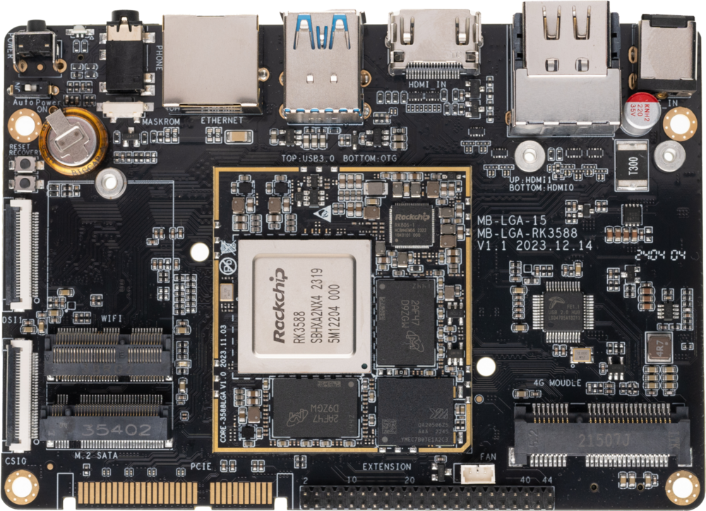
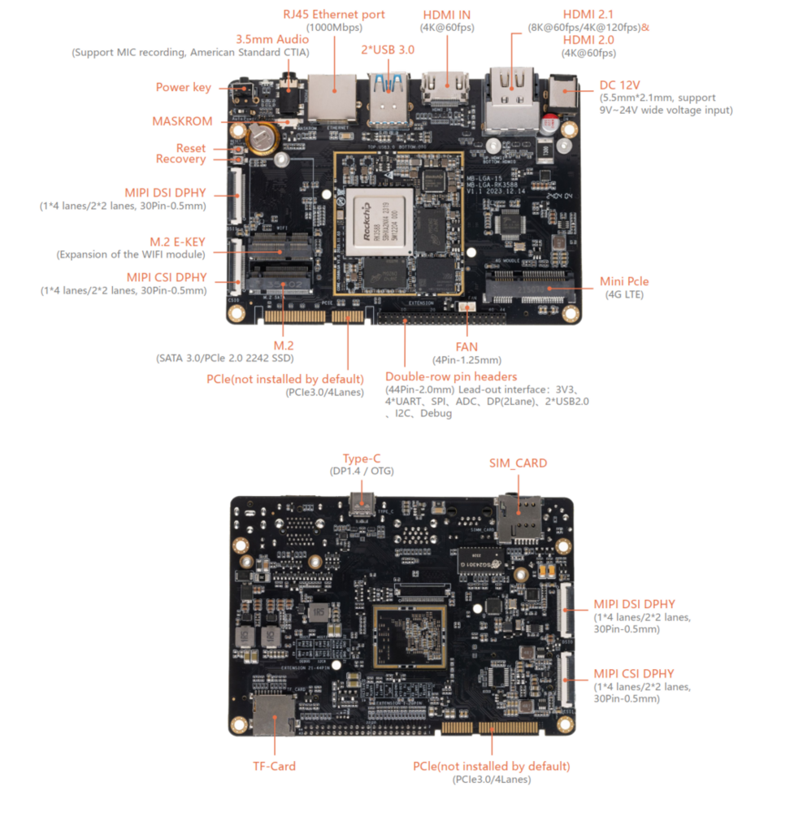

[规格书](https://download.t-firefly.com/%E4%BA%A7%E5%93%81%E8%A7%84%E6%A0%BC%E6%96%87%E6%A1%A3/%E6%A0%B8%E5%BF%83%E6%9D%BF/Core-3588L_8K%E4%BA%BA%E5%B7%A5%E6%99%BA%E8%83%BD%E6%A0%B8%E5%BF%83%E6%9D%BF_%E4%BA%A7%E5%93%81%E4%BB%8B%E7%BB%8D.pdf?v=1702602912) | [购买链接](https://item.taobao.com/item.htm?spm=a1z10.5-c-s.w4002-24436957620.52.11cd3b98ZiOzNs&id=670192393983) | [下载资料](https://community.t-firefly.com/doc/download/224)

# 简介

**Core-3588L** 基于 Rockchip 全新一代旗舰 AIoT 芯片 -- **RK3588**，采用了 8nm LP 制程；搭载八核（Cortex-A76 x 4 + Cortex-A55 x 4）64位 CPU，主频高达2.4 GHz。  

集成 ARM Mali-G610 MP4 四核 GPU，内置 AI 加速器 NPU，可提供6 Tops 算力，支持主流的深度学习框架；最大支持32 GB 大内存；支持 8K 视频编解码和多种格式的视频输入输出；支持多
种操作系统；可适用于 ARM PC、边缘计算、云服务器、智能NVR 等领域。

## 接口描述

**AIO-3588L V1.0** 提供了丰富的接口，主要包括：

* 1 x HDMI2.1（最大支持 8K@60Hz 输出）
* 1 x HDMI2.0
* 1 x HDMIIN2.0（最大支持 4K@60Hz 输入）
* 1 x Display Port1.4（最大支持 8K@30Hz 输出）
* 1 x USB3.0 OTG(Type-C)
* 2 x MIPI-DSI
* 2 x MIPI-CSI
* 1 x M.2 SATA3.0 或 M.2 PCIe2.0
* 1 x PCIe3.0x4
* 1 x TF Card
* 1 x 4G LTE
* 1 x SIM 卡槽
* 2 x USB3.0
* 2 x USB2.0（由44Pin排针引出）
* 1 x PCIe2.0 (M.2 E-KEY for WiFi6/BT5.0)
* 1 x FAN
* 1 x RJ45（支持 1Gbps）
* 1 × 3.5mm耳机接口

## 具体如下图：

## 资源与技术支持

* [[技术交流论坛]](https://forum.t-firefly.com/)：超过10万企业客户和用户沟通交流平台

### 联系方式

* 邮箱：sales@t-firefly.com
* 手机：(+86) 186 8811 7175
* 座机：0760-89881218
* 地址：广东省中山市东区中山四路 57 号宏宇大厦 2101 室