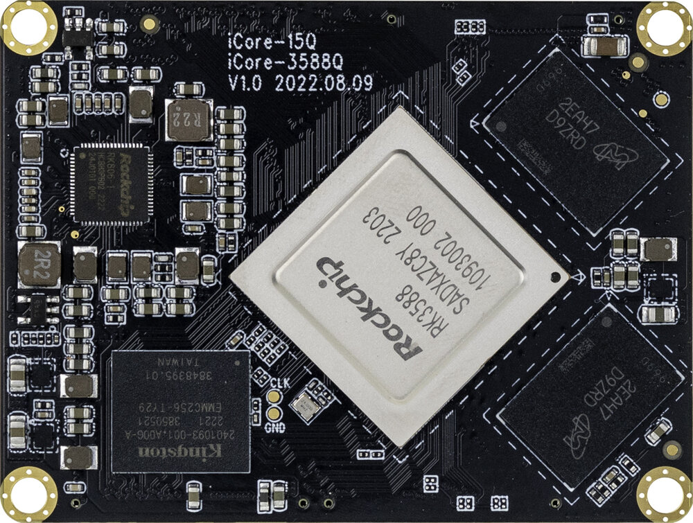
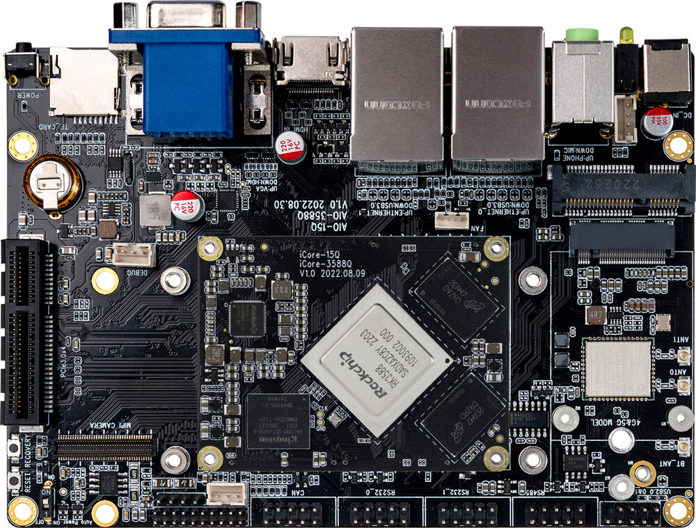
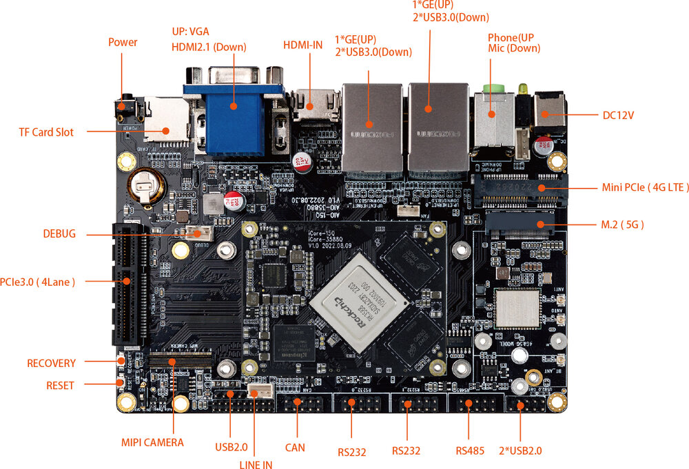
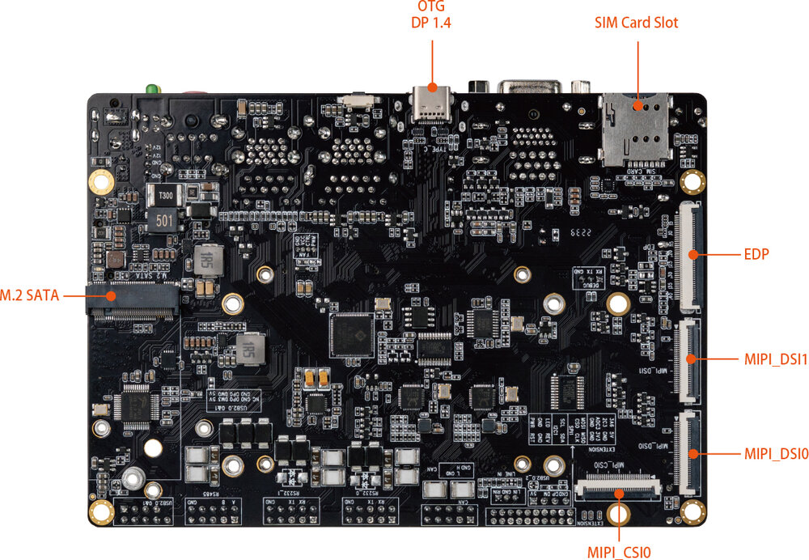

[规格书](https://download.t-firefly.com/%E4%BA%A7%E5%93%81%E8%A7%84%E6%A0%BC%E6%96%87%E6%A1%A3/%E6%A0%B8%E5%BF%83%E6%9D%BF/iCore-3588Q%20-%208K%E4%BA%BA%E5%B7%A5%E6%99%BA%E8%83%BD%E6%A0%B8%E5%BF%83%E6%9D%BF%20-%20%E4%BA%A7%E5%93%81%E4%BB%8B%E7%BB%8D.pdf?v=1677034369) | [购买链接](https://item.taobao.com/item.htm?spm=a1z10.3-c-s.w4002-24620095832.9.444c26b9Z0H4B4&id=685198426295) | [下载资料](https://community.t-firefly.com/doc/download/181)

# 简介

**3588Q**系列的核心板有**iCore-3588Q**、**iCore-3588MQ**及**iCore-3588JQ** ，底板**MB-Q-RK3588**可支持这三种不同的核心板。

**iCore-3588Q**采用Rockchip RK3588新一代旗舰级八核64位处理器，采用8nm先进架构，最高主频2.4GHz,最大可配32GB大内存；

支持8K视频编解码；采用了BTB接口，传输能力更强；拥有丰富的接口，支持多硬盘、千兆网、WiFi6、5G/4G扩展和多种视频输入输出；支持多种操作系统；可适用于ARM PC、边缘计算、云服务器、智能NVR等领域。

[AIO-3588Q](https://item.taobao.com/item.htm?spm=a1z10.3-c-s.w4002-24620095832.9.444c26b9Z0H4B4&id=685198426295) 开发板由核心板 iCore-3588Q + 底板 MB-Q-RK3588 组成,。AIO-3588Q 拥有 RGMII、CAN、PCIE3.0、USB3.0、I2C、SPI、UART、GPIO、MIPI-DSI 以及 MIPI-CSI 等丰富接口。可直接应用到各种智能产品中，加速产品落地，详细内容可参考下方接口描述。
  

  
### AIO-3588Q 标准套装包含以下配件(仅供参考)：
* iCore-3588Q 核心板 x 1
*  12V/2A 电源适配器 x 1
* MB-Q-RK3588 底板 x 1
* 铜管天线 x 3
* Type-C 数据线 x 1

另外可以选购的配件有：

* Firefly 串口模块

另外，在使用过程中，你可能需要以下配件：

*    显示设备
     * 带 HDMI 接口的显示器或电视，及 HDMI 连接线
*    网络
     *   100M/1000M 以太网线缆，及有线路由器
     *   WiFi 路由器
*    输入设备
     *   USB 无线/有线的鼠标/键盘
*    升级固件，调试
     *   Type-C 数据线
     *   串口转 USB 适配器

## 接口描述

**AIO-3588Q  V1.0** 提供了丰富的接口，主要包括：

* 1 x HDMI2.1（最大支持 8K@60Hz 输出）
* 1 x HDMI2.0
* 1 x Display Port1.4（最大支持 8K@30Hz 输出）
* 1 x USB3.0 OTG(Type-C)
* 1 x VGA
* 2 x MIPI-DSI
* 1 x MIPI-CSI
* 1 x EDP
* 1 x M.2(SATA3.0/PCIe2.0)
* 1 x PCIe3.0x4
* 1 x TF Card
* 1 x 4G LTE
* 1 x 5G 移动网络
* 1 x SIM 卡槽
* 4 x USB3.0
* 3 x USB2.0
* 1 x WIFI（支持 wifi6）
* 1 x Bluetooth
* 1 x FAN
* 2 x RJ45（支持 1Gbps）
* 1 x Line-In
* 1 x RS485
* 2 x RS232
* 1 x CAN

具体如下图：

## 资源与技术支持

* [[技术交流论坛]](https://forum.t-firefly.com/)：超过10万企业客户和用户沟通交流平台

### 联系方式

* 邮箱：sales@t-firefly.com
* 手机：(+86) 186 8811 7175
* 座机：0760-89881218
* 地址：广东省中山市东区中山四路 57 号宏宇大厦 2101 室