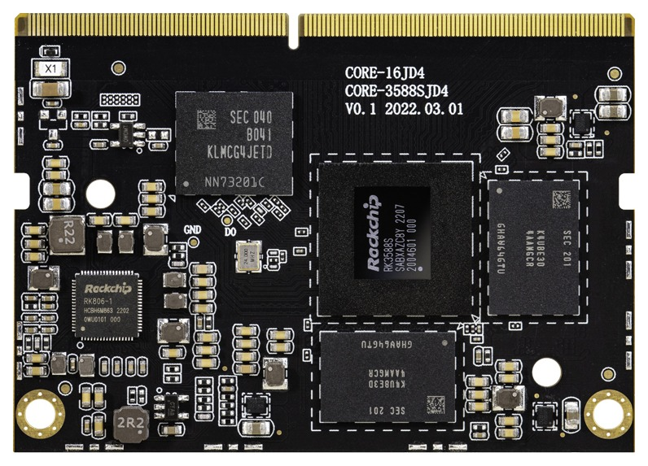
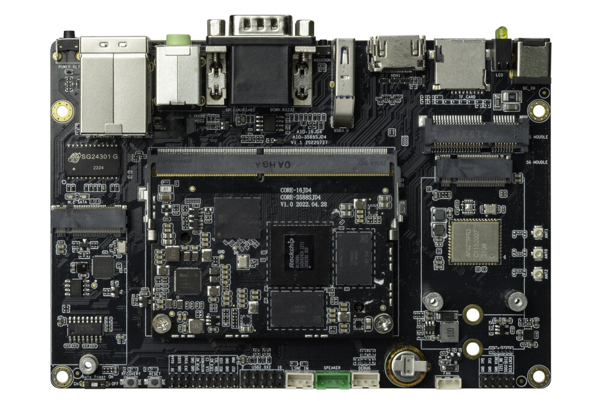
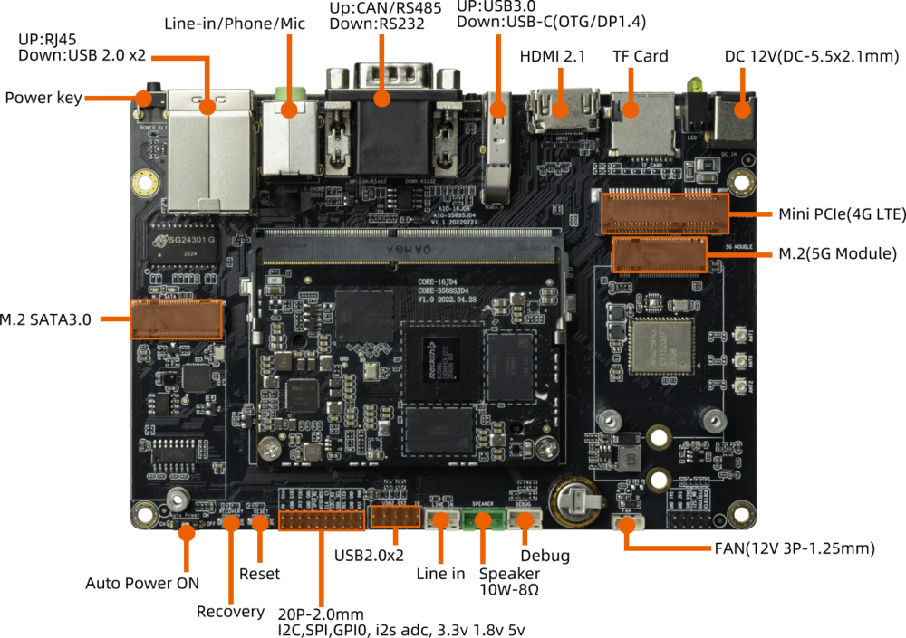
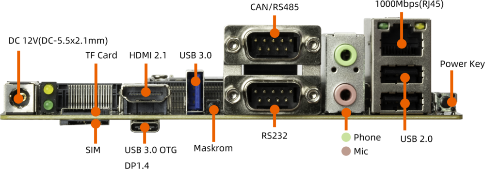
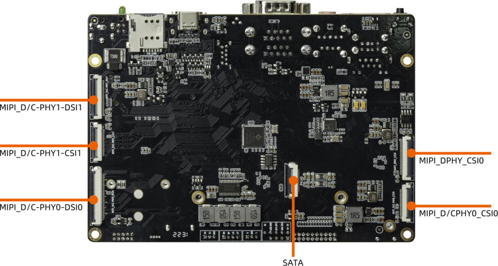

[规格书](https://download.t-firefly.com/%E4%BA%A7%E5%93%81%E8%A7%84%E6%A0%BC%E6%96%87%E6%A1%A3/%E6%A0%B8%E5%BF%83%E6%9D%BF/Core-3588SJD4%20%E5%85%AB%E6%A0%B88K%E4%BA%BA%E5%B7%A5%E6%99%BA%E8%83%BD%E6%A0%B8%E5%BF%83%E6%9D%BF-%E8%A7%84%E6%A0%BC%E4%B9%A6.pdf) | [购买链接](https://item.taobao.com/item.htm?id=676534397877) | [下载资料](https://community.t-firefly.com/doc/download/172)

# 简介

**Core-3588SJD4** 基于 Rockchip 全新一代旗舰 AIoT 芯片 -- **RK3588S**，采用了 8nm LP 制程；搭载八核（Cortex-A76 x 4 + Cortex-A55 x 4）64位 CPU，主频高达2.4 GHz。  

集成 ARM Mali-G610 MP4 四核 GPU，内置 AI 加速器 NPU，可提供6 Tops 算力，支持主流的深度学习框架；最大支持32 GB 大内存；支持 WiFi6，5G/4G 等高速无线网络通讯；支持 8K 视频编解码和多种格式的视频输入输出；支持多
种操作系统；可适用于 ARM PC、边缘计算、云服务器、智能NVR 等领域。

      

[AIO-3588SJD4](https://item.taobao.com/item.htm?id=676534397877) 开发板由核心板 Core-3588SJD4 + 底板 MB-RK3588S-JD4 组成,。AIO-3588SJD4 拥有 RGMII、SATA2.0、CAN、USB3.0、I2C、SPI、UART、GPIO、MIPI-DSI 以及 MIPI-CSI 等丰富接口。可直接应用到各种智能产品中，加速产品落地，详细内容可参考下方接口描述。
  

  
### AIO-3588SJD4 标准套装包含以下配件(仅供参考)：
* Core-3588SJD4 核心板 x 1
* 12V/2A 电源适配器 x 1
* MB-JD4-RK3588S 底板 x 1
* 铜管天线 x 3
* Type-C 数据线 x 1

另外可以选购的配件有：

* Firefly 串口模块

另外，在使用过程中，你可能需要以下配件：

*    显示设备
     * 带 HDMI 接口的显示器或电视，及 HDMI 连接线
*    网络
     *   100M/1000M 以太网线缆，及有线路由器
     *   WiFi 路由器
*    输入设备
     *   USB 无线/有线的鼠标/键盘
*    升级固件，调试
     *   Type-C 数据线
     *   串口转 USB 适配器

## 接口描述

AIO-3588SJD4  提供了丰富的接口，主要包括：

* 1 x HDMI2.1（最大支持 8K@60Hz 输出）
* 1 x Display Port1.4（最大支持 8K@30Hz 输出）
* 1 x USB3.0 OTG(Type-C)
* 2 x MIPI-DSI
* 1 x MIPI-DPHY-CSI
* 2 x MIPI-D/CPHY-CSI
* 1 x SATA2.0
* 1 x M.2(SATA2.0)
* 1 x TF Card
* 1 x 4G LTE
* 1 x 5G 移动网络
* 1 x SIM 卡槽
* 1 x USB3.0
* 4 x USB2.0(其中2个USB2.0由9Pin排针引出)
* 1 x WIFI（支持 wifi6）
* 1 x Bluetooth
* 1 x FAN
* 1 x RJ45（支持 1Gbps）
* 1 x Speaker
* 1 x Line-In
* 1 x MIC 
* 1 x POE

具体如下图：

## 资源与技术支持

* [[技术交流论坛]](https://forum.t-firefly.com/)：超过10万企业客户和用户沟通交流平台

### 联系方式

* 邮箱：sales@t-firefly.com
* 手机：(+86) 186 8811 7175
* 座机：0760-89881218
* 地址：广东省中山市东区中山四路 57 号宏宇大厦 2101 室