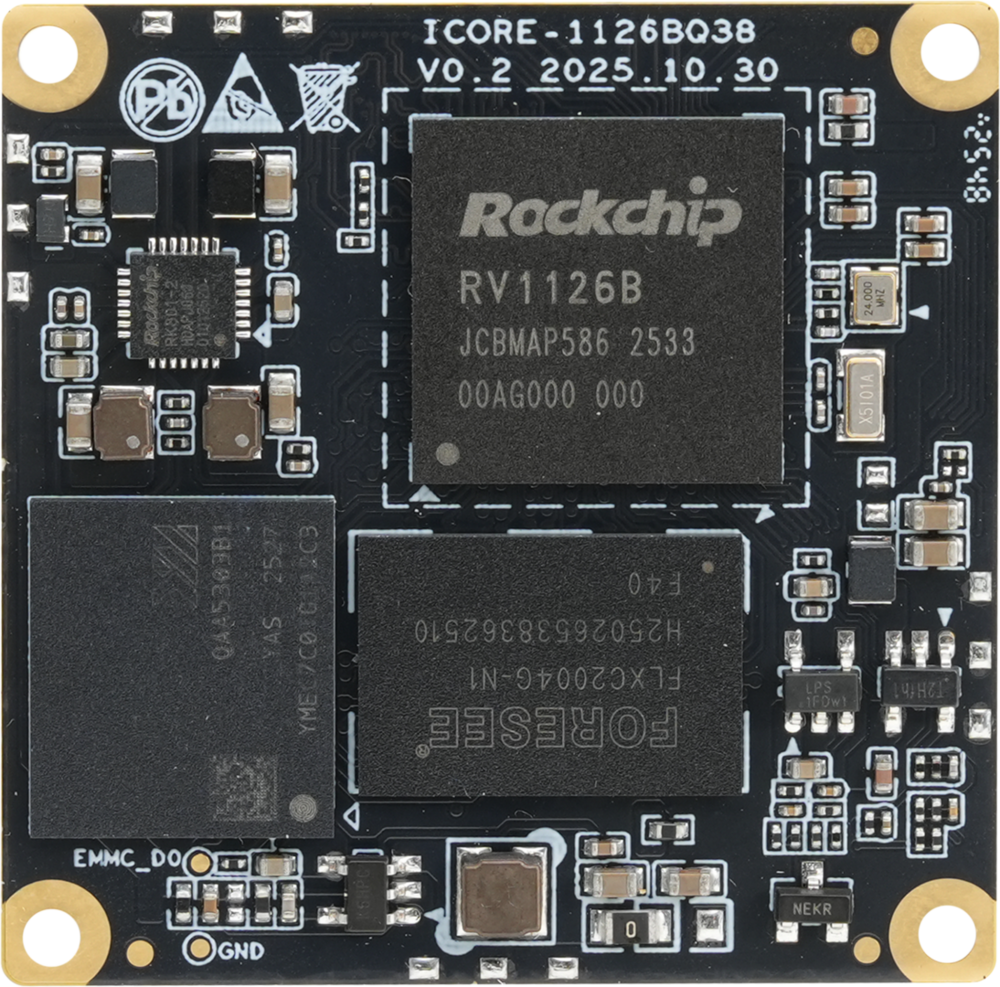
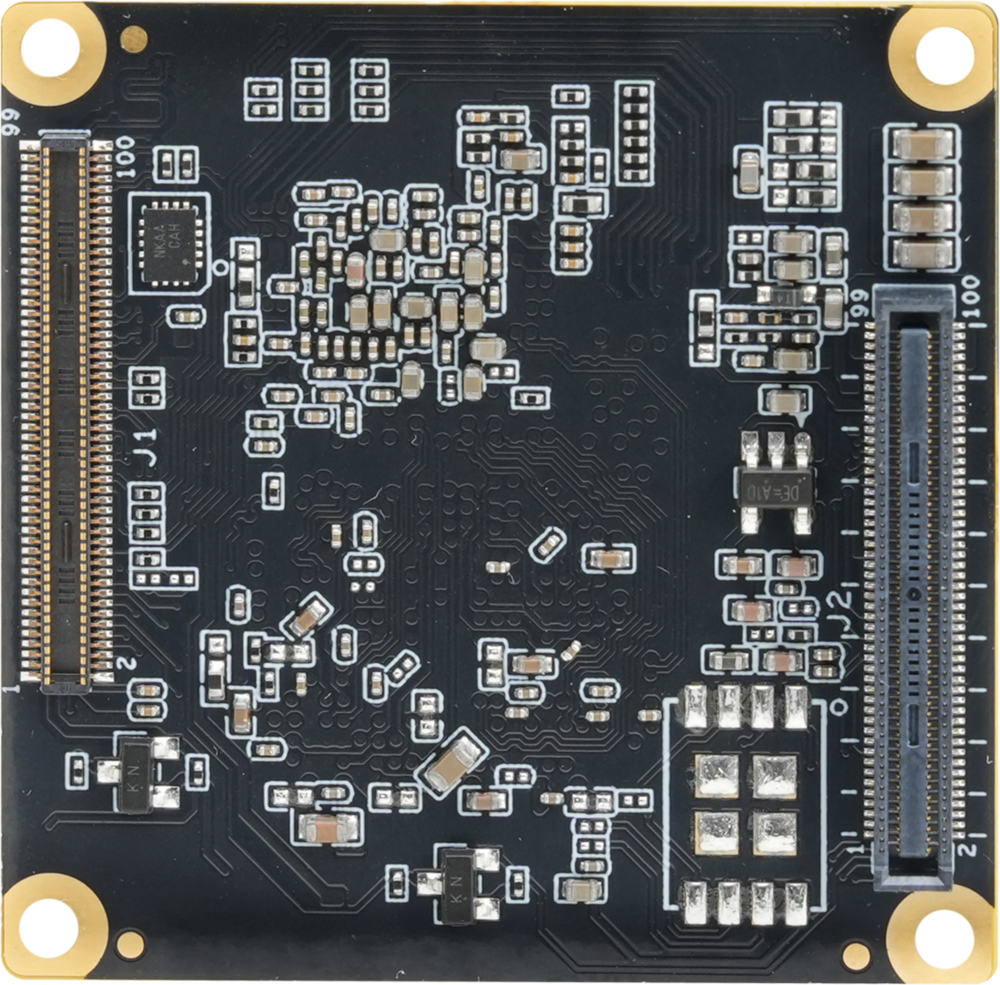
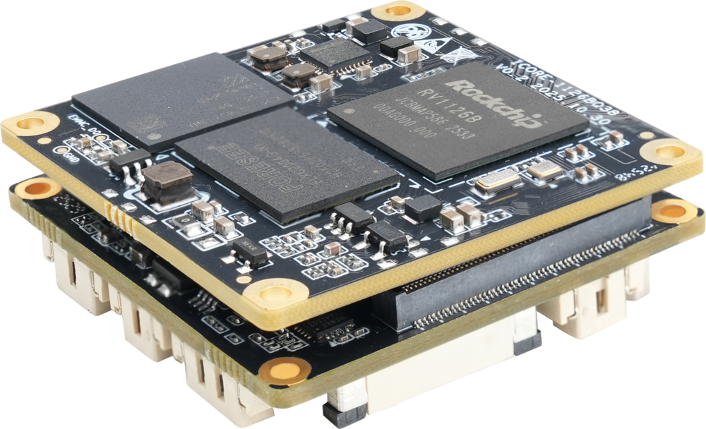
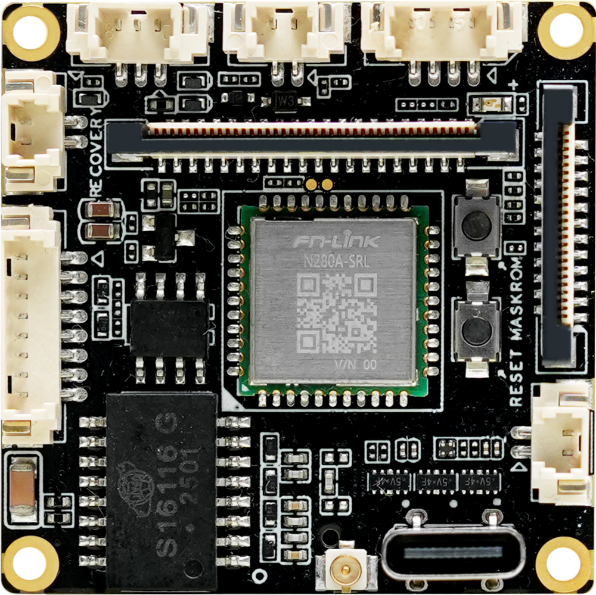
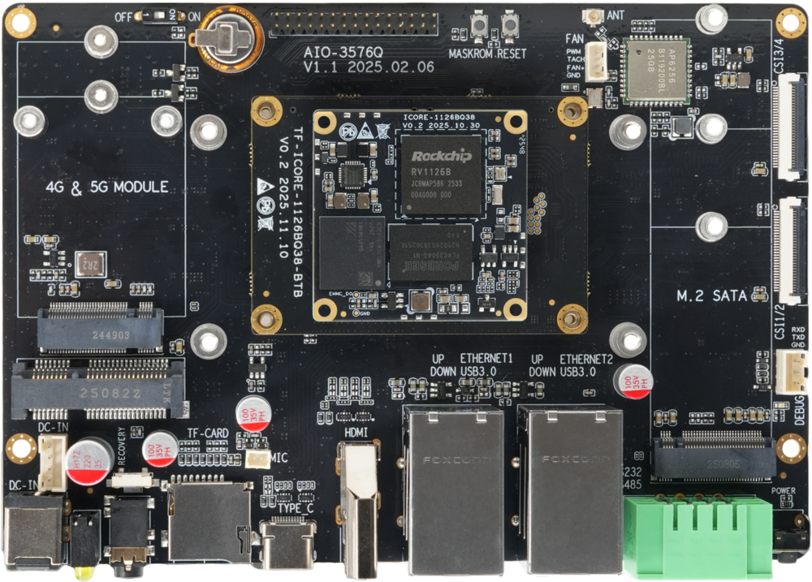
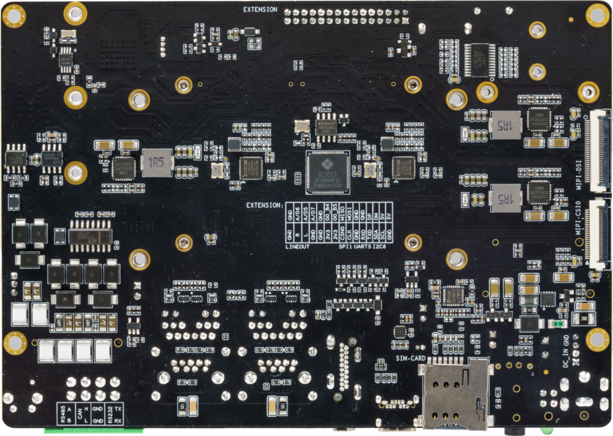
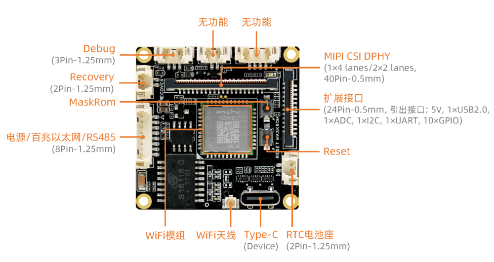
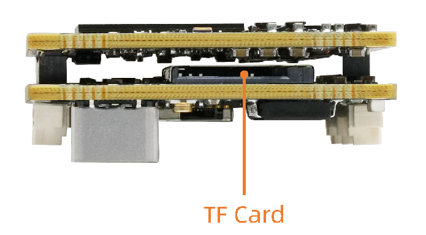

[规格书](https://download.t-firefly.com/Spec/CoreBorads/ICORE-1126BQ38_ICORE-1126BJQ38_Specification_CN.pdf) | [购买链接](https://item.taobao.com/item.htm?id=1016191924223&pisk=ft_x9IsF682D5iaxYGZuIrGUbOPkHZCqet5ISdvmfTBRTLIGihVqX5CDEVV2ol8OBLBwnnYXnVLO6OWMfNvGWj7RpV003o5sWFY_KJ43-sP27FwHanCxDjRM_VgjIIiSNY02a-z3-s5J92KbwyjmCxS6xCT6cKTWPLRi5d66c3tWUCRshF9bw_TS5qeYxRglrNAbS0a7Zr15VIKvBVv-WxVMGnpAMLeQdaUeDp1XeVwnS5SeBL7QEuCPsi6DaOULeesFeNKBWrHeMg1pPKYQv0LAZt7plwexoQYknHs62SafwEpvfaxIsm8Aft790ihaT_TfUMJecuyywZbHXp--F-1lwKtdXgoO-wUSDvvpsmN8wcowcQJPuYXj5ZVpnQp3MPnZb3PywpV8wcowcQRJKSFtbc-za&spm=a1z10.5-c-s.w4002-25768776046.13.390828ad0gKkBs&sku_properties=5919063%3A6536025) | [下载资料](https://community.t-firefly.com/doc/download/367)

# 简介

**ICORE-1126BQ38** 采用 Rockchip 四核 AI 视觉处理器 RV1126B，集成 3 TOPS NPU，支持 2B 多模态大模型和深度学习框架。支持 12M 视频编码，4K 视频解码。内置 12M ISP / 8MP AI-ISP，功耗低。硬件 AI Remosaic, 白天超高清，夜晚超低照，支持多目 AI 动态拼接、流畅自然无割裂感，AI 视频 6 轴数字防抖、多光源融合（RGB 与红外热成像融合、可见光与结构光、ToF 融合），支持 AOA 低功耗声音事件检测，内置更安全的国密级 SM2/SM3/SM4 加密算法。尺寸仅 38mm × 38mm，广泛适用于人脸识别、闸机门禁、智能安防、智能网络摄像头等行业领域。

**ICORE-1126BQ38** 可搭配不同的底板组合成不同形态的产品。分别可以组成 CAM-1126BQ38 套板和 AIO-1126BQ38 套板。

**ICORE-1126BQ38** 正面：

**ICORE-1126BQ38** 背面：

### CAM-1126BQ38

本维基介绍 CAM-1126BQ38 套板的使用。

CAM-1126BQ38 正面：

CAM-1126BQ38 背面：

### AIO-1126BQ38

AIO-1126BQ38 开发板由核心板 ICORE-1126BQ38 + BTB 转接板 + 底板 MB-Q-RK3576 组成。

点击跳转 AIO-1126BQ38 套板的维基教程：[AIO-1126BQ38 维基教程](../../../主板/AIO-1126BQ38/product_introduction/started.md)

AIO-1126BQ38 正面：

AIO-1126BQ38 背面：

 
## 接口描述

### 整机接口定义

## 资源与技术支持

* [[技术交流论坛]](https://forum.t-firefly.com/)：超过10万企业客户和用户沟通交流平台

### 联系方式

* 邮箱：sales@t-firefly.com
* 手机：(+86) 186 8811 7175
* 座机：0760-89881218
* 地址：广东省中山市东区中山四路 57 号宏宇大厦 2101 室
