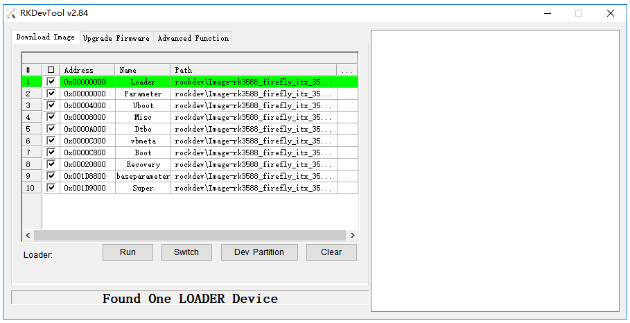
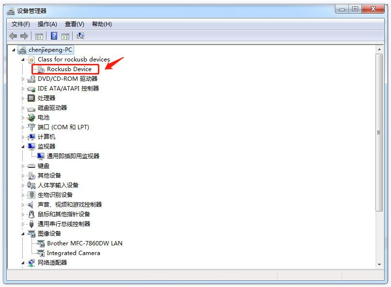
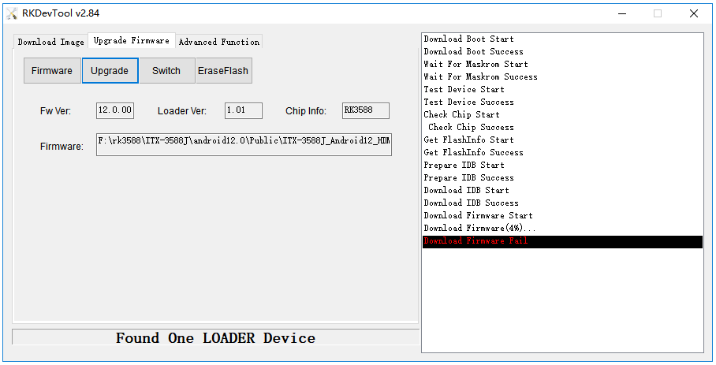
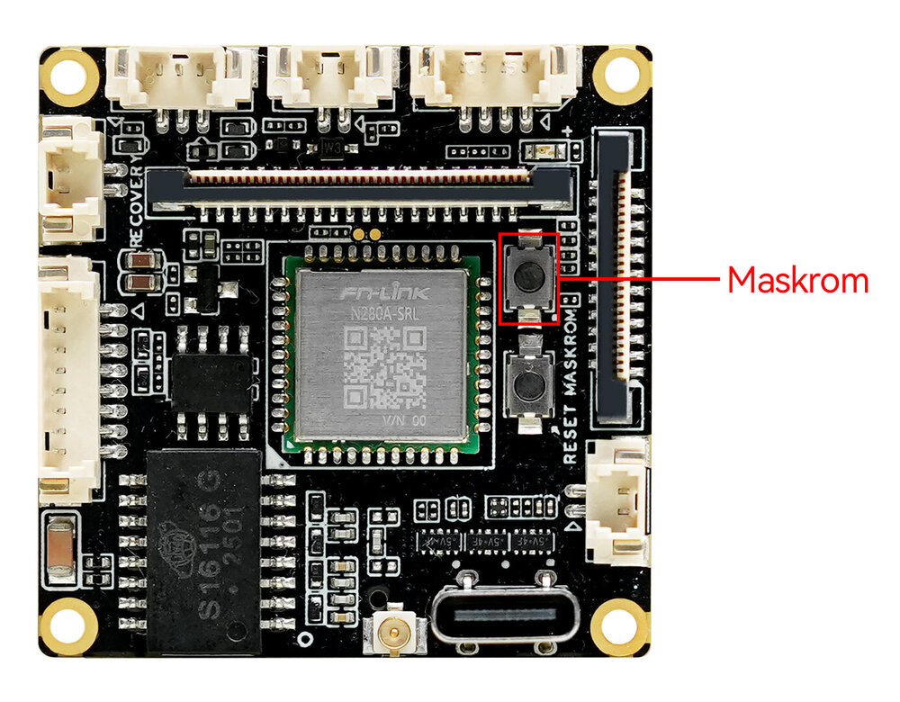
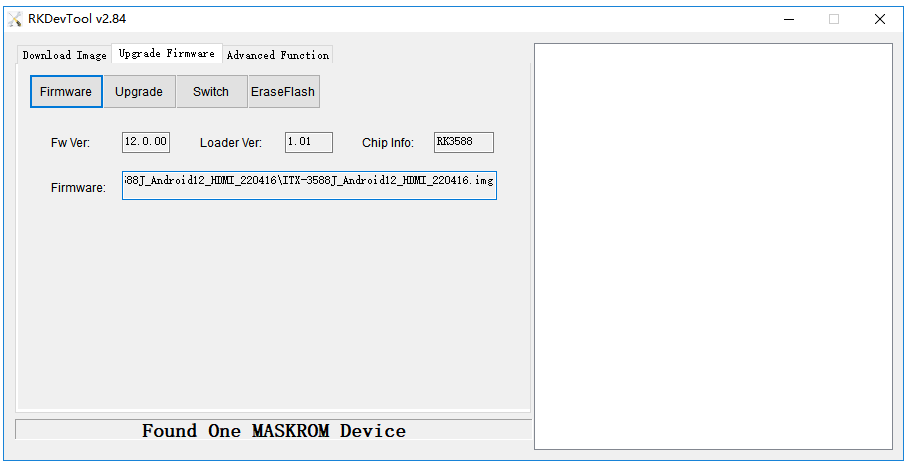

# FAQ

<Accordions>

<Accordion title="Q：设备有哪些启动模式？" type="single" id="rk_upgrade_faq_boot_mode">

**A：** EXT-iCore-3576Q38 有三种启动模式：

* Normal 模式
* Loader 模式
* MaskRom 模式

**Normal 模式**

Normal 模式就是正常的启动过程，各个组件依次加载，正常进入系统。

**Loader 模式**

在 Loader 模式下，bootloader 会进入升级状态，等待主机命令，用于固件升级等。
**MaskRom 模式**

MaskRom 模式用于 bootloader 损坏时的系统修复。

一般情况下是不用进入 `MaskRom 模式` 的，只有在 bootloader 校验失败（读取不了 IDB 块，或 bootloader 损坏）的情况下，BootRom 代码就会进入 `MaskRom 模式`。此时 BootRom 代码等待主机通过 USB 接口传送 bootloader 代码，加载并运行之。

</Accordion>

<Accordion title="Q：如何判断当前处于哪种升级模式？" type="single" id="rk_upgrade_faq_check_upgrade_mode">

**A：** 如何确定板子当前处于哪种升级模式，我们可以通过工具去查看。

<CodeBlockTabs defaultValue="Windows">
  <CodeBlockTabsList>
    <CodeBlockTabsTrigger value="Windows">Windows</CodeBlockTabsTrigger>
    <CodeBlockTabsTrigger value="Linux">Linux</CodeBlockTabsTrigger>
  </CodeBlockTabsList>

  <CodeBlockTab value="Windows">
    **Windows 操作系统**

    通过 AndroidTool 工具可以看到下方提示 `Found One LOADER Device`：

    <center>

    
    </center>

    如果有进行"进入 Loader 模式"的操作，仍旧没有看到烧写工具提示 LOADER，此时可以看一下 Windows 主机是否有提示发现新硬件并配置驱动。打开设备管理器，会见到新设备 `Rockusb Device` 出现，如下图。如果没有，可返回上一步重新[安装驱动](upgrade_firmware.md#windows-cao-zuo-xi-tong)。

    <center>

    
    </center>

    若烧写工具提示 `Found One MASKROM Device`，则说明设备当前处于 MaskRom 模式。
  </CodeBlockTab>

  <CodeBlockTab value="Linux">
    **Linux 操作系统**

    运行 upgrade_tool 后可以看到连接设备中有个 `Loader` 的提示：

    ```shell
    firefly@T-chip:~/severdir/down_firmware$ sudo upgrade_tool
    List of rockusb connected
    DevNo=1 Vid=0x2207,Pid=0x330c,LocationID=106    Loader
    Found 1 rockusb,Select input DevNo,Rescan press <R>,Quit press <Q>:q
    ```

    若列表中显示的是 `MaskRom`，则说明设备当前处于 MaskRom 模式。
  </CodeBlockTab>
</CodeBlockTabs>

如何让设备进入可升级模式，请参阅[进入升级模式的操作](upgrade_firmware.md)。

</Accordion>

<Accordion title="Q：如何进行分区刷写？" type="single" id="rk_upgrade_faq_flash_partition">

**A：** 以下内容面向需要单独烧写分区（boot/kernel/rootfs 等）的进阶用户；仅需完整固件升级请参阅[《使用 USB 线缆升级固件》](upgrade_firmware.md)。

<CodeBlockTabs defaultValue="Windows">
  <CodeBlockTabsList>
    <CodeBlockTabsTrigger value="Windows">Windows</CodeBlockTabsTrigger>
    <CodeBlockTabsTrigger value="Linux">Linux</CodeBlockTabsTrigger>
  </CodeBlockTabsList>

  <CodeBlockTab value="Windows">
    **Windows 操作系统**

    **烧写分区映像**

    烧写分区映像的步骤如下：

    1. 切换至 `Download Image` 页。
    2. 勾选需要烧录的分区，可以多选。
    3. Loader 模式下点击 `Dev Partition` 按钮，查看设备分区表。
    4. 核对各分区地址，若与 `parameter` 文件中的地址不一致，手动将 `Address` 栏修改为设备地址，否则会烧错分区。
    5. 确认映像文件路径正确，需要的话，点路径右边的空白表格单元格来重新选择。
    6. 点击 `Run` 按钮开始升级，升级结束后设备会自动重启。

    <center>

    
    </center>
  </CodeBlockTab>

  <CodeBlockTab value="Linux">
    **Linux 操作系统**

    **烧写分区映像**

    ```shell
    sudo upgrade_tool di -b /path/to/boot.img
    sudo upgrade_tool di -r /path/to/recovery.img
    sudo upgrade_tool di -m /path/to/misc.img
    sudo upgrade_tool di -u /path/to/uboot.img
    sudo upgrade_tool di -dtbo /path/to/dtbo.img
    sudo upgrade_tool di -p paramater   # 烧写 parameter
    sudo upgrade_tool ul bootloader.bin # 烧写 bootloader
    ```

    如果因 flash 问题导致升级时出错，可以尝试低级格式化、擦除 emmc：

    ```shell
    sudo upgrade_tool lf update.img # 低级格式化
    sudo upgrade_tool ef update.img # 擦除
    ```

    fastboot 烧写动态分区：

    ```shell
    adb reboot fastboot # 进入 bootloader
    sudo fastboot flash vendor vendor.img
    sudo fastboot flash system system.img
    sudo fastboot reboot # 烧写成功后，重启
    ```
  </CodeBlockTab>
</CodeBlockTabs>

</Accordion>

<Accordion title="Q：烧写时出现异常怎么办？" type="single" id="rk_upgrade_faq_flash_exception">

**A：**

**烧写失败分析**

如果烧写过程中出现 Download Boot Fail，或者烧写过程中出错，如下图所示，通常是由于使用的 USB 线连接不良、劣质线材，或者电脑 USB 口驱动能力不足导致的，请更换 USB 线或者电脑 USB 端口排查。

<center>


</center>

**无法识别设备 / 提示发现新设备**

如果有进行"进入 Loader 模式"的操作，仍旧没有看到烧写工具提示 LOADER，通常是主机尚未识别设备或未装好驱动，处理方法已在上文《如何判断当前处于哪种升级模式》一节中说明（含发现新设备 `Rockusb Device` 及驱动安装的截图），此处不再重复。

</Accordion>

</Accordions>
<Accordions>

<Accordion title="Q：如何进入 MaskRom 模式？" type="single" id="rk_upgrade_faq_enter_maskrom">

**A：** 
`MaskRom` 模式是设备变砖的最后一条防线。强行进入 `MaskRom` 涉及硬件操作，有一定风险，因此仅在设备进入不了 `Loader` 模式的情况下，方可尝试 `MaskRom` 模式。进入 `MaskRom` 的原理是人为的把 EMMC 的数据脚与地线短接，系统会认为 EMMC 数据出错，从而清除 EMMC 数据。

<Callout title="警告" type="error">

请小心阅读，并谨慎操作！

</Callout>

操作步骤如下：

1. 设备断开电源
2. 按住 iCore-3576Q38 的 MaskRom 按键（如下图所示）
3. 设备插入电源上电，保持按键约 3 秒后松开

<center>


</center>


此时设备就会进入 MaskRom 模式。

<center>


</center>

</Accordion>

</Accordions>