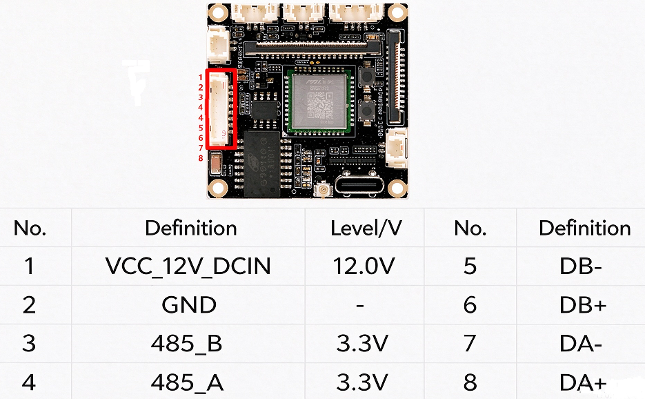
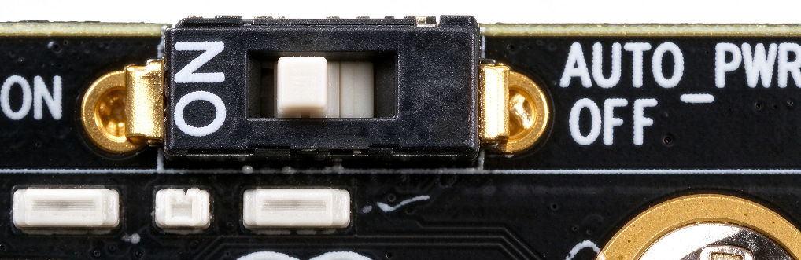
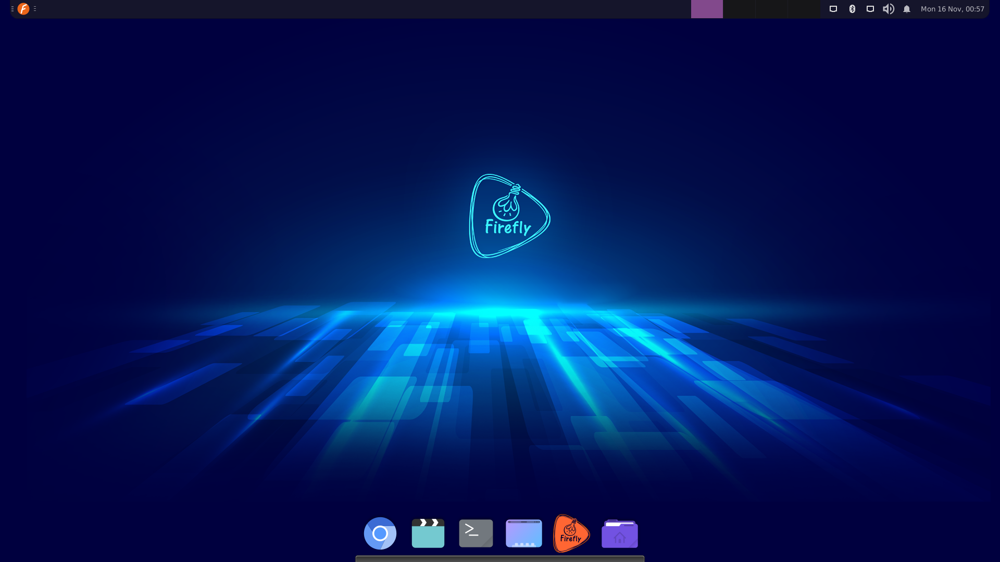
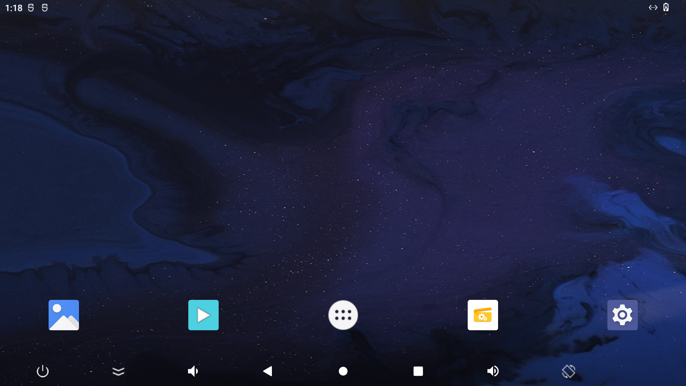
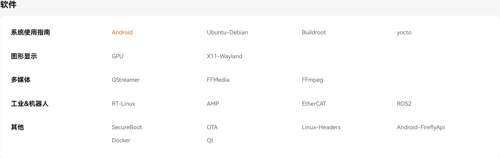
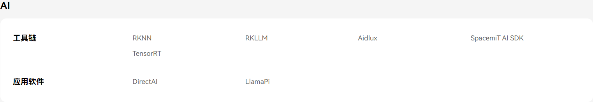

# 快速上手

## 上电开机 [step]

下图即 iCore-3576Q38 的电源接口，请对照实物将电源适配器接入该接口（以产品附带的电源适配器为准）：

<center></center>

<Callout title="无法上电开机？" type="warn">若设备带有 auto_pwr 拨码开关，需将其拨到 ON 一侧方可上电开机；若发现无法上电开机，请先检查该开关是否打在 ON 侧。下图开关位置即为正确状态：</Callout>

<center></center>


iCore-3576Q38 接通电源后即开机，上电过程会看到开机 logo：

<Callout title="提示" type="info">NVIDIA 平台产品显示 NVIDIA logo；部分平台可能无开机 logo，以实际显示为准。</Callout>

<center></center>

## 系统登录 [step]

<CodeBlockTabs defaultValue="linux">
<CodeBlockTabsList>
<CodeBlockTabsTrigger value="linux">Linux</CodeBlockTabsTrigger>
<CodeBlockTabsTrigger value="android">Android</CodeBlockTabsTrigger>
</CodeBlockTabsList>
<CodeBlockTab value="linux">

下图以 3588 系列产品的 Linux 系统（XFCE 图形界面）为例，其他平台或其他图形显示框架请以实际显示为准：

<center></center>

### 1. 账号与密码

| 平台 | 登录账号 | 密码 |
| --- | --- | --- |
| 瑞芯微（Rockchip） | `firefly` | `firefly` |
| 算能（Sophgo） | `linaro` | `linaro` |
| 高通（Qualcomm） | `firefly` | `firefly` |
| 英伟达（NVIDIA） | `nvidia` | `nvidia` |
| 进迭时空（SpacemiT） | `firefly` | `firefly` |

各平台固件统一不设置 root 密码，登录后执行 `sudo passwd root` 自行设置；若固件已设置 root 密码，则与当前平台的普通用户密码相同。

### 2. 选择任一登录方式进入系统

<CodeBlockTabs defaultValue="login-rockchip">
  <CodeBlockTabsList>
    <CodeBlockTabsTrigger value="login-rockchip">瑞芯微</CodeBlockTabsTrigger>
    <CodeBlockTabsTrigger value="login-sophgo">算能</CodeBlockTabsTrigger>
    <CodeBlockTabsTrigger value="login-qcom">高通</CodeBlockTabsTrigger>
    <CodeBlockTabsTrigger value="login-nvidia">英伟达</CodeBlockTabsTrigger>
    <CodeBlockTabsTrigger value="login-spacemit">进迭时空</CodeBlockTabsTrigger>
  </CodeBlockTabsList>

  <CodeBlockTab value="login-rockchip">

    - **HDMI 显示器 + 鼠标键盘**：登录桌面后打开终端即可开发
    - **调试串口**：所有产品均提供，可直接登录命令行
    - **ADB**：部分产品提供（多为 Type-C 接口），是否支持以产品规格为准
    - 各调试接口的具体位置，见产品文档「硬件功能使用」中的 debug / adb 章节
    - 个别无屏产品（如 3576Q38、1126BQ38 系列）必须通过调试串口或 ADB 登录

    **SSH 远程登录（可选）**：SSH 是常用的网络登录方式。设备默认使用动态 IP，需先通过上述任一方式登录系统、为设备配置静态 IP 后，再使用 SSH 连接：

    ```bash
    ssh firefly@<设备静态 IP>
    ```

  </CodeBlockTab>

  <CodeBlockTab value="login-sophgo">

    算能平台产品支持通过网络或调试串口登录系统：

    - **网络登录**：具体内容见产品文档「硬件功能使用」中的以太网章节
    - **调试串口**：具体内容见产品文档「硬件功能使用」中的调试串口章节

  </CodeBlockTab>

  <CodeBlockTab value="login-qcom">

    - **HDMI 显示器 + 鼠标键盘**：登录桌面后打开终端即可开发
    - **调试串口**：所有产品均提供，可直接登录命令行
    - **ADB**：部分产品提供（多为 Type-C 接口），是否支持以产品规格为准
    - 各调试接口的具体位置，见产品文档「硬件功能使用」中的 debug / adb 章节

    **SSH 远程登录（可选）**：SSH 是常用的网络登录方式。设备默认使用动态 IP，需先通过上述任一方式登录系统、为设备配置静态 IP 后，再使用 SSH 连接：

    ```bash
    ssh firefly@<设备静态 IP>
    ```

  </CodeBlockTab>

  <CodeBlockTab value="login-nvidia">

    - **HDMI 显示器 + 鼠标键盘**：登录桌面后打开终端即可开发
    - **调试串口**：所有产品均提供，可直接登录命令行
    - 各调试接口的具体位置，见产品文档「硬件功能使用」中的 debug 章节

    **SSH 远程登录（可选）**：SSH 是常用的网络登录方式。设备默认使用动态 IP，需先通过上述任一方式登录系统、为设备配置静态 IP 后，再使用 SSH 连接：

    ```bash
    ssh nvidia@<设备静态 IP>
    ```

  </CodeBlockTab>

  <CodeBlockTab value="login-spacemit">

    - **HDMI 显示器 + 鼠标键盘**：登录桌面后打开终端即可开发
    - **调试串口**：所有产品均提供，可直接登录命令行
    - **ADB**：部分产品提供（多为 Type-C 接口），是否支持以产品规格为准
    - 各调试接口的具体位置，见产品文档「硬件功能使用」中的 debug / adb 章节

    **SSH 远程登录（可选）**：SSH 是常用的网络登录方式。设备默认使用动态 IP，需先通过上述任一方式登录系统、为设备配置静态 IP 后，再使用 SSH 连接：

    ```bash
    ssh firefly@<设备静态 IP>
    ```

  </CodeBlockTab>
</CodeBlockTabs>

### 3. 应用开发入门

Linux 应用开发可参考社区文档 [Ubuntu/Debian 开发指南](https://community.t-firefly.com/docs/software/os-guide/Ubuntu-Debian/ubuntu-login)。

<Callout title="切勿执行系统整体升级" type="warn">不要执行 `sudo apt-get upgrade`、`sudo apt full-upgrade`、`sudo do-release-upgrade`。此类产品均为嵌入式设备，内核及操作系统都是高度定制版本，执行 upgrade 极有可能破坏系统的相关依赖，导致系统异常。</Callout>

</CodeBlockTab>
<CodeBlockTab value="android">

<Callout title="注意" type="warn">进迭时空（K3）、英伟达（NVIDIA）、算能（Sophgo）平台产品没有 Android 系统，本节仅适用于提供 Android 系统的平台产品。</Callout>

下图以 3588 系列产品的 Android 12 桌面为例，其他平台请以实际显示为准：

<center></center>

### 1. 基本操作

鼠标**右键**相当于**返回**键

### 2. 终端调试

一般 Android 产品都支持 ADB，可通过 ADB 进入终端调试；也可通过调试串口登录

### 3. 调试接口位置

见产品文档「硬件功能使用」中的 debug / adb 章节

### 4. Android 系统定制化开发与 FireflyAPI 调用开发

以下内容仅针对 Rockchip 平台产品：

- [Android 系统定制化开发指南](https://community.t-firefly.com/docs/software/os-guide/Android/customization-overview)
- [FireflyAPI 调用开发指南](https://community.t-firefly.com/docs/software/other/Android-FireflyApi/firefly-api-overview)

</CodeBlockTab>
</CodeBlockTabs>

## 应用开发合集 [step]

### 应用软件开发合集

应用软件开发合集示意图如下，点击下方链接进入：

<center></center>

<center>[应用软件开发合集](https://community.t-firefly.com/docs#software-os-guide)</center>

### AI 开发合集

AI 开发合集示意图如下：

<center></center>

<center>[AI 开发合集](https://community.t-firefly.com/docs#ai)</center>

<Callout title="特别提示：LlamaPi" type="info">LlamaPi（读作“拉马派”）是 Firefly AI 团队自研的大模型部署与管理工具，仅支持 Linux 系统。它面向具备大模型推理能力的边缘设备，帮助用户在本地部署和管理开源大模型，并通过 OpenAI 兼容 API 为第三方应用提供推理能力，可以快速本地化部署 AI 模型。</Callout>

## 系统及 BSP 开发 [step]

系统及 BSP（源码获取、编译、固件烧写）开发，请查看产品 Wiki 的开发指南章节（见「软件开发使用」）。