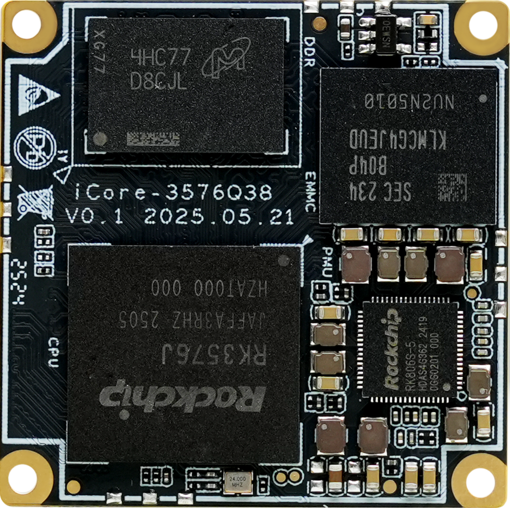
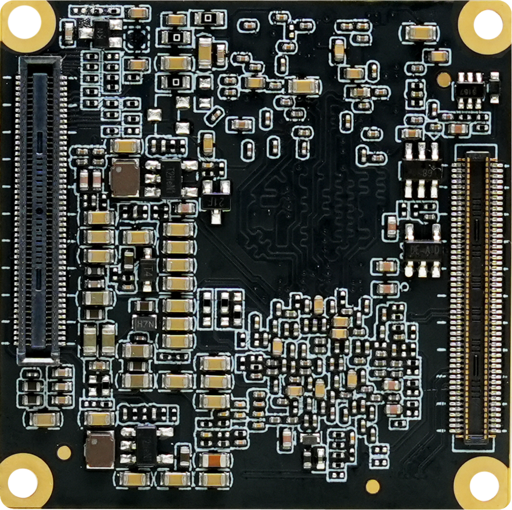
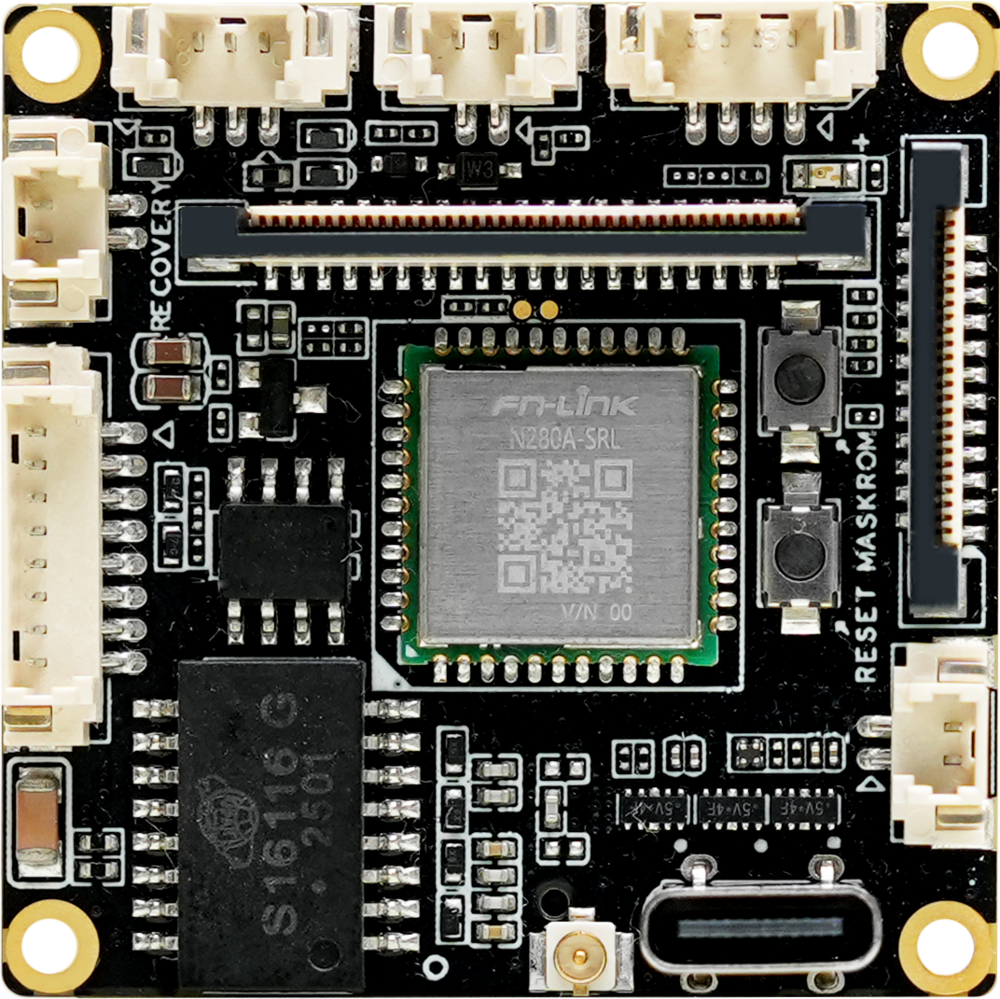
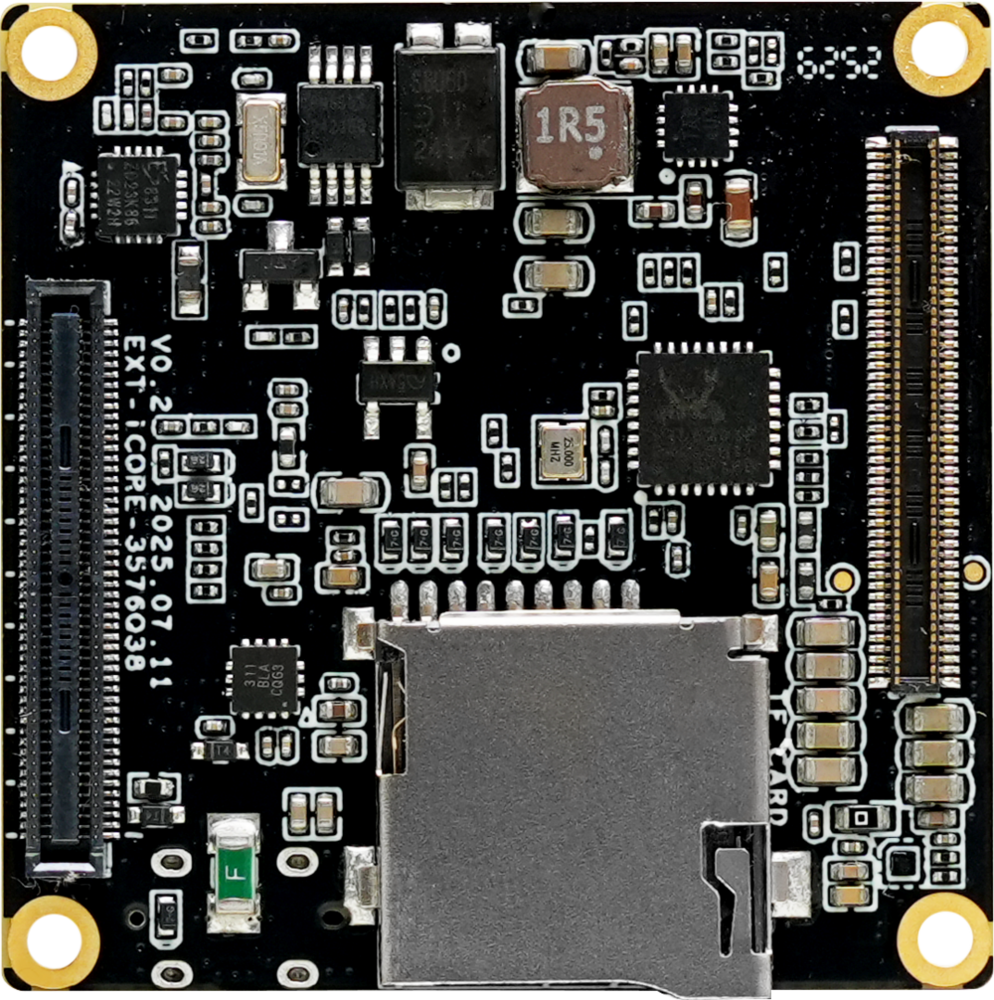
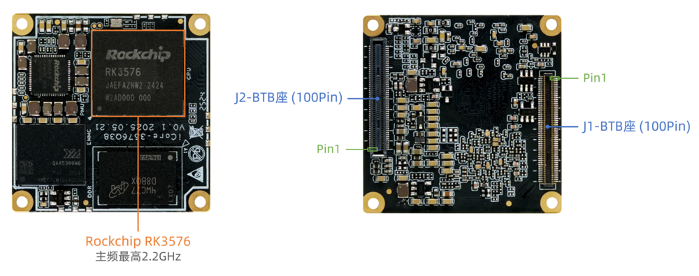
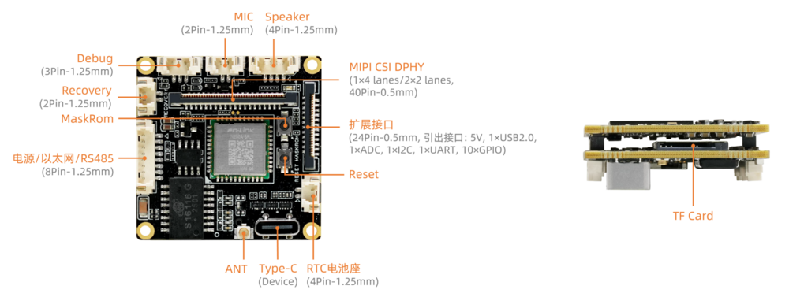

# 介绍

[规格书](https://download.t-firefly.com/Spec/CoreBorads/ICORE-3576Q38_ICORE-3576JQ38_ICORE-3576MQ38_Specification_CN.pdf) | [购买链接](https://item.taobao.com/item.htm?id=961156815691) | [下载资料](https://community.t-firefly.com/doc/download/327)

**iCore-3576Q38**采用 Rockchip 八核 AIOT 处理器 RK3576，核心板尺寸仅 38 × 38mm，集成 6 TOPS 算力 NPU，具有实时网络、Flexbus、硬件资源隔离、DSMC 等工业新特性，支持现代主流大模型私有化部署，最高支持 8K 视频解码，广泛适用于边缘计算、大模型本地化、机器视觉、工业摄像头、工控主机、汽车电子等行业领域。

**可配套开发底板 EXT-iCore-3576Q38**

## 接口描述

**EXT-iCore-3576Q38 V0.2** 使用的接口，主要包括：

* 1 x Type-C (Device Mode)
* 1 x USB2.0 (24Pin 扩展接口引出)
* 1 x MIPI-DPHY-CSI
* 1 x TF Card
* 1 x WIFI
* 1 x Bluetooth
* 1 x Ethernet（支持 100Mbps）
* 1 × Mic输入 （2P-1.25mm）
* 1 × Speaker输出（4P-1.25mm）
* 1 x RS485
* 1 x TTL串口 (24Pin 扩展接口引出)
* 1 x RTC 电池座 (4P-1.25mm)

具体如下图：

## 特殊接口说明
EXT-iCore-3576Q38 蓝牙不支持语音.

iCore-3576Q38 所有接口请查看规格书.

## 资源与技术支持

* [[技术交流论坛]](https://forum.t-firefly.com/)：超过10万企业客户和用户沟通交流平台

### 联系方式

* 邮箱：sales@t-firefly.com
* 手机：(+86) 186 8811 7175
* 座机：0760-89881218
* 地址：广东省中山市东区中山四路 57 号宏宇大厦 2101 室