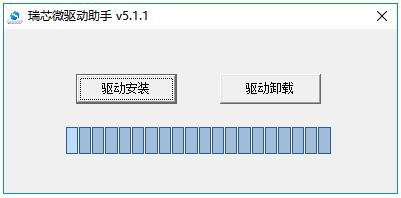
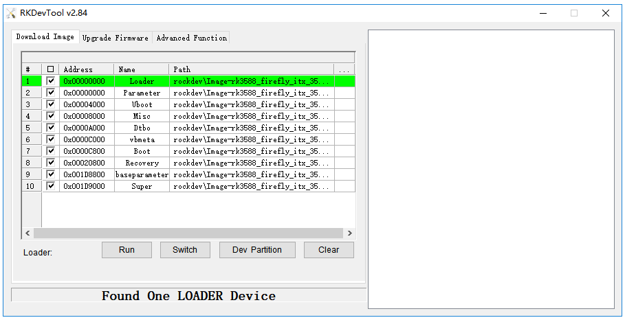
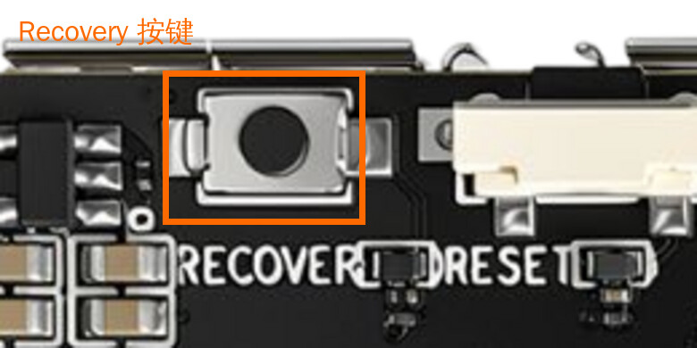
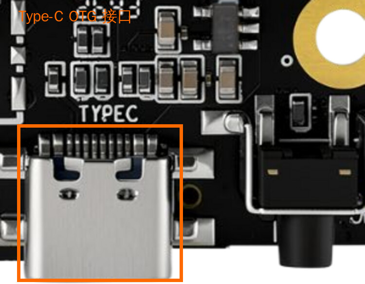
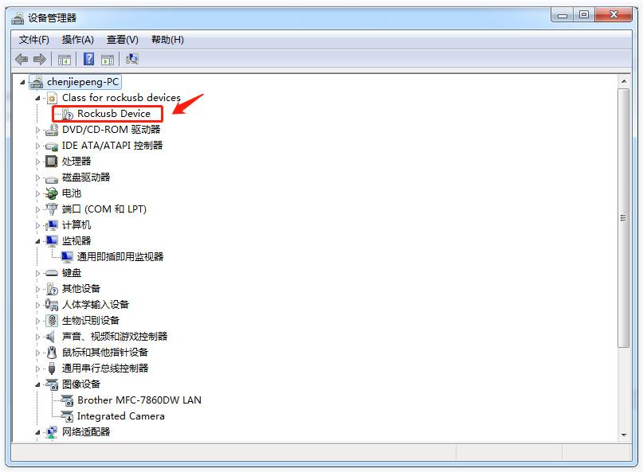
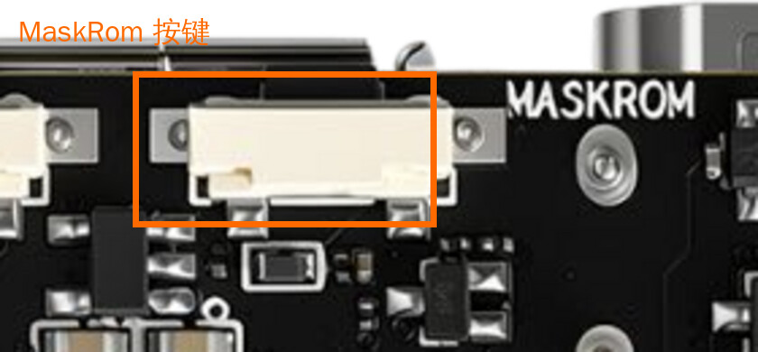
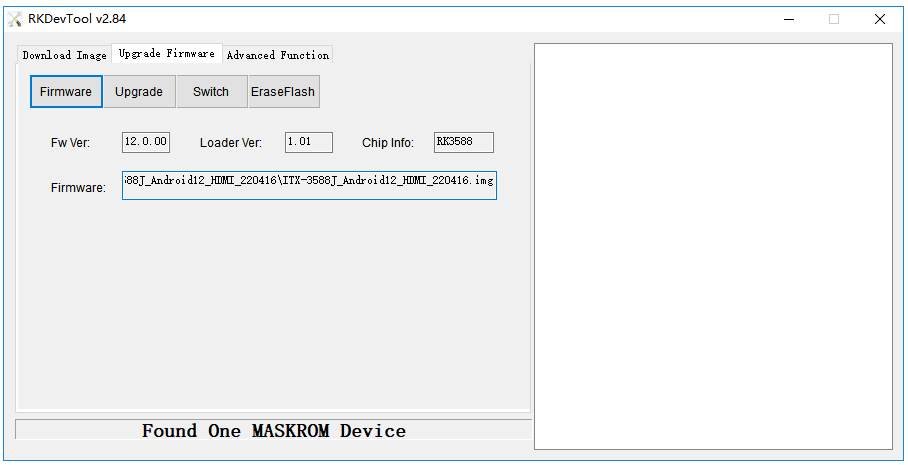
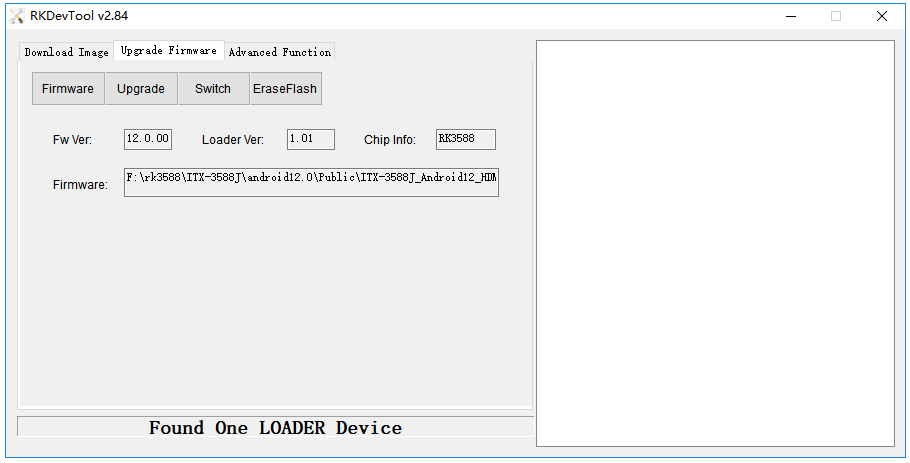

# USB升级固件

## 前言

本文介绍如何将主机上的固件，通过 Type-C 数据线 烧录到 Firefly-R3572A 主板的存储器中。升级时需要根据主机操作系统和固件类型选择合适的升级方式。

<Callout title="资料获取" type="info">

固件、AndroidTool、RK USB 驱动、Linux_Upgrade_Tool、adb/fastboot 及 SD_Firmware_Tool 请联系销售人员（sales@t-firefly.com）获取下载链接。

</Callout>

## 准备工具 [step]

* Firefly-R3572A 主板
* 12V/3A 电源适配器
* 固件（`update.img` 或分区镜像）
* 主机（Windows 或 Linux）
* 良好的 Type-C 数据线（连接主板 Type-C OTG 口与主机）

## 准备固件 [step]

固件可以通过编译 SDK 获得，也可以联系销售人员获取公版固件（统一固件）。固件文件一般有两种：

* 单个统一固件

    统一固件由分区表、bootloader、uboot、kernel、system 等所有文件打包合并成单个文件。Firefly 正式发布的固件都采用统一固件格式，升级统一固件将更新主板上所有分区的数据和分区表，并擦除主板上所有数据。

* 多个分区镜像

    即各个功能独立的文件，如分区表、bootloader、kernel 等，在开发阶段生成。独立分区镜像可以只更新指定分区，而保持其它分区数据不被破坏，在开发过程中便于调试。

<Callout title="提示" type="info">

通过统一固件解包/打包工具，可以把统一固件解包为多个分区镜像，也可以将多个分区镜像合并为一个统一固件。

</Callout>

## 安装烧写工具 [step]

<CodeBlockTabs defaultValue="Windows">
  <CodeBlockTabsList>
    <CodeBlockTabsTrigger value="Windows">Windows</CodeBlockTabsTrigger>
    <CodeBlockTabsTrigger value="Linux">Linux</CodeBlockTabsTrigger>
  </CodeBlockTabsList>

  <CodeBlockTab value="Windows">
    ### Windows 操作系统

    * 安装 RK USB 驱动

    下载 `Release_DriverAssistant.zip`，解压后运行里面的 `DriverInstall.exe`。为了让所有设备都使用更新的驱动，请先选择「驱动卸载」，再选择「驱动安装」。

    <center>

    
    </center>

    * 运行 AndroidTool 的 `RKDevTool.exe`

    <Callout title="注意" type="warn">

    为避免由下载工具版本引起的烧写问题，推荐使用公版固件压缩包内部打包好的工具进行烧写。

    </Callout>

    也可以单独解压 AndroidTool，运行 `RKDevTool_Release_v2.xx` 目录里的 `RKDevTool.exe`（Windows 7/8 需右键选择以管理员身份运行），界面如下图：

    <center>

    
    </center>
  </CodeBlockTab>

  <CodeBlockTab value="Linux">
    ### Linux 操作系统

    Linux 下无须安装设备驱动。

    * Linux_Upgrade_Tool 工具

    解压 `Linux_Upgrade_Tool_xxxx.zip` 后按以下方法安装到系统，方便调用：

    ```bash
    unzip Linux_Upgrade_Tool_xxxx.zip
    cd Linux_UpgradeTool_xxxx
    sudo mv upgrade_tool /usr/local/bin
    sudo chown root:root /usr/local/bin/upgrade_tool
    sudo chmod a+x /usr/local/bin/upgrade_tool
    ```

    * Linux_adb_fastboot 工具

    解压后按以下方法安装到系统：

    ```bash
    sudo mv adb /usr/local/bin
    sudo chown root:root /usr/local/bin/adb
    sudo chmod a+x /usr/local/bin/adb
    ```

    ```bash
    sudo mv fastboot /usr/local/bin
    sudo chown root:root /usr/local/bin/fastboot
    sudo chmod a+x /usr/local/bin/fastboot
    ```
  </CodeBlockTab>
</CodeBlockTabs>

## 进入升级模式 [step]

通常升级固件的模式有两种，分别是 Loader 模式和 MaskRom 模式。烧写固件前需要连接好设备，并让主板进入可升级模式。

<CodeBlockTabs defaultValue="loader">
  <CodeBlockTabsList>
    <CodeBlockTabsTrigger value="loader">loader</CodeBlockTabsTrigger>
    <CodeBlockTabsTrigger value="maskrom">maskrom</CodeBlockTabsTrigger>
  </CodeBlockTabsList>

  <CodeBlockTab value="loader">
    ### Loader 模式

    #### 硬件方式进入 Loader 模式

    主板提供 Recovery、MaskRom、Reset 与 Power 按键，位置见下图（主板背面）。

    <center>

    
    </center>

    连接设备并通过 RECOVERY 按键进入 Loader 升级模式的步骤如下：

    * 先断开电源适配器连接。
    * 使用 Type-C 数据线 一端连接主机，一端连接主板 Type-C OTG 口（位置见 [接口描述](../../product_introduction/started.md)）。

    <center>

    
    </center>

    * 按住主板上的 RECOVERY（恢复）键并保持。
    * 接上电源。
    * 大约两秒钟后，松开 RECOVERY 键。

    #### 软件方式进入 Loader 模式

    Type-C 数据线 接好后，在串口调试终端或 adb shell 中执行以下命令：

    ```bash
    reboot loader
    ```

    #### 查看 Loader 模式

    **Windows 操作系统**

    通过 AndroidTool 工具可以看到下方提示 `Found One LOADER Device`：

    <center>

    
    </center>

    如果已执行进入 Loader 模式的操作却没有看到提示，可查看 Windows 主机是否提示发现新硬件并配置驱动。打开设备管理器，会看到新设备 `Rockusb Device` 出现，如下图。若没有，请返回上一步重新安装驱动。

    <center>

    
    </center>

    **Linux 操作系统**

    运行 `upgrade_tool` 后可以看到连接设备中有 `Loader` 提示：

    ```text
    firefly@T-chip:~/severdir/down_firmware$ sudo upgrade_tool
    List of rockusb connected
    DevNo=1 Vid=0x2207,Pid=0x330c,LocationID=106    Loader
    Found 1 rockusb,Select input DevNo,Rescan press <R>,Quit press <Q>:q
    ```
  </CodeBlockTab>

  <CodeBlockTab value="maskrom">
    ### MaskRom 模式

    `MaskRom` 模式是设备变砖后的最后一条防线。强行进入 `MaskRom` 涉及硬件操作，有一定风险，因此仅在设备无法进入 `Loader` 模式时方可尝试。进入 `MaskRom` 的原理是人为把 eMMC 的数据脚与地线短接，系统认为 eMMC 数据出错，从而清除 eMMC 数据。

    <Callout title="警告" type="error">

    请小心阅读，并谨慎操作。

    </Callout>

    操作步骤如下：

    1. 设备断开电源。
    2. 按住主板上的 MaskRom 按键并保持（位置见下图，主板背面）。
    3. 保持按键并插入电源上电，约 3 秒后松开。

    <center>

    
    </center>

    此时设备进入 MaskRom 模式，工具中显示如下：

    <center>

    
    </center>
  </CodeBlockTab>
</CodeBlockTabs>

## 烧写固件 [step]

<CodeBlockTabs defaultValue="Windows">
  <CodeBlockTabsList>
    <CodeBlockTabsTrigger value="Windows">Windows</CodeBlockTabsTrigger>
    <CodeBlockTabsTrigger value="Linux">Linux</CodeBlockTabsTrigger>
  </CodeBlockTabsList>

  <CodeBlockTab value="Windows">
    ### Windows 操作系统

    #### 烧写统一固件 update.img

    烧写统一固件 `update.img` 的步骤如下：

    1. 切换至 `Upgrade Firmware` 页。
    2. 按 `Firmware` 按钮，打开要升级的固件文件，升级工具会显示详细的固件信息。
    3. 按 `Upgrade` 按钮开始升级。
    4. 如果升级失败，可以先按 `EraseFlash` 按钮擦除 Flash，然后再升级。

    <center>

    
    </center>

    #### 烧写分区镜像

    烧写分区镜像的步骤如下：

    1. 切换至 `Download Image` 页。
    2. 勾选需要烧录的分区，可以多选。
    3. 确认镜像文件路径正确，必要时点击路径右边的空白单元格重新选择。
    4. 点击 `Run` 按钮开始升级，升级结束后设备自动重启。

    <center>

    
    </center>
  </CodeBlockTab>

  <CodeBlockTab value="Linux">
    ### Linux 操作系统

    #### 烧写统一固件 update.img

    ```bash
    sudo upgrade_tool uf update.img
    ```

    <Callout title="注意" type="warn">

    如果升级失败，可以尝试先擦除后再升级。

    </Callout>

    ```bash
    # 擦除 flash 使用 ef 参数需要指定 loader 文件或者对应的 update.img
    sudo upgrade_tool ef update.img   # update.img 为需要烧写的固件
    # 重新烧写
    sudo upgrade_tool uf update.img
    ```
  </CodeBlockTab>
</CodeBlockTabs>