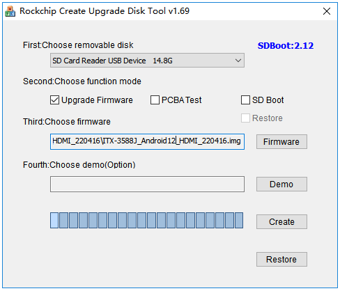

# SD卡升级固件

本文主要介绍如何通过 MicroSD 卡升级 Firefly-R3572A 主板上的固件。

使用 MicroSD 升级固件（建议用 32G 及以下容量的卡），需要在电脑上通过做卡工具将统一固件写入 MicroSD 卡，目前此操作只支持在 Windows 操作系统上完成。

## 准备工具 [step]

* 主板
* 电脑（Windows 操作系统）
* SD 卡（MicroSD）
* USB 读卡器
* 统一固件 `update.img`

## 操作步骤 [step]

* 下载需要升级到主板上的统一固件。
* 打开 SD_Firmware_Tool，勾选`固件升级`框，点击`选择固件`选择正确的升级固件。
* 将 MicroSD 插入 USB 读卡器，再插入电脑 USB 口，在列表式组合框中选择正确的 USB 设备。
* 点击`开始创建`之后，等待创建结束。
* 取出 MicroSD 卡，插入主板的 MicroSD 卡插槽，对主板上电开机，主板自动开始升级。
* 升级完成后，取出 MicroSD 卡，主板自动重启，完成整个升级固件的流程。

其他烧录方式见 [使用 USB 线缆升级固件](upgrade_firmware.md)。