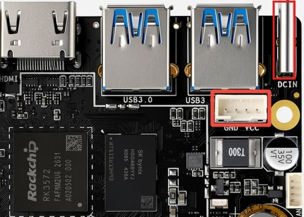
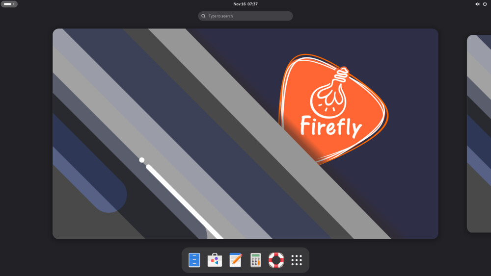
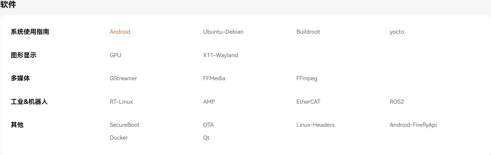
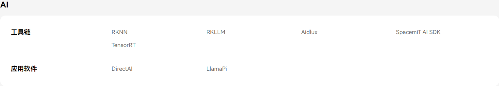

# 快速上手

## 上电开机 [step]

Firefly-R3572A 支持两种供电方式（二选一）：

- **Type-C 电源接口（丝印 DCIN）**：位于板上边缘处，额定输入 12V/3A，推荐使用 PD 3.1 及以下快充协议标准的电源适配器
- **DC 电源座（Wafer 4Pin-2mm）**：丝印 GND/VCC，额定输入 DC 12V/3A

下图中两个红框即上述供电接口：右上角边缘处为 Type-C 电源接口（DCIN），下方红框内为 DC 电源座（Wafer 4Pin-2mm），请对照实物将电源适配器接入其中任意一个接口（以产品附带的电源适配器为准）：



Firefly-R3572A 接通电源后即开机，上电过程会看到开机 logo：

<Callout title="提示" type="info">部分平台可能无开机 logo，以实际显示为准。</Callout>

<center></center>

系统启动完成后进入桌面。

## 系统登录 [step]

<CodeBlockTabs defaultValue="Linux">
  <CodeBlockTabsList>
    <CodeBlockTabsTrigger value="Linux">Linux</CodeBlockTabsTrigger>
    <CodeBlockTabsTrigger value="Android">Android</CodeBlockTabsTrigger>
  </CodeBlockTabsList>

  <CodeBlockTab value="Linux">
    下图以 Firefly-R3572A 的 Linux 系统（GNOME 桌面）为例，其他平台或其他图形显示框架请以实际显示为准：

    

    ### 1. 账号与密码

    | 平台 | 登录账号 | 密码 |
    |---|---|---|
    | 瑞芯微（Rockchip） | `firefly` | `firefly` |
    | 算能（Sophgo） | `linaro` | `linaro` |
    | 高通（Qualcomm） | `firefly` | `firefly` |
    | 英伟达（NVIDIA） | `nvidia` | `nvidia` |
    | 进迭时空（SpacemiT） | `firefly` | `firefly` |

    各平台固件统一不设置 root 密码，登录后执行 `sudo passwd root` 自行设置；若固件已设置 root 密码，则与当前平台的普通用户密码相同。

    ### 2. 选择任一登录方式进入系统

    - **HDMI 显示器 + 鼠标键盘**：登录桌面后打开终端即可开发
    - **调试串口**：通过 J3 Debug 调试串口登录命令行，波特率 1500000，详见 [Debug 使用](../hardware_usage/usb_to_ttl.md)
    - **ADB**：通过 Type-C 接口连接使用，详见 [Adb 使用](../hardware_usage/android_adb_use.md)
    - 各调试接口的具体位置，见「硬件功能使用」中的 debug / adb 章节
    - 个别无屏产品（如 3576Q38、1126BQ38 系列）必须通过调试串口或 ADB 登录

    ### 3. SSH 远程登录（可选）

    SSH 是常用的网络登录方式。设备默认使用动态 IP，需先通过上述任一方式登录系统、为设备配置静态 IP 后，再使用 SSH 连接：

    ```text
    ssh firefly@<设备静态 IP>
    ```

    ### 4. 应用开发入门

    Linux 应用开发可参考社区文档 [Ubuntu/Debian 开发指南](https://community.t-firefly.com/docs/software/os-guide/Ubuntu-Debian/ubuntu-login)。

    <Callout title="切勿执行系统整体升级" type="warn">

    不要执行 `sudo apt-get upgrade`、`sudo apt full-upgrade`、`sudo do-release-upgrade`。此类产品均为嵌入式设备，内核及操作系统都是高度定制版本，执行 upgrade 极有可能破坏系统的相关依赖，导致系统异常。

    </Callout>

  </CodeBlockTab>

  <CodeBlockTab value="Android">
    下图以 Firefly-R3572A 的 Android 16 桌面为例，其他平台请以实际显示为准：

    

    ### 1. 基本操作

    鼠标**右键**相当于**返回**键

    ### 2. 终端调试

    可通过 ADB 进入终端调试，也可通过调试串口登录。

    ### 3. 调试接口位置

    见「硬件功能使用」中的 debug / adb 章节。

    ### 4. Android 系统定制化开发与 FireflyAPI 调用开发

    以下内容仅针对 Rockchip 平台产品：

    - [Android 系统定制化开发指南](https://community.t-firefly.com/docs/software/os-guide/Android/customization-overview)
    - [FireflyAPI 调用开发指南](https://community.t-firefly.com/docs/software/other/Android-FireflyApi/firefly-api-overview)

  </CodeBlockTab>
</CodeBlockTabs>

## 应用开发合集 [step]

### 应用软件开发合集

应用软件开发合集示意图如下，点击下方链接进入：

<center></center>

<center>[应用软件开发合集](https://community.t-firefly.com/docs#software-os-guide)</center>

### AI 开发合集

AI 开发合集示意图如下：

<center></center>

<center>[AI 开发合集](https://community.t-firefly.com/docs#ai)</center>

<Callout title="特别提示：LlamaPi" type="idea">

LlamaPi（读作"拉马派"）是 Firefly AI 团队自研的大模型部署与管理工具，仅支持 Linux 系统。它面向具备大模型推理能力的边缘设备，帮助用户在本地部署和管理开源大模型，并通过 OpenAI 兼容 API 为第三方应用提供推理能力，可以快速本地化部署 AI 模型。

</Callout>

## 系统及 BSP 开发 [step]

系统及 BSP（源码获取、编译、固件烧写）开发，请查看「软件开发使用」章节：

- [编译 Linux 固件](../software_development/linux/linux_compile.md)
- [编译 Android 固件](../software_development/android/android_compile_firmware.md)