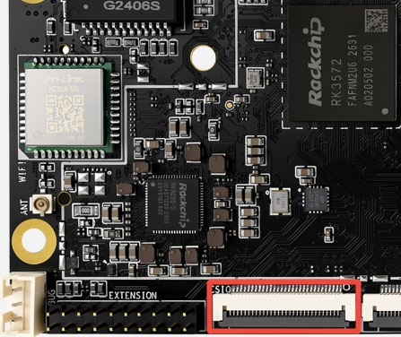
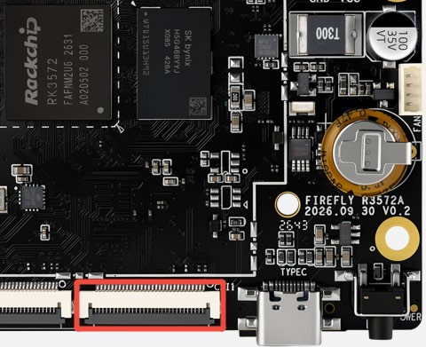

# Camera 使用

## 简介 [step]

Firefly-R3572A 提供 2 路 MIPI CSI 摄像头输入接口（MIPI CSI DPHY，支持 MIPI V1.2），均为 30Pin-0.5mm 连接器，支持 1×4 Lane 或 1×2 Lane 摄像头模组。

## 硬件连接 [step]

摄像头接口定义如下：

| 连接器 | 接口 | Lane | I2C 控制器 |
| --- | --- | --- | --- |
| J20 | MIPI-CSI0 | 4 Lane（CSI0/CSI1） | I2C3 |
| J21 | MIPI-CSI1 | 4 Lane（CSI2/CSI3） | I2C5 |

连接器信号包含摄像头的 MCLK、RESET、PDN 控制信号，电平 1.8 V。连接器在主板上的位置如下图：

<center>


</center>

<center>


</center>

<Callout title="注意" type="warn">

连接摄像头模组前先断电，并确认模组的接口方向与 Lane 数量配置一致。

</Callout>

## 查看摄像头设备 [step]

系统启动后，通过 v4l2 工具确认摄像头节点是否正常注册：

```bash
v4l2-ctl --list-devices
```

查看摄像头支持的分辨率与格式：

```bash
v4l2-ctl -d /dev/video0 --list-formats-ext
```

查看 Media 拓扑：

```bash
media-ctl -p
```

## 采集图像 [step]

使用 `v4l2-ctl` 抓取一帧图像验证通路：

```bash
v4l2-ctl -d /dev/video0 --set-fmt-video=width=1920,height=1080,pixelformat=NV12 --stream-mmap --stream-count=1 --stream-to=out.yuv
```

设备节点编号与格式支持情况以系统实际枚举结果为准。

## 驱动与 ISP [step]

* 摄像头模组驱动位于 SDK 内核 `drivers/media/` 目录，模组支持列表以 SDK 提供的传感器驱动为准。
* Firefly-R3572A 搭载的 RK3572 内置 12 MP ISP，ISP 相关配置与多摄调试方法参考 SDK 内 `rkisp` 相关文档。
* 板级 DTS 中需要配置摄像头模组的电源、时钟、I2C 与 CSI Lane 绑定，参考 SDK 内对应板级 DTS 文件。

## 软件相关目录 [step]

```text
Linux kernel-6.12
|-- arch/arm64/boot/dts/rockchip   # DTS 配置文件
|-- drivers/phy/rockchip           # MIPI DPHY 驱动
|-- drivers/media
|-- platform/rockchip/cif          # RKCIF 驱动
|-- platform/rockchip/isp          # RKISP 驱动
|-- dev                            # probe、异步注册、clock、pipeline、iommu 及 media/v4l2 framework
|-- capture                        # mp/sp/rawwr 的配置及 vb2、帧中断处理
|-- isp_params                     # 3A 相关参数设置
|-- isp_stats                      # 3A 相关统计
|-- rkisp                          # isp subdev 和 entity 注册
|-- csi                            # csi subdev 和 mipi 配置
|-- i2c                            # CIS（cmos image sensor）驱动，如 xc7160.c、imx415.c
```

## 使用 SDK 已适配的摄像头模组 [step]

Firefly-R3572A 的 Linux SDK 在板级 DTS 中默认包含 XC7160 与 IMX415 两套双摄配置（位于 `kernel-6.12/arch/arm64/boot/dts/rockchip/`），二者互斥，按实际使用的摄像头选择其一：

```text
# 默认：双路 XC7160（内置 ISP，YUV 输出，走 RKCIF）
#include "rk3572-firefly-r3572a-dual-xc7160.dtsi"

# 备选：双路 IMX415（RAW 输出，走 RKISP）
#include "rk3572-firefly-r3572a-dual-imx415.dtsi"
```

两套配置共用的 CSI/DPHY 链路定义在 `rk3572-firefly-r3572a-dual-camera-common.dtsi`；物理连接为 V02 板将 CSI0/CSI1 与 CSI2/CSI3 分别直连到两个摄像头连接器，采用 4 Lane 直连（Full Mode）。对应关系如下：

| 摄像头 | 连接器 | I2C 总线（地址） | 时钟 | CSI/DPHY | 数据通路 |
| --- | --- | --- | --- | --- | --- |
| XC7160_0 | CON1（J20） | I2C3（0x1B） | CAM_CLK0 | CSI0/CSI1 → DPHY0 | RKCIF（YUV，内置 ISP） |
| XC7160_1 | CON2（J21） | I2C5（0x1B） | CAM_CLK2 | CSI2/CSI3 → DPHY3 | RKCIF（YUV，内置 ISP） |
| IMX415_0 | CON1（J20） | I2C3（0x37） | CAM_CLK0 | CSI0/CSI1 → DPHY0 | RKISP（RAW） |
| IMX415_1 | CON2（J21） | I2C5（0x37） | CAM_CLK2 | CSI2/CSI3 → DPHY3 | RKISP（RAW） |

<Callout title="注意" type="info">

以上节点名、I2C 地址、pinctrl 与 dtsi 文件名均取自 Firefly-R3572A 的 Linux SDK 板级 DTS。不同 SDK 版本可能调整，实际以你手中 SDK 的 `rk3572-firefly-r3572a*.dtsi` 文件为准。XC7160 与 IMX415 为互斥选配，请勿同时启用同一连接器上的两套 sensor 节点。

</Callout>


## Camera 底层调试 [step]

查找摄像头节点：

```shell
# 一款主板可能存在多个摄像头节点。IMX415 为 RAW Sensor，数据经 RKISP，
# 抓取 rkisp_mainpath 对应的 video 节点；XC7160 内置 ISP 输出 YUV，
# 抓取 stream_cif_mipi_id0 对应的 video 节点
root@firefly:~# grep '' /sys/class/video4linux/video*/name
/sys/class/video4linux/video0/name:stream_cif_mipi_id0
/sys/class/video4linux/video22/name:rkisp_mainpath
...
```

使用 v4l2-ctl 抓取 camera 数据帧：

```shell
v4l2-ctl --verbose -d /dev/video0 --set-fmt-video=width=1920,height=1080,pixelformat='NV12' --stream-mmap=4 --stream-to=/data/out.yuv
```

把 out.yuv 文件拷贝出来通过 PC 查看：

```shell
ffplay -f rawvideo -video_size 1920x1080 -pix_fmt nv12 out.yuv
```

## Linux 系统预览摄像头 [step]

在 Wayland 桌面环境下使用 GStreamer 预览摄像头画面（`/dev/video31` 为示例节点，请按 `v4l2-ctl --list-devices` 的实际枚举结果替换）：

```bash
DISPLAY=:0 gst-launch-1.0 -v \
    v4l2src device=/dev/video31 io-mode=dmabuf \
    ! video/x-raw,format=NV12,width=1920,height=1080,framerate=30/1 \
    ! fpsdisplaysink video-sink=waylandsink text-overlay=false sync=false
```

其中 `io-mode=dmabuf` 采用 DMA-BUF 零拷贝传输，`fpsdisplaysink` 封装 `waylandsink` 在 Wayland 桌面显示画面并输出实时帧率。

## Android 系统使用 Camera 应用 [step]

除了官方默认支持的摄像头外，Android 系统使用 camera 的 apk 打开摄像头都需要配置 camera3_profiles*.xml，具体可参考 Android SDK `hardware/rockchip/camera/etc/camera` 目录下的文件。

## IQ 文件 [step]

raw 摄像头支持的 iq 文件路径为 `external/camera_engine_rkaiq/iqfiles/isp3x`，iq 文件采用 `.json` 的方式（不再是 `.xml`）。若使用 raw 摄像头 sensor，请留意 isp3x 目录所支持的 iq 文件。

