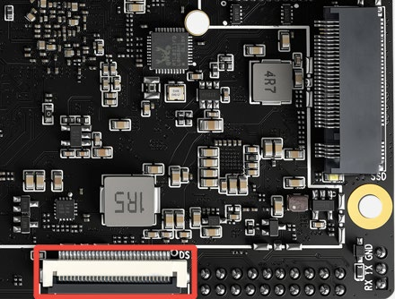
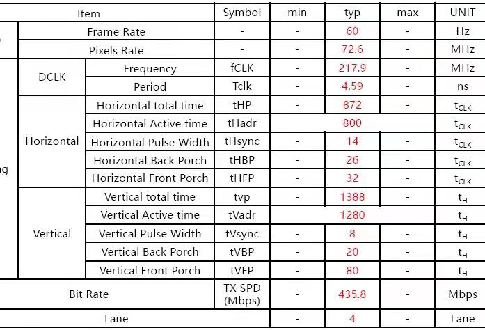
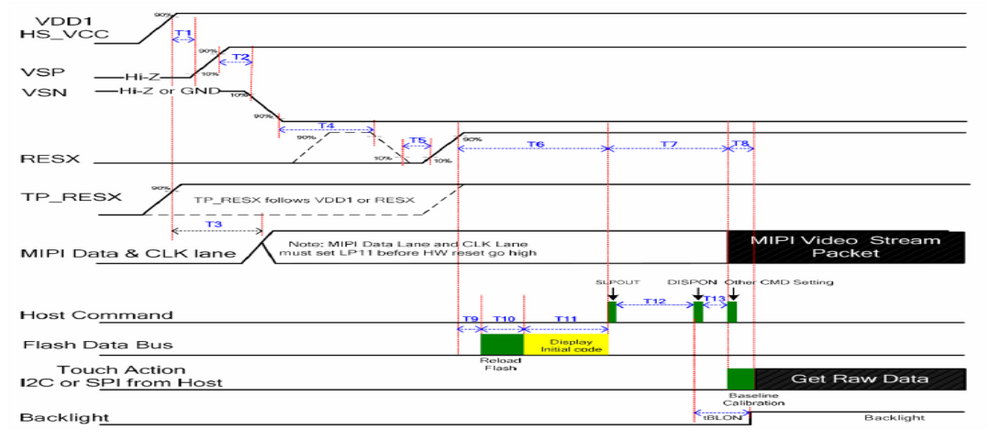

# Display 使用

## 简介 [step]

Firefly-R3572A 支持两类显示输出：

| 接口 | 连接器 | 规格 |
| --- | --- | --- |
| HD2.1 | 标准 HD 接口 | 最高 4K@60Hz |
| MIPI DSI | J18，30Pin-0.5mm | DPHY 1.2，1×4 Lane，2.5 Gbps/Lane |

系统支持 4K@60fps + 2K@60fps 双屏异显输出。

## HD 显示 [step]

HD 接口支持热插拔检测，接入显示器后系统自动完成分辨率协商。查看当前显示模式：

```bash
cat /sys/class/drm/card0-HDMI-A-1/status
cat /sys/class/drm/card0-HDMI-A-1/modes
```

设备节点名称以系统实际枚举为准，可通过 `ls /sys/class/drm/` 确认。

## MIPI DSI 显示 [step]

Firefly-R3572A 的 DSI 接口（J18）支持 4 Lane 数据输出。DSI 软件上表示为 `dsi`，默认外接的屏幕是 [Firefly V2 版本屏幕](https://community.t-firefly.com/docs/products/accessories/DM-M10R800-V3S/started)。该屏的板级配置位于 SDK 的 `kernel-6.12/arch/arm64/boot/dts/rockchip/rk3572-firefly-r3572a-mipi101-BSD1218-A101KL68.dtsi`，由主 DTS 的 `DSI` 开关控制是否启用。

这块屏的主要参数如下（以 SDK dtsi 为准）：

| 项目 | 参数 |
| --- | --- |
| 分辨率 | 800 × 1280 |
| DSI Lane | 4 Lane |
| 像素时钟 | 70 MHz |
| 兼容属性 | `simple-panel-dsi` |
| 触摸屏 | I2C6 上的 Goodix GT9xxx 电容触摸 |

DSI 接口（J18）除 4 Lane 视频信号外，还包含触摸屏 I2C（I2C6）、背光控制（`LCD_BL_EN`、`LCD_BL_PWM`）与复位信号。

* J18 DSI 接口

<center>


</center>

* V2 屏幕显示时序

<center>


</center>

* V2 屏幕上电时序

<center>


</center>

点亮 MIPI 屏需要完成以下配置：

1. 在板级 DTS（上述 dtsi）中配置屏的供电、复位、背光与 DSI 时序参数，并包含该 dtsi。
2. 确认触摸屏的 I2C 地址挂在 I2C6 上。
3. 编译并烧录固件后，通过 `modetest` 或桌面环境验证显示输出。

<Callout title="注意" type="warn">

J18 的 LCD 控制信号电平为 3.3 V，连接屏体或转接板前先确认信号电平匹配。更换其它屏幕时，需要按新屏时序单独配置对应的 DTS。

</Callout>

## 双屏异显 [step]

系统支持 HD + MIPI DSI 双屏异显。桌面环境下通过系统显示设置配置各屏的显示模式；命令行环境下可使用 `modetest` 或合成器（如 `weston`）的输出配置实现异显。

各接口支持的最大分辨率与帧率以 SDK 固件实际支持为准。

## 调试手段 [step]

* 获取 HD 输出的 edid

```bash
busybox hexdump /sys/class/drm/card0-HDMI-A-1/edid
```

* 获取 HD 所支持的分辨率

```bash
cat /sys/class/drm/card0-HDMI-A-1/modes
```

* 获取 HD 的连接状态

```bash
cat /sys/class/drm/card0-HDMI-A-1/status
```

* 获取系统中正在使用的 Video Port（与所连接的显示控制器）信息

```bash
cat /d/dri/0/summary
```

一般如果遇到 HD/MIPI DSI 无法显示的问题，都需要先执行上面的命令看一下连接状态、edid 和分辨率是否正确。

