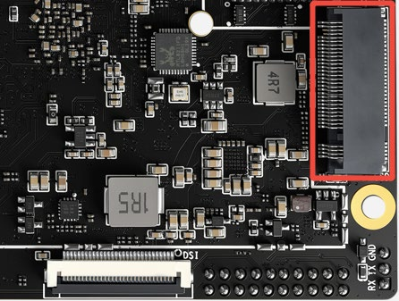

# PCIe 使用

## 简介 [step]

Firefly-R3572A 板载 1 个 M.2 M-KEY 连接器（U29），默认配置为 PCIe 模式，可扩展 NVMe 协议的 2280 规格 SSD。该插槽也可通过软件切换为 SATA 模式使用 SATA SSD，两种模式互斥，详见 [SATA 使用](usage_sata.md)。

## 硬件安装 [step]

1. 断电后将 NVMe SSD 以 45° 角插入 M.2 连接器。
2. 按下 SSD 尾端并固定螺丝。

<center>


</center>

<Callout title="注意" type="warn">

当前固件默认将 M.2 插槽配置为 PCIe（NVMe）模式。如需使用 SATA 协议 SSD，需修改主 DTS 的 `PCIE1`/`SATA1` 开关切换为 SATA 模式（二者互斥），详见 [SATA 使用](usage_sata.md)。

</Callout>

## 查看设备 [step]

系统启动后确认 PCIe 设备已枚举：

```bash
lspci
```

查看 NVMe 块设备节点：

```bash
ls /dev/nvme*
```

正常情况下可以看到 `/dev/nvme0` 及其分区节点 `/dev/nvme0n1`、`/dev/nvme0n1p1` 等。

## 挂载使用 [step]

对新 SSD 先分区并创建文件系统：

```bash
fdisk /dev/nvme0n1                # 创建分区
mkfs.ext4 /dev/nvme0n1p1          # 创建 ext4 文件系统
mount /dev/nvme0n1p1 /mnt         # 挂载到 /mnt
```

查看 SSD 信息与健康状况：

```bash
nvme list
nvme smart-log /dev/nvme0
```

## 读写测速 [step]

可以参考如下命令对 NVMe SSD 进行读写速度测试：

* dd

```bash
# 路径根据实际挂载路径修改
# 写 1G 文件
echo 3 > /proc/sys/vm/drop_caches
dd if=/dev/zero of=/mnt/nvme/test1 bs=1M count=1024 conv=sync
# 读 1G 文件
echo 3 > /proc/sys/vm/drop_caches
dd if=/mnt/nvme/test1 of=/dev/null conv=sync
```

* fio

```bash
# 使用 fio 会格式化硬盘
# 写
fio -filename=/dev/nvme0n1 -direct=1 -iodepth 1 -thread -rw=write -ioengine=psync -bs=1M -size=200G -numjobs=30 -runtime=60 -group_reporting -name=mytest
# 读
fio -filename=/dev/nvme0n1 -direct=1 -iodepth 1 -thread -rw=read -ioengine=psync -bs=1M -size=200G -numjobs=30 -runtime=60 -group_reporting -name=mytest
```

## 开机自动挂载 [step]

需要开机自动挂载时，将设备信息写入 `/etc/fstab`：

```text
/dev/nvme0n1p1  /mnt/nvme  ext4  defaults  0  2
```

写入前使用 `blkid /dev/nvme0n1p1` 获取 UUID 并以 UUID 方式填写更可靠。
