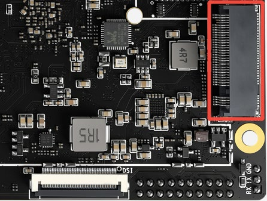

# SATA 使用

## 简介 [step]

Firefly-R3572A 板载 1 个 M.2 M-KEY 连接器（U29），可通过软件配置为以下两种模式之一，二者互斥：

* **PCIe 模式（NVMe）**：默认配置，使用 NVMe 协议 SSD，详见 [PCIe 使用](usage_pcie.md)
* **SATA 模式**：使用 SATA 协议 SSD，即本章内容

<center>


</center>

## 软件配置（DTS） [step]

M.2 插槽的模式由主 DTS `rk3572-firefly-r3572a.dts` 中的两个开关决定，`SATA1` 与 `PCIE1` 不能同时为 1：

```text
#define PCIE1   1 /* M.2 NVMe */
#define SATA1   0 /* M.2 SATA; mutually exclusive with PCIE1 */
```

切换到 SATA 模式时，改为：

```text
#define PCIE1   0
#define SATA1   1
```

板级 DTS `rk3572-firefly-r3572a.dtsi` 中 SATA 节点在 `SATA1 && (PCIE1 == 0)` 时启用，供电仍取自 M.2 插槽的 `vcc3v3_pcie1`：

```text
#if SATA1 && ( PCIE1 == 0 )
/* M.2 slot in SATA mode: combphy2_ps switches to PHY_TYPE_SATA and
 * vcc3v3_pcie1 still supplies the slot. */
&sata1 {
    ahci-supply = <&vcc3v3_pcie1>;
    status = "okay";
};
#endif
```

<Callout title="注意" type="info">

芯片级节点 `sata1: sata@24810000`（`compatible = "rockchip,rk-ahci", "snps,dwc-ahci"`）定义在 `kernel-6.12/arch/arm64/boot/dts/rockchip/rk3572.dtsi`，使用 `combphy2_ps` 的 `PHY_TYPE_SATA` 物理层。以上开关、节点名与供电来自 Firefly-R3572A 的 Linux SDK，实际以你手中 SDK 的 dts 为准。

</Callout>

修改 DTS 后需重新编译固件并烧录；切换模式时 M.2 插槽上必须使用对应协议的 SSD（SATA 模式插 SATA SSD，PCIe 模式插 NVMe SSD）。

## 查看设备 [step]

系统启动后，确认 SATA 控制器已枚举并识别出硬盘：

```bash
# 查看 SATA 块设备节点（Linux 下通常为 /dev/sda、/dev/sdb 等）
ls /dev/sd*

# 查看磁盘信息
fdisk -l

# 查看内核日志中的 SATA/AHCI 信息
dmesg | grep -i -E "sata|ahci|ata"
```

Android 系统下块设备节点通常为 `/dev/block/sd*`。

## 挂载 [step]

### 命令手动挂载

以 `/dev/sda` 为例（请按实际设备节点替换）：

```bash
# 格式化为 EXT4（会清空数据，确认无需保留数据时再执行）
mkfs.ext4 /dev/sda

# 创建挂载点并挂载
mkdir -p /mnt/sata
mount /dev/sda /mnt/sata

# 查看挂载结果
df -h
```

使用 `blkid /dev/sda` 获取 UUID 后，以 UUID 方式写入 `/etc/fstab` 可实现开机自动挂载，避免设备节点编号变化导致挂载错误。
