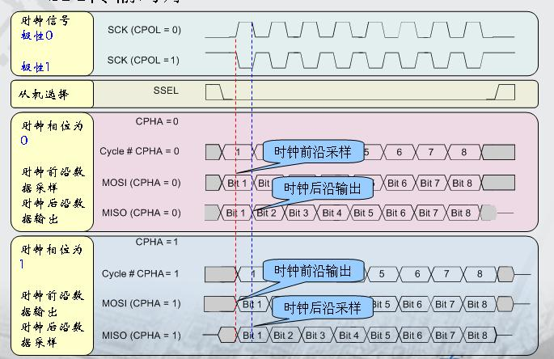

# SPI 使用

## 简介 [step]

SPI 是一种高速、全双工、同步串行通信接口，用于连接微控制器、传感器、存储设备等。Firefly-R3572A 通过 J1 双排排针引出 SPI2 接口。

## 硬件连接 [step]

SPI2 引脚定义如下：

| 排针序号 | 信号 | 电平 |
| --- | --- | --- |
| 12 | SPI2_MISO_M1 | 1.8 V |
| 14 | SPI2_MOSI_M1 | 1.8 V |
| 16 | SPI2_CLK_M1 | 1.8 V |
| 18 | SPI2_CSN0_M1 | 1.8 V |
| 5 / 6 | GND |  |

<center>


</center>

<Callout title="注意" type="warn">

SPI 信号电平为 1.8 V，外接 3.3 V 器件需加装电平转换电路。

</Callout>

SPI 以主从方式工作，通常需要 4 根信号线：

```text
CS       片选信号
SCLK     时钟信号
MOSI     主设备数据输出、从设备数据输入
MISO     主设备数据输入、从设备数据输出
```

Linux 内核用 CPOL 与 CPHA 的组合表示 SPI 的四种工作模式：

```text
CPOL＝0，CPHA＝0    SPI_MODE_0
CPOL＝0，CPHA＝1    SPI_MODE_1
CPOL＝1，CPHA＝0    SPI_MODE_2
CPOL＝1，CPHA＝1    SPI_MODE_3
```

* CPOL：时钟信号初始电平，0 为低电平，1 为高电平。
* CPHA：采样时钟沿，0 为第一个时钟沿采样，1 为第二个时钟沿采样。

四种工作模式的波形图如下：

<center>


</center>

## DTS 配置 [step]

在板级 DTS 中使能 SPI2 并挂载 spidev 设备：

```text
&spi2 {
    status = "okay";
    pinctrl-names = "default";
    pinctrl-0 = <&spi2m1_csn0_pins>, <&spi2m1_pins>;
    max-freq = <50000000>;
    spidev2: spidev@00 {
        compatible = "rockchip,spidev";
        status = "okay";
        reg = <0x0>;
        spi-max-frequency = <50000000>;
    };
};
```

内核需选中 `SPI_SPIDEV` 配置。DTS 文件路径与 pinctrl 宏名以 Firefly-R3572A SDK 实际代码为准。

## 驱动编写 [step]

下面以 XM25QU128C Flash 模块为例简单介绍 SPI 驱动的编写。

### 硬件连接

Firefly-R3572A 与 XM25QU128C 硬件连接如下表：

| XM25QU128C | Firefly-R3572A |
| ----       | ----        |
| /CS        | SPI2_CSN0_M1 |
| D0         | SPI2_MISO_M1 |
| GND        | GND         |
| VCC        | 1.8V        |
| CLK        | SPI2_CLK_M1  |
| D1         | SPI2_MOSI_M1   |

### 编写 Makefile/Kconfig

在 `kernel-6.12/drivers/spi/Kconfig` 中添加对应的驱动文件配置：

```text
config SPI_FIREFLY
       tristate "Firefly SPI demo support"
       default y
        help
          Select this option if your Firefly board needs to run SPI demo.
```

在 `kernel-6.12/drivers/spi/Makefile` 中添加对应的驱动文件名：

```text
obj-$(CONFIG_SPI_FIREFLY)              += spi-firefly-demo.o
```

### 配置 DTS 节点

在 `kernel-6.12/arch/arm64/boot/dts/rockchip/rk3572-firefly-demo.dtsi` 中添加 SPI 驱动结点描述，如下所示：

```text
/* Firefly SPI demo */
&spi2{
    spi_demo: spi_demo@00{
        compatible = "firefly,rk3572-spi";
        status = "okay";
        reg = <0x00>;
        spi-max-frequency = <50000000>;
        //spi-cpha;   /* SPI mode: CPHA=1 */
        //spi-cpol;   /* SPI mode: CPOL=1 */
        //spi-cs-high;
    };
};

&spidev2 {
    status = "disabled";
};
```

* status: 如果要启用 SPI，则设为 `okay`，如不启用，设为 `disabled`。
* spi_demo@00: 由于本例子使用 CS0，故此处设为 `00`，如果使用 CS1，则设为 `01`。
* compatible: 这里的属性必须与驱动中的结构体 of_device_id 中的成员 compatible 保持一致。
* reg: 此处与 spi_demo@00 保持一致，本例设为：0x00。
* spi-max-frequency: 此处设置 spi 使用的最高频率。
* spi-cpha，spi-cpol: SPI 的工作模式在此设置，本例所用的模块 SPI 工作模式为 SPI_MODE_0 或者 SPI_MODE_3，这里我们选用 SPI_MODE_0，如果使用 SPI_MODE_3，spi_demo 中打开 spi-cpha 和 spi-cpol 即可。

### 定义 SPI 驱动

在内核源码目录 `kernel-6.12/drivers/spi/` 中创建新的驱动文件，如：`spi-firefly-demo.c`。

在定义 SPI 驱动之前，用户首先要定义变量 `of_device_id`。`of_device_id` 用于在驱动中调用 DTS 文件中定义的设备信息，其定义如下所示：

```c
static struct of_device_id firefly_match_table[] = { { .compatible = "firefly,rk3572-spi",},{},};
```

此处的 `compatible` 与 DTS 文件中的保持一致。

spi_driver 定义如下所示：

```c
static struct spi_driver firefly_spi_driver = {
	.driver = {
		.name = "firefly-spi",
		.owner = THIS_MODULE,
		.of_match_table = firefly_match_table,},
	.probe = firefly_spi_probe,};
};
```

### 注册 SPI 设备

在初始化函数 `static int __init firefly_spi_init(void)` 中向内核注册 SPI 驱动：`spi_register_driver(&firefly_spi_driver);`

如果内核启动时匹配成功，则 SPI 核心会配置 SPI 的参数（mode、speed 等），并调用 `firefly_spi_probe`。

### 读写 SPI 数据

* `firefly_spi_probe` 中使用了两种接口操作读取 `XM25QU128C` 的 ID:
* `firefly_spi_read_xm25x_id_0` 接口直接使用了 `spi_transfer` 和 `spi_message` 来传送数据。
* `firefly_spi_read_xm25x_id_1` 接口则使用 SPI 接口 `spi_write_then_read` 来读写数据。

成功后会打印：

```text
console:/ $  dmesg | grep spi
[    1.791786] [    T1] firefly-spi spi2.0: Firefly SPI demo program
[    1.791788] [    T1] firefly spi demo
[    1.791795] [    T1] firefly-spi spi2.0: firefly_spi_probe: setup mode 0, 8 bits/w, 50000000 Hz max
[    1.791838] [    T1] firefly_spi_read_xm25x_id_0 ID = 20 41 18
[    1.791875] [    T1] firefly_spi_read_xm25x_id_1 ID = 20 41 18
```

### 打开 SPI demo

`spi-firefly-demo` 默认没有打开，如果需要的话可以将 demo 驱动节点中的 `status` 属性由 `disabled` 改为 `okay` 打开。

### 常用 SPI 接口

下面是常用的 SPI API 定义：

```c
void spi_message_init(struct spi_message *m);
void spi_message_add_tail(struct spi_transfer *t, struct spi_message *m);
int spi_sync(struct spi_device *spi, struct spi_message *message) ;
int spi_write(struct spi_device *spi, const void *buf, size_t len);
int spi_read(struct spi_device *spi, void *buf, size_t len);
ssize_t spi_w8r8(struct spi_device *spi, u8 cmd);
ssize_t spi_w8r16(struct spi_device *spi, u8 cmd);
ssize_t spi_w8r16be(struct spi_device *spi, u8 cmd);
int spi_write_then_read(struct spi_device *spi, const void *txbuf, unsigned n_tx, void *rxbuf, unsigned n_rx);
```

## 用户态使用 [step]

配置完成后系统生成 spidev 设备节点，可通过以下命令确认：

```bash
ls /dev/spidev*
```

用户态程序通过 `ioctl` 控制 SPI 收发，核心流程：

```c
#include <linux/spi/spidev.h>

int fd = open("/dev/spidev2.0", O_RDWR);
ioctl(fd, SPI_IOC_WR_MODE, &mode);           /* 设置工作模式 */
ioctl(fd, SPI_IOC_WR_BITS_PER_WORD, &bits);  /* 设置数据位宽 */
ioctl(fd, SPI_IOC_WR_MAX_SPEED_HZ, &speed);  /* 设置通信速率 */
ret = ioctl(fd, SPI_IOC_MESSAGE(1), &xfer);  /* 全双工收发 */
```

spidev 的详细使用说明参考 SDK 内核 `Documentation/spi/spidev.rst` 文档。

## FAQ [step]

### SPI 数据传送异常？

确认 SPI 4 个引脚的 IOMUX 配置正确、CLK 频率正确、CS 信号已拉低，且工作模式与从设备匹配。
