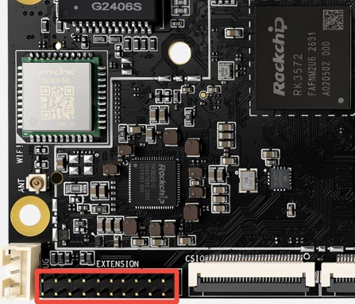

# UART 使用

## 简介 [step]

Firefly-R3572A 提供两类串口资源：J3 Debug 连接器为调试串口，使用 UART0 控制器的 m0 引脚复用；J1 双排排针引出 UART2，可用于业务通信。其他 UART 资源可根据需要在 SDK 中开启使用。

## 调试串口（UART0 m0） [step]

J3 Debug 连接器默认作为系统调试控制台使用，波特率 1500000，接线与使用方法详见 [Debug 使用](usb_to_ttl.md)。

<Callout title="注意" type="warn">

调试串口输出系统日志，不要接业务设备，避免与系统日志互相干扰。

</Callout>

## 扩展串口（UART2） [step]

UART2 通过 J1 双排排针引出，引脚定义如下：

| 排针序号 | 信号 | 电平 |
| --- | --- | --- |
| 17 | UART2_TX（串阻 22R） | 3.3 V |
| 19 | UART2_RX（串阻 22R） | 3.3 V |
| 5 / 6 | GND |  |

<center>


</center>

## DTS 配置 [step]

在板级 DTS 中使能 UART2 控制器（pinctrl 复用组以 SDK 实际代码为准）：

```text
&uart2 {
    status = "okay";
    pinctrl-0 = <&uart2m2_xfer_pins>;
};
```

## 收发验证 [step]

配置完成后，系统生成对应串口节点 `/dev/ttyS2`（节点编号以实际配置为准）。短接 J1 排针的 UART2_TX 与 UART2_RX 引脚后，在调试串口或 ADB 中执行：

```bash
busybox stty -echo -F /dev/ttyS2          # 关闭回显
cat /dev/ttyS2 &                          # 后台读取输入
echo "firefly uart test..." > /dev/ttyS2  # 发送字符串
```

终端接收到字符串 `firefly uart test...` 说明收发正常。
