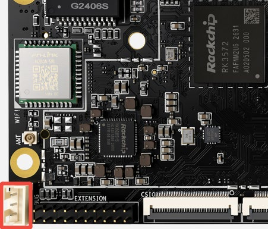
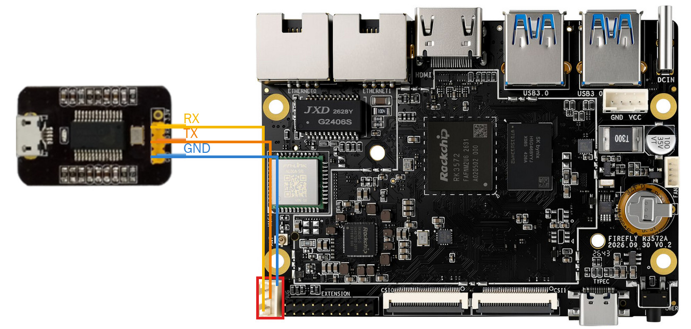

# Debug 使用

如果正在进行 U-Boot 或内核开发，USB 串口适配器（USB 转串口 TTL 适配器的简称）对于检查系统启动日志非常有用，特别是在没有图形桌面显示的情况下。

## 硬件连接 [step]

Firefly-R3572A 板载 Debug 调试串口（J3，3Pin-2mm 间距 Wafer 座），使用 UART0 控制器的 m0 引脚复用，引脚定义如下：

| 序号 | 定义 | 电平/V |
| --- | --- | --- |
| 1 | UART0_RXD | 3.3 |
| 2 | UART0_TXD | 3.3 |
| 3 | GND |  |

串口转 USB 适配器的引脚与调试串口的对应关系：

* 适配器 3.3 V 电源引脚（NC），不需要连接
* 适配器 GND，接 J3 的 GND
* 适配器 TXD，接 J3 的 UART0_RXD
* 适配器 RXD，接 J3 的 UART0_TXD

<Callout title="注意" type="warn">

1. J3 调试串口电平为 3.3 V，不要连接 5 V 电平的适配器，避免损坏主板。
2. 如遇 TX 和 RX 不能输入输出的问题，可以尝试对调 TX 和 RX 的连接。

</Callout>

J3 在主板上的位置如下图红框所示：

<center>


</center>

Firefly-R3572A 串口连接图：

<center>



</center>

## 串口参数配置 [step]

Firefly-R3572A 使用以下串口参数：

* 波特率：1500000
* 数据位：8
* 停止位：1
* 奇偶校验：无
* 流控：无

## 使用方法 [step]

<CodeBlockTabs defaultValue="Windows">
  <CodeBlockTabsList>
    <CodeBlockTabsTrigger value="Windows">Windows</CodeBlockTabsTrigger>
    <CodeBlockTabsTrigger value="Ubuntu">Ubuntu</CodeBlockTabsTrigger>
  </CodeBlockTabsList>

  <CodeBlockTab value="Windows">

    ### 安装驱动

    下载驱动并安装：

    - [CH340](https://www.wch.cn/downloads/CH341SER_EXE.html)
    - [PL2303](https://www.prolific.com.tw/en/portfolio-item/pl2303gl/)
    - [CP210X](https://www.silabs.com/software-and-tools/usb-to-uart-bridge-vcp-drivers)

    插入适配器后，系统会提示发现新硬件，并初始化，之后可以在设备管理器找到对应的 COM 口：

    <center>

    
    </center>

    ### 安装软件

    Windows 上一般用 putty 或 SecureCRT，推荐使用免费的 MobaXterm。这是一款功能强大的终端软件，其使用方法与上述工具类似。

    下载 [MobaXterm](https://mobaxterm.mobatek.net/)：

    1. 选择 `session` 为 `Serial`。
    2. 将 `Serial port` 修改为在设备管理器中找到的 COM 端口。
    3. 设置 `Speed (bsp)` 为 1500000。
    4. 点击 `OK` 按钮。

    <center>

    
    </center>

    <center>

    
    </center>

  </CodeBlockTab>

  <CodeBlockTab value="Ubuntu">

    在 Ubuntu 上可以有多种选择：

    - minicom
    - picocom
    - kermit

    以下介绍 minicom 的使用。

    ### 安装 minicom

    ```bash
    sudo apt-get install minicom
    ```

    连接好串口线后，查看串口设备文件，下面示例是 `/dev/ttyUSB0`：

    ```console
    $ ls /dev/ttyUSB*
    /dev/ttyUSB0
    ```

    运行：

    ```console
    $ sudo minicom
    Welcome to minicom 2.7
    OPTIONS: I18n
    Compiled on Jan  1 2014, 17:13:19.
    Port /dev/ttyUSB0, 15:57:00
    Press CTRL-A Z for help on special keys
    ```

    以上提示 CTRL-A Z 是转义键，按 Ctrl-a 然后再按 Z 就可以调出帮助菜单。

    根据提示按 `O` 进入设置界面，选择 `Serial port setup`，再输入前面提示的字母，设置成如下：

    ```text
       E -    Bps/Par/Bits       : 1500000 8N1
       F - Hardware Flow Control : No
       G - Software Flow Control : No
    ```

    <Callout title="注意" type="warn">

    `Hardware Flow Control` 和 `Software Flow Control` 都要设成 No，否则可能导致无法输入。

    </Callout>

    设置完成后回到上一菜单，选择 `Save setup as dfl` 即可保存为默认配置，以后将默认使用该配置。

  </CodeBlockTab>
</CodeBlockTabs>