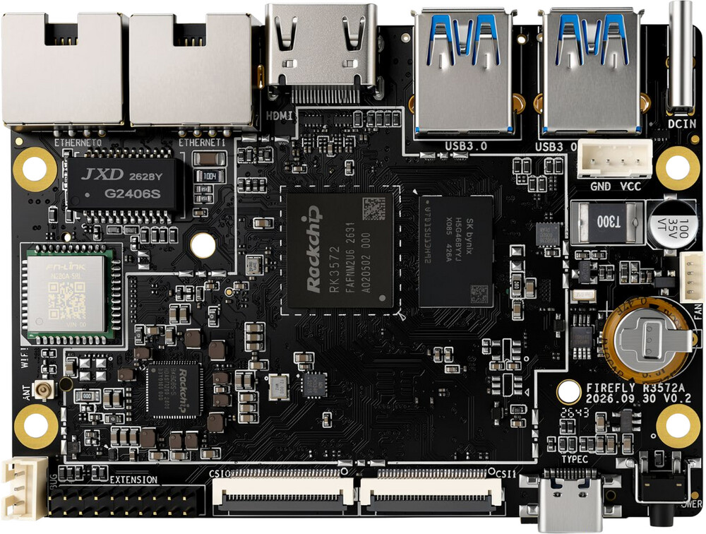
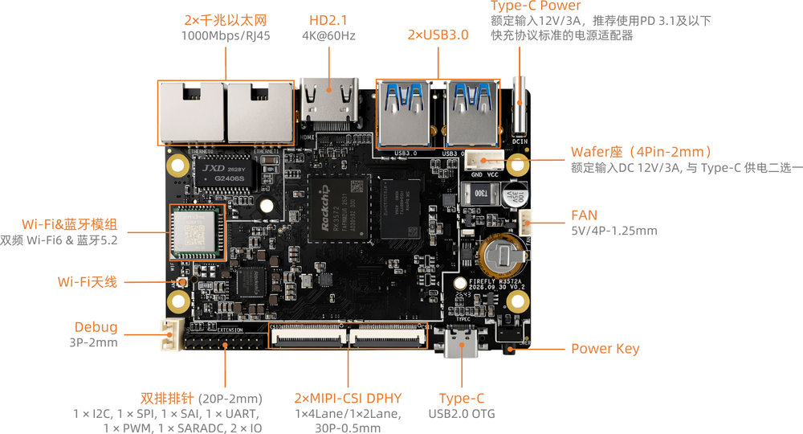
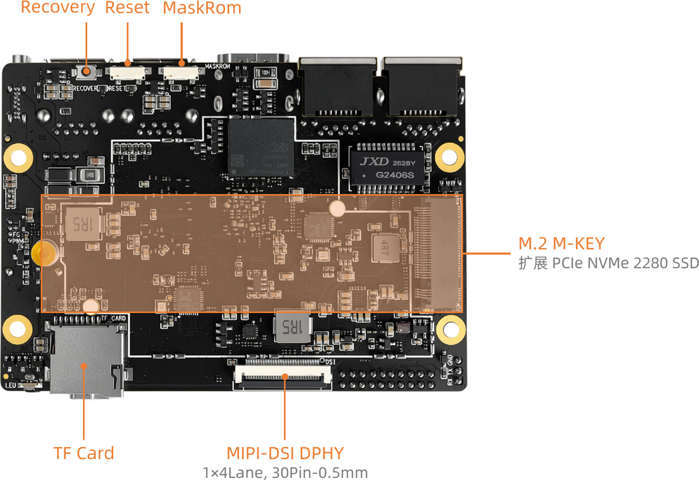
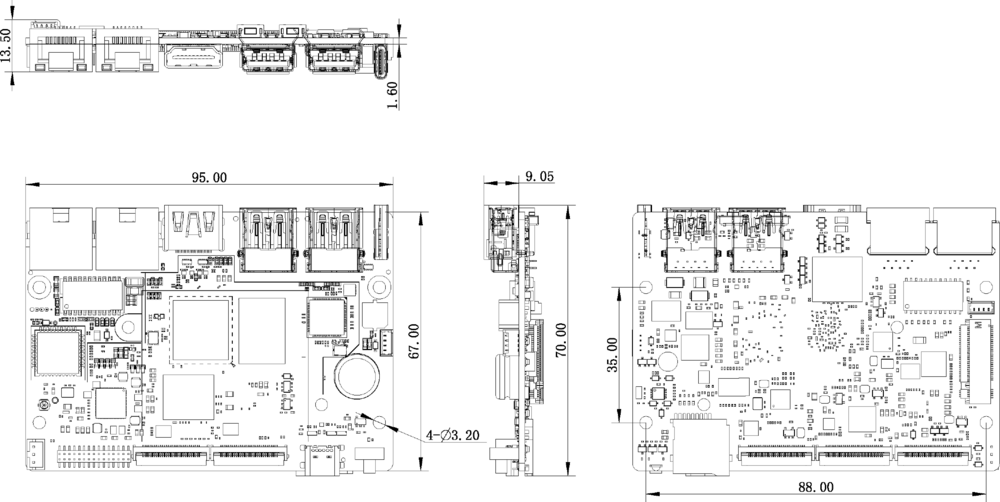

[规格书](https://download.t-firefly.com/Spec/Mainboards/Firefly%20R3572A_Specification_CN.pdf)

# 简介

**Firefly-R3572A** 是一款基于 Rockchip RK3572 八核 64 位 AIoT 处理器（2 × Cortex-A73 + 6 × Cortex-A53，主频最高 2.2 GHz，8nm 先进制程）的开源主板，具备优异的低功耗特性。

主板内置 ARM Mali G310 GPU 与 4 TOPS（稀疏 INT8）算力 NPU，支持 Transformer 架构下超大规模参数模型的私有化部署，支持多种深度学习框架、自定义算子开发与 Docker 容器化管理技术。主板采用 SBC（Single-Board Computer，单板计算机）一体板设计，尺寸仅 95 mm × 70 mm，可便捷嵌入各类整机设备，广泛适用于边缘计算、AI 摄像头、智能监控、NAS、零售设备、数字标牌等应用场景。

## 标准套装

**Firefly-R3572A** 标准套装包含以下配件（仅供参考）：

* Firefly-R3572A 主板 × 1
* 12V/3A 电源适配器 × 1
* Type-C 数据线 × 1

另外可以选购的配件有：

* Firefly 串口模块

此外，在使用过程中，你可能需要以下配件：

* 显示设备
  * 带 HD 接口的显示器或电视，及 HD 连接线
* 网络
  * 1000M 以太网线缆，及有线路由器
  * Wi-Fi 路由器
* 输入设备
  * USB 无线/有线的鼠标/键盘
* 升级固件，调试
  * Type-C 数据线
  * 串口转 USB 适配器

## 接口描述

**Firefly-R3572A** 提供丰富的扩展接口，主要包括：

* 2 × RJ45（1000 Mbps 千兆以太网）
* 1 × HD2.1（最高支持 4K@60Hz 输出）
* 1 × MIPI DSI DPHY 1.2（1×4 Lanes，30Pin-0.5mm）
* 2 × MIPI CSI DPHY（1×4 Lanes 或 1×2 Lanes，30Pin-0.5mm）
* 2 × USB3.0
* 1 × Type-C（USB2.0 OTG）
* 1 × M.2 M-KEY（可扩展 PCIe NVMe 2280 SSD）
* 1 × TF Card
* 1 × 双排排针（20Pin-2mm，引出 I2C、SPI、SAI、UART、PWM、SARADC、IO）
* 1 × Debug（3Pin-2mm）
* 1 × FAN（4Pin-1.25mm）
* 板载 Wi-Fi & 蓝牙模组（双频 Wi-Fi 6 & 蓝牙 5.2）

具体如下图：

## 产品尺寸

## 资源与技术支持

* [技术交流论坛](https://forum.t-firefly.com/)：超过 10 万企业客户和用户沟通交流平台

### 联系方式

* 邮箱：sales@t-firefly.com
* 手机：(+86) 186 8811 7175
* 座机：0760-89881218
* 地址：广东省中山市东区中山四路 57 号宏宇大厦 2101 室