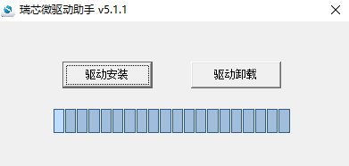
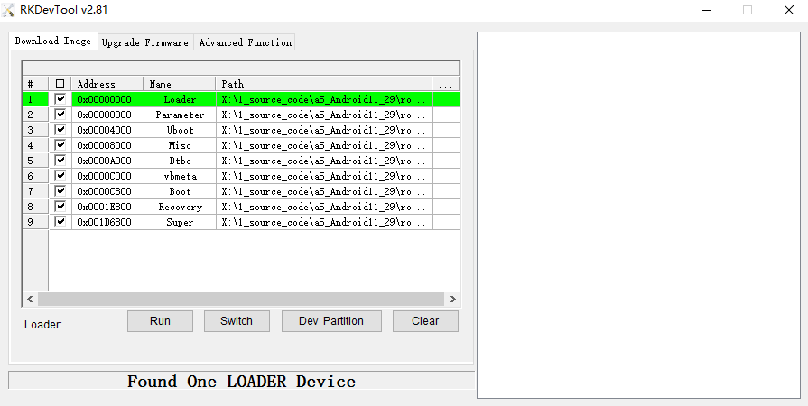
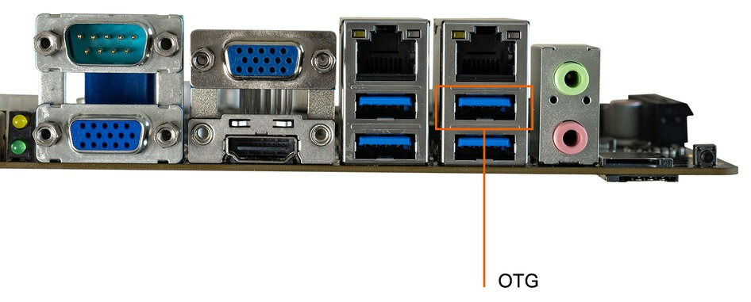
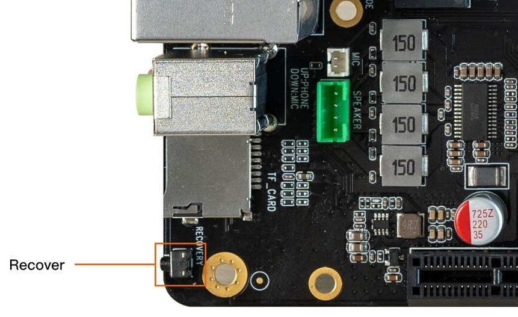
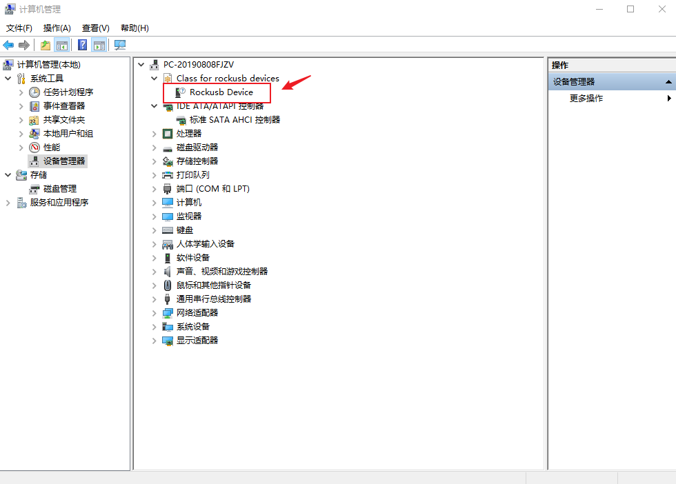
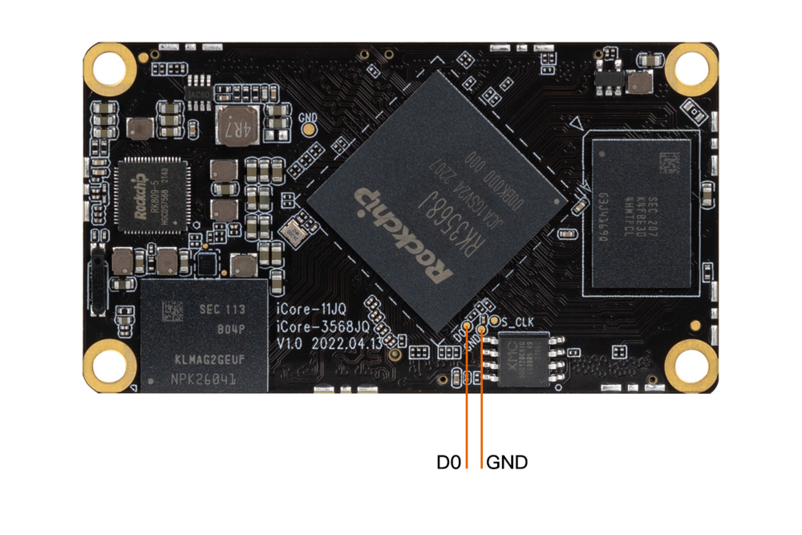
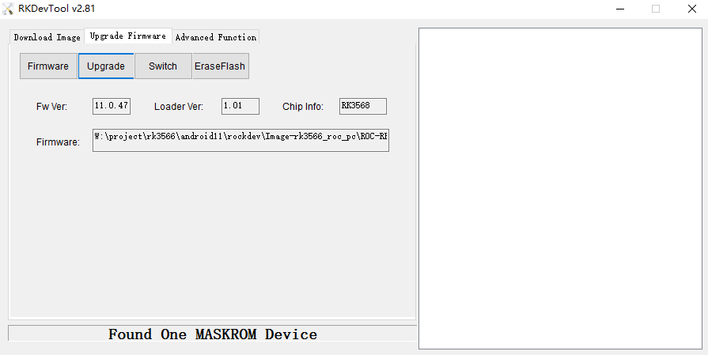
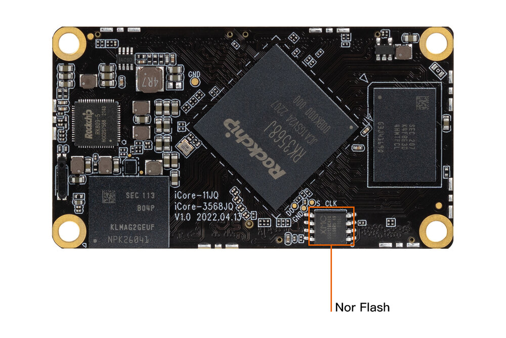
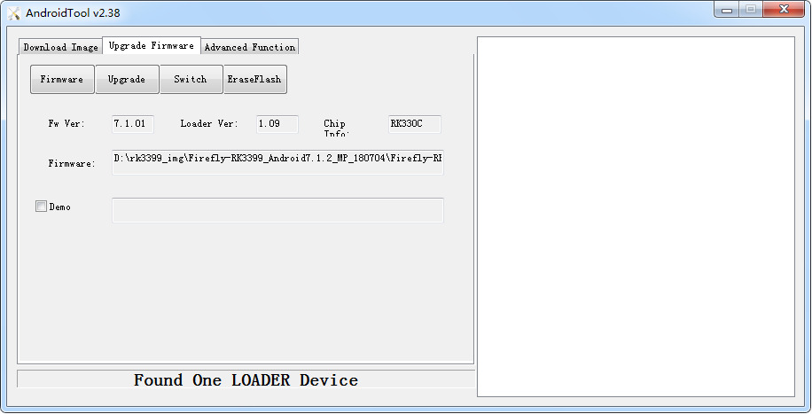

# USB升级固件

## 前言

本文介绍了如何将主机上的固件，通过 双公头USB数据线烧录到 iCore-3568JQ 开发板的存储器中。升级时，需要根据主机操作系统和固件类型来选择合适的升级方式。

## 准备工具 [step]
- ITX-3568Q 开发板
- [固件](https://community.t-firefly.com/doc/download/163)
- 主机
- 良好的 双公头USB数据线

## 准备固件 [step]
固件可以通过编译 SDK 获得，也可以通过[资源下载](https://community.t-firefly.com/doc/download/163)处下载公版固件（统一固件）。固件文件一般有两种：

- 单个统一固件

    统一固件是由分区表、bootloader、uboot、kernel、system 等所有文件打包合并成的单个文件。Firefly 正式发布的固件都是采用统一固件格式，升级统一固件将会更新主板上所有分区的数据和分区表，并且擦除主板上所有数据。

- 多个分区镜像

    即各个功能独立的文件，如分区表、bootloader、kernel 等，在开发阶段生成。独立分区镜像可以只更新指定的分区，而保持其它分区数据不被破坏，在开发过程中会很方便调试。

> 通过统一固件解包/打包工具，可以把统一固件解包为多个分区镜像，也可以将多个分区镜像合并为一个统一固件。

## 安装烧写工具 [step]
<CodeBlockTabs defaultValue="Windows">
  <CodeBlockTabsList>
    <CodeBlockTabsTrigger value="Windows">Windows</CodeBlockTabsTrigger>
    <CodeBlockTabsTrigger value="Linux">Linux</CodeBlockTabsTrigger>
  </CodeBlockTabsList>

  <CodeBlockTab value="Windows">
    ### Windows操作系统
    - 安装 RK USB 驱动

    下载 [Release_DriverAssistant.zip](https://community.t-firefly.com/doc/download/163)，解压，然后运行里面的 DriverInstall.exe。为了所有设备都使用更新的驱动，请先选择 `驱动卸载`，然后再选择 `驱动安装`。
    <center>

    

    </center>


    - 运行 AndroidTool 的 RKDevTool.exe

    <Callout title="注意" type="warn">
      为避免由下载工具版本引起的烧写问题，推荐使用公版固件压缩包内部打包好的工具进行烧写
    </Callout>

    例如安卓公版固件压缩包解压后如下：
    ```shell
    XXXX_Android11_HDMI_XXXX
    ├── XXXX_Android11_HDMI_XXXX.img
    ├── linux
    │   └── Linux_Upgrade_Tool_v1.59.zip
    └── windows
        ├── DriverAssitant_v5.1.1.zip
        └── RKDevTool_Release_v2.81.zip
    ```
    也可以单独下载 [AndroidTool](https://community.t-firefly.com/doc/download/163)，解压，运行 `RKDevTool_Release_v2.xx` 目录里面的 `RKDevTool.exe`（注意，如果是 Windows 7/8，需要按鼠标右键，选择以管理员身份运行），如下图：

    <center>

    

    </center>
  </CodeBlockTab>

  <CodeBlockTab value="Linux">
    ### Linux操作系统
    Linux 下无须安装设备驱动
    - [Linux_Upgrade_Tool](https://community.t-firefly.com/doc/download/163) 工具

    下载 [Linux_Upgrade_Tool](https://community.t-firefly.com/doc/download/163)，并按以下方法安装到系统中，方便调用：

    ```bash
    unzip Linux_Upgrade_Tool_xxxx.zip
    cd Linux_UpgradeTool_xxxx
    sudo mv upgrade_tool /usr/local/bin
    sudo chown root:root /usr/local/bin/upgrade_tool
    sudo chmod a+x /usr/local/bin/upgrade_tool
    ```


    - [Linux_adb_fastboot](https://community.t-firefly.com/doc/download/163#other_615) 工具

    下载 [Linux_adb_fastboot](https://community.t-firefly.com/doc/download/163#other_615)，并按以下方法安装到系统中，方便调用：

    ```bash
    sudo mv adb /usr/local/bin
    sudo chown root:root /usr/local/bin/adb
    sudo chmod a+x /usr/local/bin/adb
    ```

    ```bash
    sudo mv fastboot /usr/local/bin
    sudo chown root:root /usr/local/bin/fastboot
    sudo chmod a+x /usr/local/bin/fastboot
    ```
  </CodeBlockTab>
</CodeBlockTabs>

## 进入升级模式 [step]
通常升级固件的模式有两种，分别是 Loader 模式和 MaskRom 模式。烧写固件前，需要连接好设备，并让板子进入到可升级模式。

<CodeBlockTabs defaultValue="loader">
  <CodeBlockTabsList>
    <CodeBlockTabsTrigger value="loader">loader</CodeBlockTabsTrigger>
    <CodeBlockTabsTrigger value="maskrom">maskrom</CodeBlockTabsTrigger>
  </CodeBlockTabsList>
  <CodeBlockTab value="loader">
    ### Loader模式
    #### 硬件方式进入Loader模式 [step]
    连接设备并通过 **RECOVERY** 按键进入 Loader 升级模式步骤如下：

- 先断开电源适配器连接
- 双公头 USB 数据线一端连接主机，一端连接开发板

<center>


</center>

- 按住设备上的 RECOVERY（恢复）键并保持

<center>


</center>

- 接上电源
- 大约两秒钟后，松开 RECOVERY 键

此时设备就会进入 Loader 模式。
    #### 软件方式进入Loader模式 [step]
    双公头USB数据线接好后在串口调试终端或 adb shell 给板子运行以下命令

    ```shell
    reboot loader
    ```

    #### 查看Loader模式 [step]
    如何确定板子是否进入 Loader 模式，可以通过工具去查看

    **Windows操作系统**

    通过 AndroidTool 工具可以看到下方提示 `Found One LOADER Device`
    <center>

    

    </center>

    如果有进行「进入 Loader 模式」的操作，仍旧没有看到烧写工具提示 LOADER，此时可以看一下 Windows 主机是否有提示发现新硬件并配置驱动。打开设备管理器，会见到新设备 `Rockusb Device` 出现，如下图。如果没有，可返回上一步重新 [安装驱动](03-upgrade_firmware.md#windows-cao-zuo-xi-tong)。

    <center>

    

    </center>

    **Linux操作系统**

    运行 upgrade_tool 后可以看到连接设备中有个 `Loader` 的提示

    ```shell
    firefly@T-chip:~/severdir/down_firmware$ sudo upgrade_tool
    List of rockusb connected
    DevNo=1 Vid=0x2207,Pid=0x330c,LocationID=106    Loader
    Found 1 rockusb,Select input DevNo,Rescan press <R>,Quit press <Q>:q
    ```

    <Callout title="说明" type="info">
      Loader 模式不写入 SPI/NOR Flash，无需切换存储器，直接按下方「烧写固件」章节升级即可。
    </Callout>
  </CodeBlockTab>

  <CodeBlockTab value="maskrom">
    ### MaskRom模式

`MaskRom` 模式是设备变砖的最后一条防线。强行进入 `MaskRom` 涉及硬件操作，有一定风险，因此仅在设备进入不了 `Loader` 模式的情况下，方可尝试 `MaskRom` 模式。进入 `MaskRom` 的原理是人为的把 EMMC 的数据脚与地线短接，系统会认为 EMMC 数据出错，从而清除 EMMC 数据。

<Callout title="警告" type="error">

请小心阅读，并谨慎操作！

</Callout>

#### 进入 MaskRom 模式的方式 [step]

操作步骤如下：


- 设备断开电源
- 使用 双公头USB数据线连接设备和电脑
- 用金属镊子接通 iCore-3568JQ 上的如下图所示的两个测试点并保持（如下图所示）
- 设备插入电源
- 稍候片刻，之后松开镊子


短接 EMMC 附近的 D0 和 GND 测试点。

<center>



</center>


#### 确认进入 MaskRom 模式 [step]

此时设备就会进入 MaskRom 模式。

<center>



</center>
    <a id="rk_upgrade_maskrom_nor_flash"></a>

    #### MaskRom 模式下的存储器选择 [step]

    当 ITX-3568Q **同时**贴有 NOR Flash (SPI Flash) 与 eMMC 两种存储器时，在 MaskRom 模式下烧写固件前，需要先确认固件写入的目标存储器。两种升级模式的默认写入目标如下：

    | 升级模式 | 固件默认写入 | 是否需要切换存储器 |
    | ---- | ---- | ---- |
    | Loader 模式 | eMMC | 无需切换，直接按「烧写固件」章节操作 |
    | MaskRom 模式 | NOR Flash | 烧写整包固件前需切换到 eMMC |

    板载 NOR Flash 存储器位置如下图：

    <center>

    

    </center>

    <Callout title="注意" type="warn">
      MaskRom 模式下固件默认写入 NOR Flash。NOR Flash 容量较小，不足以装载系统镜像，一般只适合烧写 `MiniLoaderAll.bin` 等较小的文件；直接烧写整包统一固件会因容量不足而烧写失败。烧写整包固件前，务必先按下方方法将存储器切换到 eMMC。
    </Callout>

<CodeBlockTabs defaultValue="firefly">
  <CodeBlockTabsList>
    <CodeBlockTabsTrigger value="firefly">Firefly 方法（推荐）</CodeBlockTabsTrigger>
    <CodeBlockTabsTrigger value="vendor">原厂方法</CodeBlockTabsTrigger>
  </CodeBlockTabsList>
  <CodeBlockTab value="firefly">
    烧写最新官方固件 / 最新 SDK 编译的固件，此方法无需切换存储器。在 MaskRom 模式下直接烧写整包固件，无论成功与否，设备断电或重启后，NOR Flash 中如有数据都会被自动擦除（约需 30~60 秒），完成后设备自动进入 Loader 模式，再按「烧写固件」章节烧写整包固件即可。
  </CodeBlockTab>
  <CodeBlockTab value="vendor">
    烧写 `MiniLoaderAll.bin` 并切换存储器到 eMMC，适用于手头没有最新固件的情况（`MiniLoaderAll.bin` 整个流程只需准备一次）：

    1. 准备 `MiniLoaderAll.bin`，一般存放在 SDK 的 `rockdev` 目录（Android SDK 为 `rockdev/Image-rk3568_firefly_itx_3568q/MiniLoaderAll.bin`，Linux SDK 为 `rockdev/MiniLoaderAll.bin`），也可从 [官方下载链接](https://www.t-firefly.com/share/index/index/id/4e86cc234c3b26e2b12084e383074ada.html) 获取对应 CPU 型号的文件。
    2. 切换到下载工具的 `Advanced Function` 页，加载并下载 `MiniLoaderAll.bin`。
    3. 点击 `List Storage` 读取存储器列表，选中 `SPINOR` 并点击 `EraseAll`，确保 NOR Flash 为空。
    4. 在存储列表中选中 `Emmc`，点击 `Switch Storage`，将固件目标存储器切换为 eMMC。
    5. 点击 `EraseAll` 擦除 eMMC。
    6. 切换到 `Upgrade Firmware` 页，选择整包固件进行升级。

    完成以上步骤后，固件目标存储器已切换为 eMMC，之后即可按「烧写固件」章节正常烧写整包固件。
  </CodeBlockTab>
</CodeBlockTabs>

    #### 烧写失败后的处理 [step]

    若不慎将整包固件直接写入 NOR Flash，烧写会因容量不足而失败，可按设备当前状态处理：

    | 设备当前状态 | 处理方法 |
    | ---- | ---- |
    | 未断电、未重启 | 直接点击下载工具的 `EraseFlash` 擦除 NOR Flash，再按上述方法二切换到 eMMC 后重新烧写 |
    | 已断电或已重启 | 通过 Recovery 按键进入 Loader 模式，点击 AndroidTool 的 `Go maskrom` 重新进入 MaskRom 模式，再按上述方法二切换到 eMMC 后重新烧写 |
    | 点击 `Go maskrom` 无法进入 MaskRom | 部分旧固件不支持从 NOR Flash 的 bootloader 返回 MaskRom，此时通过 Recovery 按键重新进入 Loader 模式，点击 `EraseFlash` 擦除后重启板子，即可进入 MaskRom 模式 |

    <Callout title="提示" type="info">
      若已连接串口调试终端，可在启动到 NOR Flash 的 U-Boot 命令行（串口 log 显示 `Bootdev(atags): mtd 2`）中执行 `mtd erase nor0` 擦除 NOR Flash 后 `reboot`，或执行 `rbrom` 返回 MaskRom 模式，再按上述方法处理。
    </Callout>

  </CodeBlockTab>
</CodeBlockTabs>

## 烧写固件 [step]
<CodeBlockTabs defaultValue="Windows">
  <CodeBlockTabsList>
    <CodeBlockTabsTrigger value="Windows">Windows</CodeBlockTabsTrigger>
    <CodeBlockTabsTrigger value="Linux">Linux</CodeBlockTabsTrigger>
  </CodeBlockTabsList>

  <CodeBlockTab value="Windows">
    ### windows操作系统

    #### 烧写统一固件 update.img

    烧写统一固件 update.img 的步骤如下：

    1. 切换至 `Upgrade Firmware` 页。
    2. 按 `Firmware` 按钮，打开要升级的固件文件。升级工具会显示详细的固件信息。
    3. 按 `Upgrade` 按钮开始升级。
    4. 如果升级失败，可以尝试先按 `EraseFlash` 按钮来擦除 Flash，然后再升级。板载 Nor Flash 的设备请参考 [MaskRom 模式下的存储器选择](03-upgrade_firmware.md#rk_upgrade_maskrom_nor_flash)。
    <center>

    

    </center>
  </CodeBlockTab>

  <CodeBlockTab value="Linux">

    ### Linux操作系统
    #### 烧写统一固件 update.img

    ```bash
    sudo upgrade_tool uf update.img
    ```

    <Callout title="注意" type="warn">
      如果升级失败，可以尝试先擦除后再升级。
    </Callout>

    ```bash
    # 擦除 flash 使用 ef 参数需要指定 loader 文件或者对应的 update.img
    sudo upgrade_tool ef update.img   #update.img :你需要烧写的 Ubuntu 固件
    # 重新烧写
    sudo upgrade_tool uf update.img
    ```

    如果因固件被写入 Nor Flash 导致整包烧写失败，请参考 [MaskRom 模式下的存储器选择](03-upgrade_firmware.md#rk_upgrade_maskrom_nor_flash)章节切换升级存储器。
  </CodeBlockTab>
</CodeBlockTabs>