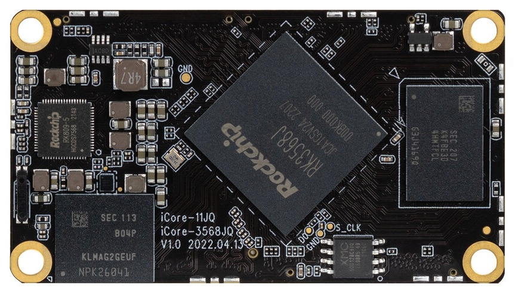
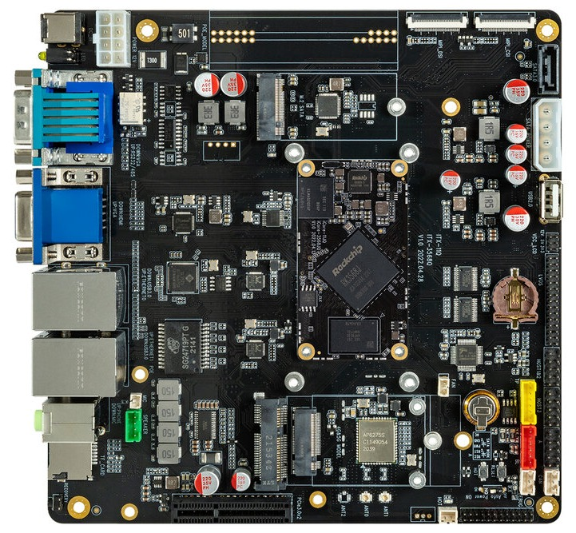
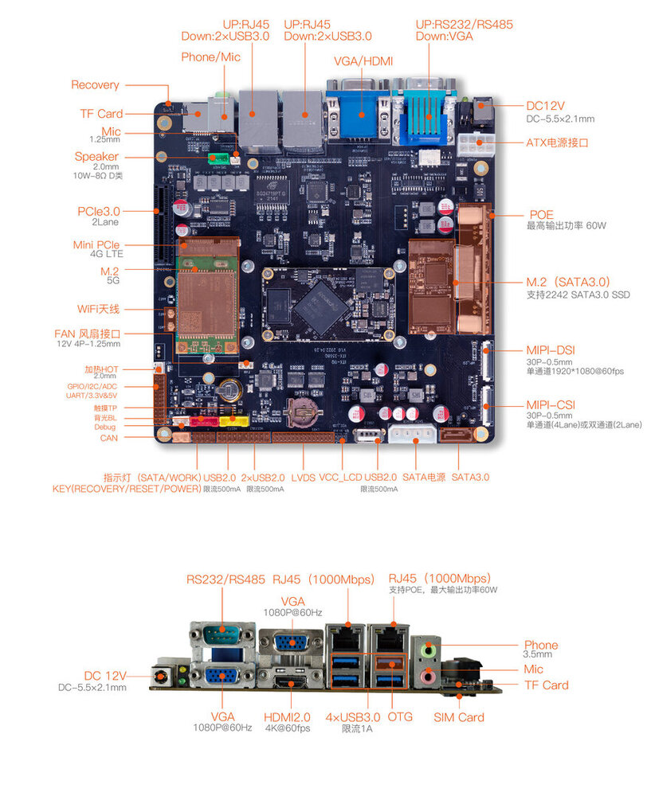

# 简介

[规格书](https://download.t-firefly.com/%E4%BA%A7%E5%93%81%E8%A7%84%E6%A0%BC%E6%96%87%E6%A1%A3/%E6%A0%B8%E5%BF%83%E6%9D%BF/iCore-3568Q%E5%9B%9B%E6%A0%B8%E5%B7%A5%E4%B8%9A%E6%A0%B8%E5%BF%83%E6%9D%BF%20-%20%E8%A7%84%E6%A0%BC%E4%B9%A6.pdf) | [下载资料](https://community.t-firefly.com/doc/download/163)

[iCore-3568JQ]()板载 RK3568J 四核 64 位工业级处理器，支持 8GB 大内存；支持 WiFi6，5G/4G 等高速无线网络通讯；采用了 BTB 接口，传输能力更强；拥有工业级的稳定性，在 -40°C 至 85°C 工作温度下可长时间稳定运行；提供底板参考设计资料，用户可自主深度化定制

[ITX-3568Q]()开发板由核心板 iCore-3568JQ 加底板组成，标准 ITX 主板尺寸，标准的接口规范，可适配通用的 ITX 电脑机箱。提供丰富的拓展接口，让用户在创造时能有更大的想象空间

## 接口描述

ITX-3568Q 提供了丰富的接口，主要包括：

- 12V 电源接口
- 4 x USB3.0（OTG×1，HOST×3）
- 4 x USB2.0（接口×1，座子×3）
- HDMI
- VGA
- MIPI 屏幕接口
- LVDS 屏接口
- 以太网
- MIC 接口
- 3.5mm 耳机接口
- TF 卡槽
- SIM 卡槽
- SATA 3.0 接口
- 风扇接口
- 喇叭接口
- Power 按键（座子）
- Reset 按键
- Recovery 按键
- 调试串口
- 工业级串口（RS485，RS232，TTL）
- 扩展口（ADC，I2C，GPIO）
- MIPI 摄像头接口
- MINI-PCIE（4G LTE）
- M.2（5G LTE）
- PCIe 3.0 接口
- M.2 SATA 3.0 接口
- CAN/CANFD

整机接口分布如下图：

## 资源与技术支持

- [技术交流论坛](https://forum.t-firefly.com/)：超过 10 万企业客户和用户沟通交流平台

### 联系方式

- 邮箱：sales@t-firefly.com
- 手机：(+86) 186 8811 7175
- 座机：0760-89881218
- 地址：广东省中山市东区中山四路 57 号宏宇大厦 2101 室
