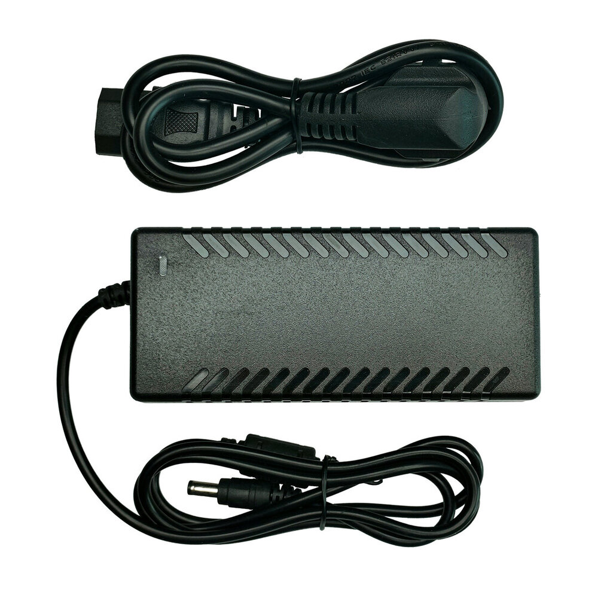
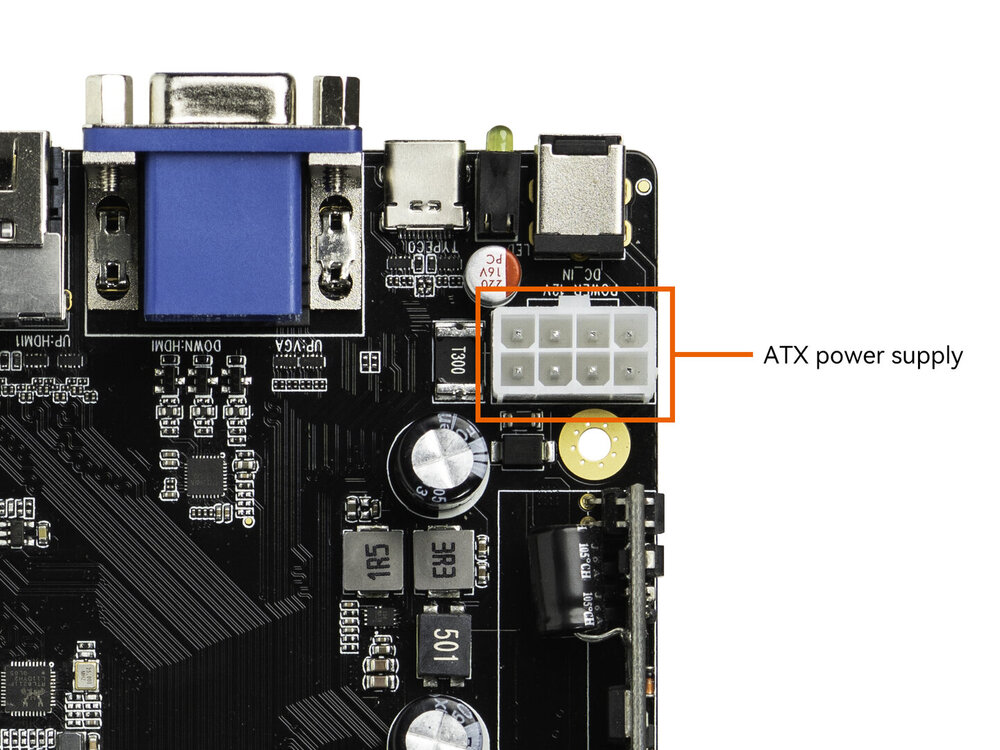
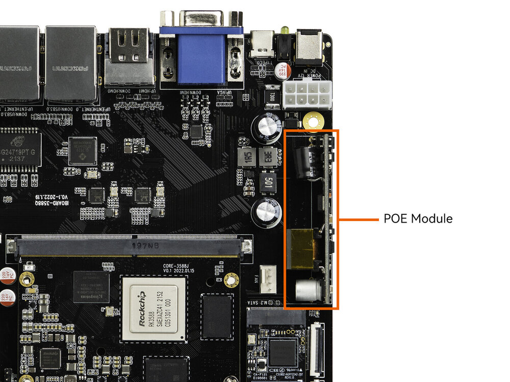

# 配件与模组

**Core-3588J** 可搭配以下配件与模组使用，点击对应链接查看详细资料。具体支持情况请以实际机型为准。

<CodeBlockTabs defaultValue="camera">
  <CodeBlockTabsList>
    <CodeBlockTabsTrigger value="camera">摄像头模组</CodeBlockTabsTrigger>
    <CodeBlockTabsTrigger value="display">显示屏模组</CodeBlockTabsTrigger>
  </CodeBlockTabsList>

  <CodeBlockTab value="camera">
## 摄像头模组 [step]

Firefly 提供 MIPI 接口摄像头模组，满足图像采集与 AI 视觉应用需求。下表按平台分组，汇总各板型当前 SDK 已完成驱动适配/调试的摄像头（以传感器型号列出）：

> 表中 `√` 仅表示当前 SDK 设备树下的驱动已适配、调试通过，**并不代表 IQ（图像质量）已调好**。自动曝光、白平衡、降噪等实际成像效果取决于对应的 ISP/IQ 配置，需结合对应 SDK 确认。
>
> 以下均以 Linux 系统为主，Android 系统需结合实际 SDK 的设备树配置来确认。
>
> `—` 表示 SDK 暂未完成适配验证，不一定代表硬件不兼容。

在售摄像头仅以下三款，传感器与产品的对应关系如下：

- IMX415 → [800W CAM-8MS1M(IMX415)](../../配件/IMX415/started.md)
- XC7160 → [800W 单目摄像头 CAM-8MS1M](../../配件/CAM-8MS1M/started.md)
- gc2053/gc2093 → [200W 双目摄像头 CAM-2MS2MF](../../配件/CAM-2MS2MF/started.md)

其他传感器/摄像头仅完成适配说明，Firefly 并不售卖；如需采购，请自行寻找摄像头及对应排线。

<CodeBlockTabs defaultValue="rk3588">  <CodeBlockTabsList>
    <CodeBlockTabsTrigger value="rk3588">RK3588</CodeBlockTabsTrigger>
    <CodeBlockTabsTrigger value="rk3576">RK3576</CodeBlockTabsTrigger>
    <CodeBlockTabsTrigger value="rk356x">RK356X</CodeBlockTabsTrigger>
    <CodeBlockTabsTrigger value="rk3506">RK3506</CodeBlockTabsTrigger>
    <CodeBlockTabsTrigger value="rv1126">RV1126</CodeBlockTabsTrigger>
    <CodeBlockTabsTrigger value="rv1126b">RV1126B</CodeBlockTabsTrigger>
    <CodeBlockTabsTrigger value="k3">K3</CodeBlockTabsTrigger>
  </CodeBlockTabsList>

  <CodeBlockTab value="rk3588">

**RK3588**

| 板型 | [IMX415](../../配件/IMX415/started.md) | IMX586 | [XC7160](../../配件/CAM-8MS1M/started.md) | SC3336 | IMX335 | OS04A10 | [gc2053/gc2093](../../配件/CAM-2MS2MF/started.md) |
| ---- | ---- | ---- | ---- | ---- | ---- | ---- | ---- |
| AIO-3588Q | √ | √ | √ | — | — | — | — |
| ITX-3588 | √ | √ | √ | — | — | — | — |
| AIO-3588L | √ | √ | √ | — | — | — | — |
| AIO-3588JD4 | √ | — | — | — | — | — | — |
| AIO-3588SG | √ | — | √ | — | — | — | — |
| AIO-3588SJD4-AI | √ | — | — | — | — | — | — |
| AIO-3588SJD4 | √ | — | √ | — | — | — | — |
| ROC-3588S-PC | √ | √ | √ | — | — | — | √ |

  </CodeBlockTab>

  <CodeBlockTab value="rk3576">

**RK3576**

| 板型 | [IMX415](../../配件/IMX415/started.md) | IMX586 | [XC7160](../../配件/CAM-8MS1M/started.md) | SC3336 | IMX335 | OS04A10 | [gc2053/gc2093](../../配件/CAM-2MS2MF/started.md) |
| ---- | ---- | ---- | ---- | ---- | ---- | ---- | ---- |
| AIO-3576C | √ | — | √ | — | — | — | — |
| AIO-3576JD4 | √ | — | √ | — | — | — | — |
| AIO-3576Q | √ | — | √ | — | — | — | — |
| AIO-3576Q38 | √ | √ | √ | — | — | — | — |
| EXT-ICORE-3576Q38 | √ | — | √ | √ | √ | — | — |
| ROC-RK3576-PC | √ | — | √ | — | — | — | — |

  </CodeBlockTab>

  <CodeBlockTab value="rk356x">

**RK356X**

| 板型 | [IMX415](../../配件/IMX415/started.md) | IMX586 | [XC7160](../../配件/CAM-8MS1M/started.md) | SC3336 | IMX335 | OS04A10 | [gc2053/gc2093](../../配件/CAM-2MS2MF/started.md) |
| ---- | ---- | ---- | ---- | ---- | ---- | ---- | ---- |
| AIO-3566JD4 | √ | — | √ | — | — | — | √ |
| ROC-RK3566-PC | √ | — | √ | — | — | — | √ |
| AIO-3568J | √ | — | √ | — | — | — | √ |
| ITX-3568Q | √ | — | √ | — | — | — | √ |
| ROC-RK3568-PC-SE | √ | — | √ | — | — | — | √ |

  </CodeBlockTab>

  <CodeBlockTab value="rk3506">

**RK3506**

该平台暂无已确认适配的摄像头传感器。

| 板型 | [IMX415](../../配件/IMX415/started.md) | IMX586 | [XC7160](../../配件/CAM-8MS1M/started.md) | SC3336 | IMX335 | OS04A10 | [gc2053/gc2093](../../配件/CAM-2MS2MF/started.md) |
| ---- | ---- | ---- | ---- | ---- | ---- | ---- | ---- |
| ROC-RK3506-PC | — | — | — | — | — | — | — |

  </CodeBlockTab>

  <CodeBlockTab value="rv1126">

**RV1126**

| 板型 | [IMX415](../../配件/IMX415/started.md) | IMX586 | [XC7160](../../配件/CAM-8MS1M/started.md) | SC3336 | IMX335 | OS04A10 | [gc2053/gc2093](../../配件/CAM-2MS2MF/started.md) |
| ---- | ---- | ---- | ---- | ---- | ---- | ---- | ---- |
| CAM-C1126S2U | — | — | — | — | — | — | √ |
| C40PL | — | — | — | — | — | √ | — |

  </CodeBlockTab>

  <CodeBlockTab value="rv1126b">

**RV1126B**

| 板型 | [IMX415](../../配件/IMX415/started.md) | IMX586 | [XC7160](../../配件/CAM-8MS1M/started.md) | SC3336 | IMX335 | OS04A10 | [gc2053/gc2093](../../配件/CAM-2MS2MF/started.md) |
| ---- | ---- | ---- | ---- | ---- | ---- | ---- | ---- |
| AIO-1126BJD4 | √ | √ | √ | — | — | √ | — |
| AIO-1126BQ38 | √ | √ | √ | — | — | √ | — |
| CAM-1126BQ38 | √ | — | — | √ | √ | — | — |
| AIO-1126BJD4V0 | √ | — | — | — | — | √ | — |
| AIO-1126BJD4V0（旧底板） | √ | — | — | — | — | √ | — |

  </CodeBlockTab>

  <CodeBlockTab value="k3">

**K3**

| 板型 | [IMX415](../../配件/IMX415/started.md) | IMX586 | [XC7160](../../配件/CAM-8MS1M/started.md) | SC3336 | IMX335 | OS04A10 | [gc2053/gc2093](../../配件/CAM-2MS2MF/started.md) |
| ---- | ---- | ---- | ---- | ---- | ---- | ---- | ---- |
| CORE-K3JD4 | — | — | — | — | — | — | — |
| ITX-K3L | √ | — | — | — | — | — | — |
| AIBOX-K3 | — | — | — | — | — | — | — |

  </CodeBlockTab>
</CodeBlockTabs>
  </CodeBlockTab>

  <CodeBlockTab value="display">
## 显示屏模组 [step]

Firefly 适配了以下显示屏，其中仅 **DM-M10R800-V3S**（10.1寸 800×1280 MIPI 屏）在售；表中其他列对应的屏幕均未售卖，仅提供对应的设备树（DTS）配置作为参考，需要时请自行准备屏幕。

> 以下均以 Linux 系统为主，Android 系统需结合实际 SDK 的设备树配置来确认。
>
> 表中 `√` 表示当前 SDK 设备树已完成适配调试验证；`—` 表示 SDK 暂未完成适配验证，不一定代表硬件不兼容。

已适配屏幕型号：

- **DM-M10R800-V3S**：10.1寸 / 800×1280 / MIPI，在售
- NE156QUM-N66：15.6寸 / 4K / EDP，未售卖（仅作 DTS 参考）
- 156FHM-T06：15.6寸 / 1080P / EDP，未售卖（仅作 DTS 参考）
- 10.1寸 1080P 双通道 LVDS 屏：未售卖（仅作 DTS 参考）
- 10.1寸 800×1280 单通道 LVDS 屏：未售卖（仅作 DTS 参考）

<CodeBlockTabs defaultValue="rk3588">  <CodeBlockTabsList>
    <CodeBlockTabsTrigger value="rk3588">RK3588</CodeBlockTabsTrigger>
    <CodeBlockTabsTrigger value="rk3576">RK3576</CodeBlockTabsTrigger>
    <CodeBlockTabsTrigger value="rk356x">RK356X</CodeBlockTabsTrigger>
    <CodeBlockTabsTrigger value="rk3506">RK3506</CodeBlockTabsTrigger>
    <CodeBlockTabsTrigger value="rv1126">RV1126</CodeBlockTabsTrigger>
    <CodeBlockTabsTrigger value="rv1126b">RV1126B</CodeBlockTabsTrigger>
    <CodeBlockTabsTrigger value="k3">K3</CodeBlockTabsTrigger>
  </CodeBlockTabsList>

  <CodeBlockTab value="rk3588">

**RK3588**

| 板型 | [10.1寸 800×1280 MIPI](../../配件/DM-M10R800-V3S/started.md) | 15.6寸 4K EDP | 15.6寸 1080P EDP | 10.1寸 1080P LVDS | 10.1寸 800×1280 LVDS |
| ---- | ---- | ---- | ---- | ---- | ---- |
| AIO-3588Q | √ | — | √ | — | — |
| ITX-3588 | √ | — | — | — | — |
| AIO-3588L | √ | — | — | — | — |
| AIO-3588JD4 | — | — | — | — | — |
| AIO-3588SG | √ | √ | — | — | — |
| AIO-3588SJD4-AI | — | — | — | — | — |
| AIO-3588SJD4 | √ | — | — | — | — |
| ROC-3588S-PC | √ | — | — | — | — |

  </CodeBlockTab>

  <CodeBlockTab value="rk3576">

**RK3576**

| 板型 | [10.1寸 800×1280 MIPI](../../配件/DM-M10R800-V3S/started.md) | 15.6寸 4K EDP | 15.6寸 1080P EDP | 10.1寸 1080P LVDS | 10.1寸 800×1280 LVDS |
| ---- | ---- | ---- | ---- | ---- | ---- |
| AIO-3576C | √ | √ | — | √ | √ |
| AIO-3576JD4 | — | — | — | — | — |
| AIO-3576Q | √ | — | — | — | — |
| AIO-3576Q38 | — | — | — | — | — |
| EXT-ICORE-3576Q38 | √ | — | — | — | — |
| ROC-RK3576-PC | √ | — | — | — | — |

  </CodeBlockTab>

  <CodeBlockTab value="rk356x">

**RK356X**

| 板型 | [10.1寸 800×1280 MIPI](../../配件/DM-M10R800-V3S/started.md) | 15.6寸 4K EDP | 15.6寸 1080P EDP | 10.1寸 1080P LVDS | 10.1寸 800×1280 LVDS |
| ---- | ---- | ---- | ---- | ---- | ---- |
| AIO-3566JD4 | √ | — | √ | — | — |
| ROC-RK3566-PC | √ | — | — | — | — |
| AIO-3568J | √ | — | √ | — | — |
| ITX-3568Q | √ | — | — | — | √ |
| ROC-RK3568-PC-SE | √ | — | √ | — | — |

  </CodeBlockTab>

  <CodeBlockTab value="rk3506">

**RK3506**

| 板型 | [10.1寸 800×1280 MIPI](../../配件/DM-M10R800-V3S/started.md) | 15.6寸 4K EDP | 15.6寸 1080P EDP | 10.1寸 1080P LVDS | 10.1寸 800×1280 LVDS |
| ---- | ---- | ---- | ---- | ---- | ---- |
| ROC-RK3506-PC | √ | — | — | — | — |

  </CodeBlockTab>

  <CodeBlockTab value="rv1126">

**RV1126**

| 板型 | [10.1寸 800×1280 MIPI](../../配件/DM-M10R800-V3S/started.md) | 15.6寸 4K EDP | 15.6寸 1080P EDP | 10.1寸 1080P LVDS | 10.1寸 800×1280 LVDS |
| ---- | ---- | ---- | ---- | ---- | ---- |
| CAM-C1126S2U | √ | — | — | — | — |
| C40PL | √ | — | — | — | — |

  </CodeBlockTab>

  <CodeBlockTab value="rv1126b">

**RV1126B**

| 板型 | [10.1寸 800×1280 MIPI](../../配件/DM-M10R800-V3S/started.md) | 15.6寸 4K EDP | 15.6寸 1080P EDP | 10.1寸 1080P LVDS | 10.1寸 800×1280 LVDS |
| ---- | ---- | ---- | ---- | ---- | ---- |
| AIO-1126BJD4 | √ | — | — | — | — |
| AIO-1126BQ38 | √ | — | — | — | — |
| CAM-1126BQ38 | — | — | — | — | — |
| AIO-1126BJD4V0 | √ | — | — | — | — |
| AIO-1126BJD4V0（旧底板） | √ | — | — | — | — |

  </CodeBlockTab>

  <CodeBlockTab value="k3">

**K3**

| 板型 | [10.1寸 800×1280 MIPI](../../配件/DM-M10R800-V3S/started.md) | 15.6寸 4K EDP | 15.6寸 1080P EDP | 10.1寸 1080P LVDS | 10.1寸 800×1280 LVDS |
| ---- | ---- | ---- | ---- | ---- | ---- |
| CORE-K3JD4 | — | — | — | — | — |
| ITX-K3L | √ | — | — | — | — |
| AIBOX-K3 | — | — | — | — | — |

  </CodeBlockTab>
</CodeBlockTabs>
  </CodeBlockTab>
</CodeBlockTabs>

## 电源适配器

推荐使用以下电源适配器为设备供电：

# 电源适配器

## 产品参数

* 产品：电源适配器
* 型号：HHT108A-120700
* 输入标准：AC100-240V1.8A 50/60Hz
* 输出标准：DC12V-7A

**注意：** ITX-3588J  一体机正常工作需要电源 12V/7A，电流低于 7A 可能会因电流过小而异常重启，为了保证开发板的正常工作，请使用电压为 12V，电流为 7A 的电源，推荐使用 Firefly 官网电源配件。

## 实物图

## 其他供电方式
ITX-3588J  除了使用 12V电源适配器，还可以选择 ATX 电源接口 或 POE(最高输出功率 60w) 供电源输入, 接口图：

