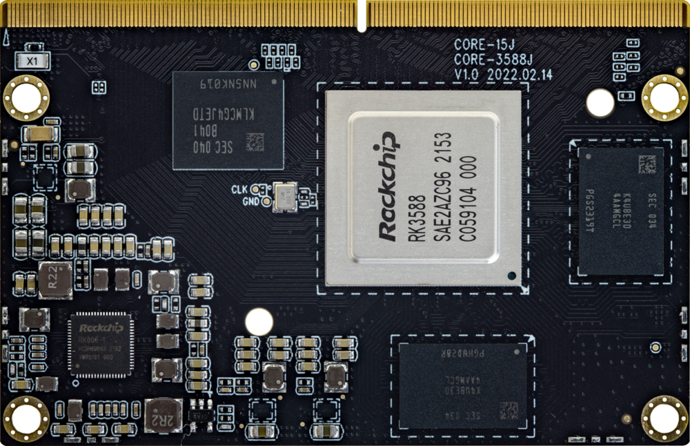
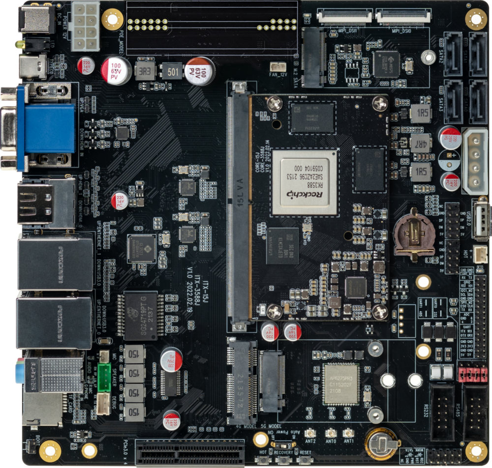
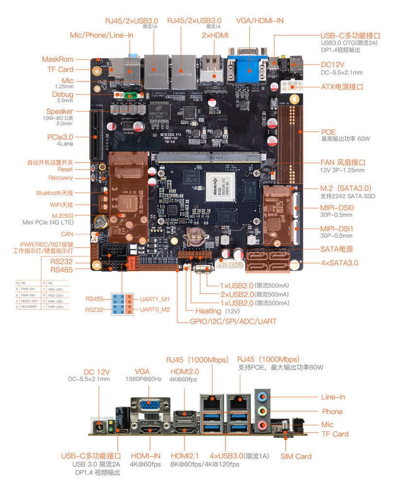
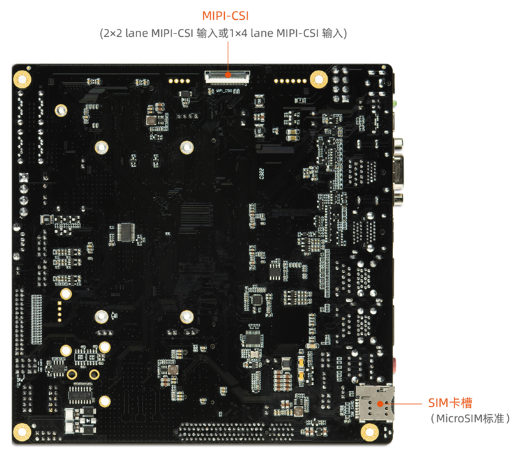

[规格书](https://download.t-firefly.com/%E4%BA%A7%E5%93%81%E8%A7%84%E6%A0%BC%E6%96%87%E6%A1%A3/%E8%A1%8C%E4%B8%9A%E4%B8%BB%E6%9D%BF/ITX-3588J-8K%E4%BA%BA%E5%B7%A5%E6%99%BA%E8%83%BDITX%E6%A0%87%E5%87%86%E4%B8%BB%E6%9D%BF-%E8%A7%84%E6%A0%BC%E4%B9%A6.pdf) | [购买链接](https://item.taobao.com/item.htm?spm=a1z10.5-c-s.w4002-24436957620.52.11cd3b98ZiOzNs&id=670192393983) | [下载资料](https://community.t-firefly.com/doc/download/161)

# 简介

**Core-3588J** 基于 Rockchip 全新一代旗舰 AIoT 芯片 -- **RK3588**，采用了 8nm LP 制程；搭载八核（Cortex-A76 x 4 + Cortex-A55 x 4）64位 CPU，主频高达2.4 GHz。  

集成 ARM Mali-G610 MP4 四核 GPU，内置 AI 加速器 NPU，可提供6 Tops 算力，支持主流的深度学习框架；最大支持32 GB 大内存；支持 WiFi6，5G/4G 等高速无线网络通讯；支持 8K 视频编解码和多种格式的视频输入输出；支持多
种操作系统；可适用于 ARM PC、边缘计算、云服务器、智能NVR 等领域。

      

[ITX-3588J](https://item.taobao.com/item.htm?id=670519903322) 开发板由核心板 Core-3588J + 底板 MB-JM3-RK3588ITX 组成,。ITX-3588J 拥有 RGMII、SATA3.0、CAN、PCIE3.0、USB3.0、I2C、SPI、UART、GPIO、MIPI-DSI 以及 MIPI-CSI 等丰富接口，提供多种的供电方式。可直接应用到各种智能产品中，加速产品落地，详细内容可参考下方接口描述。
  

  
### ITX-3588J 标准套装包含以下配件(仅供参考)：
* Core-3588J 核心板 x 1
*  12V/7A 电源适配器 x 1
* MB-JM3-RK3588ITX 底板 x 1
* 铜管天线 x 2
* Type-C 数据线 x 1

另外可以选购的配件有：

* Firefly 串口模块

另外，在使用过程中，你可能需要以下配件：

*    显示设备
     * 带 HDMI 接口的显示器或电视，及 HDMI 连接线
*    网络
     *   100M/1000M 以太网线缆，及有线路由器
     *   WiFi 路由器
*    输入设备
     *   USB 无线/有线的鼠标/键盘
*    升级固件，调试
     *   Type-C 数据线
     *   串口转 USB 适配器

## 接口描述

**ITX-3588J  V1.3** 提供了丰富的接口，主要包括：

* 1 x HDMI2.1（最大支持 8K@60Hz 输出）
* 1 x HDMI2.0
* 1 x HDMIIN2.0（最大支持 4K@60Hz 输入）
* 1 x Display Port1.4（最大支持 8K@30Hz 输出）
* 1 x USB3.0 OTG(Type-C)
* 1 x VGA
* 2 x MIPI-DSI
* 1 x MIPI-CSI
* 4 x SATA3.0
* 1 x M.2(SATA3.0)
* 1 x PCIe3.0x4
* 1 x TF Card
* 1 x 4G LTE
* 1 x 5G 移动网络
* 1 x SIM 卡槽
* 4 x USB3.0
* 4 x USB2.0
* 1 x WIFI（支持 wifi6）
* 1 x Bluetooth
* 1 x FAN（V1.1版本及后续版本为4 PIN，通过PWM控制和ADC检测接入）
* 2 x RJ45（支持 1Gbps）
* 1 x Speaker
* 1 x Line-In
* 1 x RS485
* 1 x RS232
* 1 x CAN（V1.1版本新增,V1.1版本H与L标反,V1.2及后续版本丝印正确）
* 多种电源输入接口

具体如下图：

[ITX-3588J  旧版本接口定义](../interface_definition_old.md)

## 资源与技术支持

* [[技术交流论坛]](https://forum.t-firefly.com/)：超过10万企业客户和用户沟通交流平台

### 联系方式

* 邮箱：sales@t-firefly.com
* 手机：(+86) 186 8811 7175
* 座机：0760-89881218
* 地址：广东省中山市东区中山四路 57 号宏宇大厦 2101 室