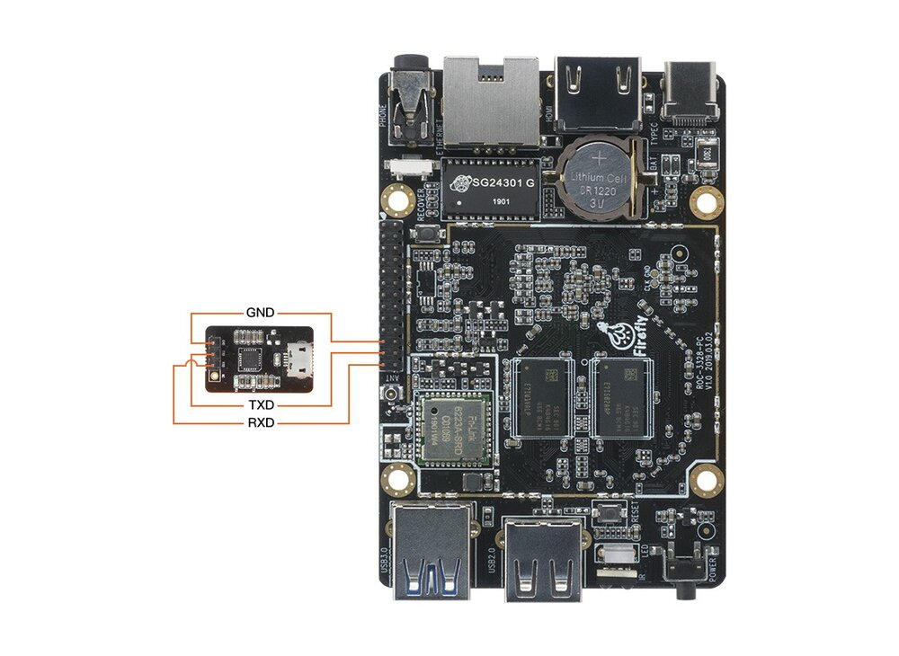
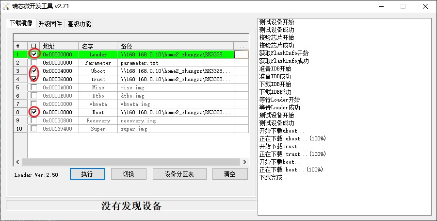

# Debug 使用

如果正在进行 U-Boot 或内核开发，USB 串口适配器（USB 转串口 TTL 适配器的简称）对于检查系统启动日志非常有用，特别是在没有图形桌面显示的情况下。

## 硬件连接 [step]

<Callout title="注意" type="warn">

由于用于串口调试的 UART2 与蓝牙所使用的串口复用，ROC-RK3328-PC 官方发布的固件无法直接使用串口调试；如果使用串口调试，蓝牙就无法正常使用，需要按下文「配置串口调试」的方法修改固件。

</Callout>

串口转 USB 适配器，有四个引脚：

- 3.3V 电源（NC），不需要连接
- GND，串口的地线，接开发板串口的 GND 针
- TXD，串口的输出线，接开发板串口的 TX 针
- RXD，串口的输入线，接开发板串口的 RX 针

<Callout title="注意" type="warn">

如使用其它串口适配器遇到 TX 和 RX 不能输入和输出的问题，可以尝试对调 TX 和 RX 的连接。

</Callout>

ROC-RK3328-PC 串口连接图：

<center>



</center>

### 配置串口调试

#### Linux 固件

配置串口调试前，首先需要[《编译 Linux 固件》],然后请进行如下修改：

打开配置文件 `kernel/arch/arm64/boot/dts/rockchip/rk3328-roc-pc.dts`。

串口调试的相关配置节点：

```
fiq-debugger {
	status = "disabled";
};
...

&uart2 {
	dma-names = "tx", "rx";
	status = "okay";
};
```

修改为：

```
fiq-debugger {
	status = "okay";
};
...

&uart2 {
	dma-names = "tx", "rx";
	status = "disabled";
};
```

编译内核，然后下载固件。

#### Android 7.1 固件

配置串口调试前，首先需要[《编译 Android 固件》],然后请进行如下修改：

打开配置文件 `kernel/arch/arm64/boot/dts/rk3328-roc-pc-port.dtsi`。

串口调试的相关配置节点：

```
fiq-debugger {
	status = "disabled";
};
...
&uart_dbg {
	status = "okay";
	dma-names = "tx","rx";
};
```

修改为：

```
fiq-debugger {
	status = "okay";
};
...
&uart_dbg {
	status = "disabled";
	dma-names = "tx","rx";
};
```

编译内核，然后下载固件。

#### Android 10.0 固件

U-Boot 修改：

```
diff --git a/u-boot/configs/rk3328_defconfig b/u-boot/configs/rk3328_defconfig
index 9e9b7544c1..ae66c2b36d 100644
--- a/u-boot/configs/rk3328_defconfig
+++ b/u-boot/configs/rk3328_defconfig
@@ -19,7 +19,6 @@ CONFIG_FIT=y
 CONFIG_FIT_VERBOSE=y
 CONFIG_SPL_LOAD_FIT=y
 CONFIG_BOOTDELAY=0
-CONFIG_DISABLE_CONSOLE=y
 CONFIG_SYS_CONSOLE_INFO_QUIET=y
 # CONFIG_DISPLAY_CPUINFO is not set
 CONFIG_ANDROID_BOOTLOADER=y
```

```
cp rkbin/bin/rk33/rk3328_ddr_333MHz_v1.16_uart2_debug.bin rkbin/bin/rk33/rk3328_ddr_333MHz_v1.16.bin
cd u-boot
./make.sh rk3328
```

内核修改：

```
diff --git a/kernel/arch/arm64/boot/dts/rockchip/roc-rk3328-pc.dtsi b/kernel/arch/arm64/boot/dts/rockchip/roc-rk3328-pc.dtsi
index af29607..d5b9a86 100644
--- a/kernel/arch/arm64/boot/dts/rockchip/roc-rk3328-pc.dtsi
+++ b/kernel/arch/arm64/boot/dts/rockchip/roc-rk3328-pc.dtsi
@@ -176,7 +176,7 @@

 #define UART2_BLUETOOTH 0
 #define UART2_DEBUG 1
-#define UART2_FUNCTION UART2_BLUETOOTH
+#define UART2_FUNCTION UART2_DEBUG
```

```
cd kernel
make ARCH=arm64 BOOT_IMG=../rockdev/Image-roc_rk3328_pc_32/boot.img roc-rk3328-pc.img -j24
```

最后烧录 uboot 目录下的 **rk3328_loader_v1.16.250.bin**、**uboot.img**、**trust.img** 与 kernel 目录下的 **boot.img** 即可：

<center>



</center>

另外当配置调试串口输出时，会有大量关于蓝牙的打印：

```
[  178.375793] init: Service 'vendor.bluetooth-1-0' (pid 5490) received signal 11
[  178.375865] init: Sending signal 9 to service 'vendor.bluetooth-1-0' (pid 5490) process group...
[  178.376177] libprocessgroup: Successfully killed process cgroup uid 1002 pid 5490 in 0ms
[  178.376448] init: updatable process 'vendor.bluetooth-1-0' exited 4 times in 4 minutes
[  178.376699] init: Init cannot set 'ro.init.updatable_crashing_process_name' to 'vendor.bluetooth-1-0': Read-only property was already set
[  178.376839] init: Init cannot set 'ro.init.updatable_crashing' to '1': Read-only property was already set
[  178.377832] binder: release 5490:5490 transaction 55248 in, still active
[  178.377853] binder: send failed reply for transaction 55248 to 5573:5612
[  178.950182] audit: audit_lost=511 audit_rate_limit=5 audit_backlog_limit=64
[  178.950212] audit: rate limit exceeded
[  180.540002] binder: undelivered death notification, 00000000d4b533c0
[  181.805281] audit: audit_lost=515 audit_rate_limit=5 audit_backlog_limit=64
[  181.805305] audit: rate limit exceeded
```

如果觉得这些打印太繁琐，可以直接关闭蓝牙功能，然后编译 Android 上层。

上层修改：

```
--- a/device/rockchip/common/BoardConfig.mk
+++ b/device/rockchip/common/BoardConfig.mk
@@ -402,8 +402,8 @@ BOARD_TEMPERATURE_SENSOR_SUPPORT ?= false
 BOARD_USB_HOST_SUPPORT ?= false
 BOARD_USB_ACCESSORY_SUPPORT ?= true
 BOARD_CAMERA_SUPPORT ?= false
-BOARD_BLUETOOTH_SUPPORT ?= true
-BOARD_BLUETOOTH_LE_SUPPORT ?= true
+BOARD_BLUETOOTH_SUPPORT ?= false
+BOARD_BLUETOOTH_LE_SUPPORT ?= false
```

```
./FFTools/make.sh -a -j8
```

最后烧写 **super.img** 即可。


## 串口参数配置 [step]

ROC-RK3328-PC 使用以下串口参数：

- 波特率：1500000
- 数据位：8
- 停止位：1
- 奇偶校验：无
- 流控：无

## 使用方法 [step]

<CodeBlockTabs defaultValue="Windows">
  <CodeBlockTabsList>
    <CodeBlockTabsTrigger value="Windows">Windows</CodeBlockTabsTrigger>
    <CodeBlockTabsTrigger value="Ubuntu">Ubuntu</CodeBlockTabsTrigger>
  </CodeBlockTabsList>

  <CodeBlockTab value="Windows">

    ### 安装驱动

    下载驱动并安装：

    - [CH340](https://www.wch.cn/downloads/CH341SER_EXE.html)
    - [PL2303](https://www.prolific.com.tw/en/portfolio-item/pl2303gl/)
    - [CP210X](https://www.silabs.com/software-and-tools/usb-to-uart-bridge-vcp-drivers)

    插入适配器后，系统会提示发现新硬件，并初始化，之后可以在设备管理器找到对应的 COM 口：

    <center>

    
    </center>

    ### 安装软件

    Windows 上一般用 putty 或 SecureCRT，推荐使用免费的 MobaXterm。这是一款功能强大的终端软件，其使用方法与上述工具类似。

    下载 [MobaXterm](https://mobaxterm.mobatek.net/)：

    1. 选择 `session` 为 `Serial`。
    2. 将 `Serial port` 修改为在设备管理器中找到的 COM 端口。
    3. 设置 `Speed (bsp)` 为 1500000。
    4. 点击 `OK` 按钮。

    <center>

    
    </center>

    <center>

    
    </center>

  </CodeBlockTab>

  <CodeBlockTab value="Ubuntu">

    在 Ubuntu 上可以有多种选择：

    - minicom
    - picocom
    - kermit

    以下介绍 minicom 的使用。

    ### 安装 minicom

    ```bash
    sudo apt-get install minicom
    ```

    连接好串口线后，查看串口设备文件，下面示例是 `/dev/ttyUSB0`：

    ```console
    $ ls /dev/ttyUSB*
    /dev/ttyUSB0
    ```

    运行：

    ```console
    $ sudo minicom
    Welcome to minicom 2.7
    OPTIONS: I18n
    Compiled on Jan  1 2014, 17:13:19.
    Port /dev/ttyUSB0, 15:57:00
    Press CTRL-A Z for help on special keys
    ```

    以上提示 CTRL-A Z 是转义键，按 Ctrl-a 然后再按 Z 就可以调出帮助菜单。

    根据提示按 `O` 进入设置界面，选择 `Serial port setup`，再输入前面提示的字母，设置成如下：

    ```text
       E -    Bps/Par/Bits       : 1500000 8N1
       F - Hardware Flow Control : No
       G - Software Flow Control : No
    ```

    <Callout title="注意" type="warn">

    `Hardware Flow Control` 和 `Software Flow Control` 都要设成 No，否则可能导致无法输入。

    </Callout>

    设置完成后回到上一菜单，选择 `Save setup as dfl` 即可保存为默认配置，以后将默认使用该配置。

  </CodeBlockTab>
</CodeBlockTabs>
