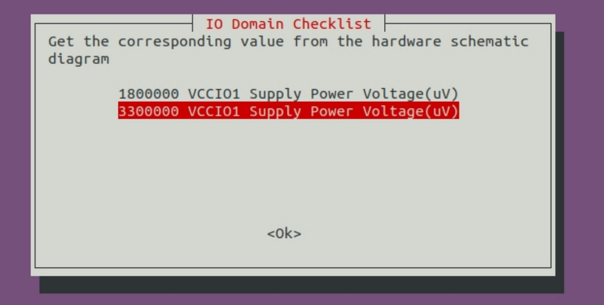
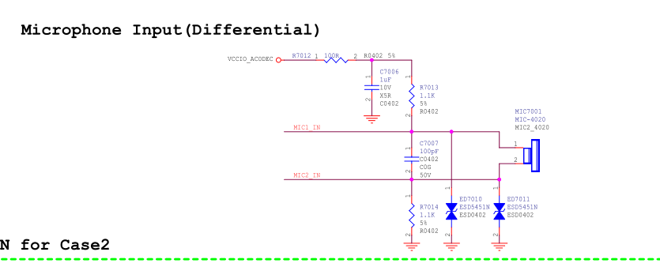
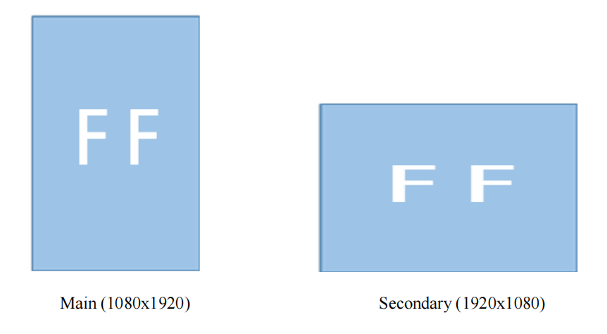

# FAQs

## kernel 编译弹出 “IO-Domain Checklist” 对话框

kernel 新建了 dts 文件 `arch/arm64/boot/dts/rockchip/rk3566-roc-pc-DEMO.dts`，编译 kernel 时弹出如下对话框。

<center>



</center>

先进行如下操作，再编译 kernel：

```bash
cp arch/arm64/boot/dts/rockchip/.rk3566-roc-pc.dtb.dts.tmp.domain arch/arm64/boot/dts/rockchip/.rk3566-roc-pc-DEMO.dtb.dts.tmp.domain
```

<Callout title="切记" type="error">

不要轻易修改主控电源域的 IO 电平，否则，最坏的情况可能会导致 IO 的损坏。

</Callout>

## ROC-RK3566-PC SPK和MIC的使用问题

如果需要使用 ROC-RK3566-PC 来调试 SPK 和 MIC 功能，可以使用外部扩展出来的 IO 口进行调试，软件默认支持，由于硬件信号是直接从 codec 引出来的，所以 SPK 只需接上喇叭即可，MIC 这部分需要增加偏置电路才可以录音，如下：

<center>



</center>

<Callout title="注意" type="warn">

硬件版本 ROC-RK3566-PC V1.2 2022.01.22 的 MIC 部分已经有了偏置电路。

</Callout>
## RK3566 双屏显示问题

由于 RK3566 双屏幕显示是使用同一个内部输入源，即 `VOP` 是 `Same Source, Dual Display`，所以如果是使用 MIPI 屏幕作为主屏，会导致副屏 HDMI 画面会严重拉伸（如下图），所以想避免这个问题，主副屏幕都应该使用同分辨率同方向（横竖屏一致）的屏幕。

<center>



</center>


## 修改 kernel/buildroot 等配置后编译烧录发现不生效

通过 `make menuconfig` 修改配置之后，使用 `build.sh` 编译，烧录发现修改没有生效。然后检查 config 发现之前的修改消失了。

这是因为只将修改保存到了临时文件 `.config`，编译时 `build.sh` 会用配置文件覆盖掉 `.config`。

所以修改后要保存到配置文件：
```bash
make ARCH=arm64 savedefconfig
mv defconfig arch/arm64/configs/firefly_linux_defconfig
```
之后再使用 `build.sh` 编译。

## V1.0版本的设备和V1.1版本的设备的区别
### V1.0版本设备
在 V1.0 版本设备中，I2C2_M0 和 I2C2_M1 被硬件同时引出，造成了复用，所以使用 I2C2_M1 的 MIPI CSI 和使用 I2C2_M0 的 RTC 和 MIPI DSI 触摸部分是不能同时使用，V1.0 版本设备出厂固件默认是使能 I2C2_M0（即支持 RTC 和 MIPI DSI 关闭 MIPI CSI），如需要使能 MIPI CSI，则 SDK 需要进行以下修改即可。
```dts
&i2c2{
	pinctrl-0 = <&i2c2m1_xfer>;
};

```

这样 I2C2 就使用了 M1 通道，而 RTC 和 MIPI DSI 的触摸部分暂时用不了。

### V1.1及以上版本设备
在 V1.1 及以上版本的设备中，MIPI CSI 单独使用的 I2C4_M0 和 RTC、MIPI DSI 所使用的 I2C2_M0 是不冲突的，共用的，不需要使用上一步的配置来进行区分使用。

## HDMI 无法 4K 显示？

暂时无法支持自动切换 4K，默认 1080P 显示，后续会更新支持。可以使用以下命令手动设置 4K 分辨率后，重新插拔 HDMI 线：

```bash
# 设置4k60：
setprop persist.sys.resolution.main 3840x2160@60
# 每次设置完更新sys.display.timeline(每次加1)使分辨率生效
setprop sys.display.timeline 1
```

## 3.5mm耳机座子接国标耳机有异常？

目前 ROC-RK3566-PC 仅支持美标类型（CTIA）的耳机，对于国标类型（OMTP）的耳机硬件不兼容，会出现左右声道同时存在双声道的现象。


## 开机异常并循环重启怎么办？


有可能是电源电流不够，请使用 PD 电源来供电。

## Ubuntu 默认的用户名和密码是什么？

- 用户名：`firefly`
- 密码：`firefly`
- 切换超级用户 `sudo -s`


## 写号工具写入SN，MAC地址

<Callout title="注意" type="warn">

如果开发板进行了 eMMC 擦除操作，之前写入的数据也会被清除。

</Callout>

### Windows方式

- 安装 RKDevInfoWriteTool
  - [下载地址](https://community.t-firefly.com/doc/download/106#other_379)
- 在 RKDevInfoWriteTool 的**设置**里选中「RPMB」
- 根据需要在 RKDevInfoWriteTool 的**设置**里配置「SN」「WIFI MAC」「LAN MAC」「BT MAC」等
- 开发板进入 loader 模式
- RKDevInfoWriteTool 进行**写入**或者**读取**操作

具体操作可以参考 RKDevInfoWriteTool 安装目录下的《RKDevInfoWriteTool 使用指南》PDF 文档。

### Linux方式

开发板自身写号方式：

- buildroot 使能 `BR2_PACKAGE_VENDOR_STORAGE`
- 通过 `vendor_storage` 命令进行读写操作
  - [下载地址](https://community.t-firefly.com/doc/download/106#other_379)
    - SN
      ```shell
      vendor_storage -w VENDOR_SN_ID -t string -i cad895bedb8ee15f
      vendor_storage -r VENDOR_SN_ID -t hex -i /dev/null
      ```
    - LAN MAC
      ```shell
      vendor_storage -w VENDOR_LAN_MAC_ID -t string -i AABBCCDDEEFF
      vendor_storage -r VENDOR_LAN_MAC_ID -t hex -i /dev/null
      ```

    其他可以根据 `vendor_storage -h` 提示进行操作。

应用程序如何读取，可以参考 `buildroot/package/rockchip/vendor_storage/vendor_storage.c` 里的 `vendor_storage_read` 函数。

## Ubuntu系统，如果插入耳机后，没有声音，该如何处理？

`Menu` -> `Multimedia` -> `PulseAudio Volume Control` -> `Configuration` -> 选择正在工作的声卡，关闭另一个声卡。

## Android 下如何让系统抓取 LOG？

1、`Settings（设置）` -> `About tablet（关于平板电脑）` -> 点击 7 下 `Build number（版本号）`

2、`Settings（设置）` -> `System（系统）` -> `Advanced（高级）` -> `Developer options（开发者选项）` -> `Android LogSave（日志采集器）`。打开功能后，系统的 `/data/vendor/logs` 目录下就会生成对应日期的日志文件夹，里面包括系统 logcat 和内核 kmsg。

## Android SDK单独编译生成的boot.img遇到问题

目前，Android 单独编译 kernel 生成的 boot.img 的方法：

- 编译时指定 `BOOT_IMG` 参数，如 `BOOT_IMG=../rockdev/Image-rk3566_roc_pc/boot.img`

  `BOOT_IMG` 指定的前置 boot.img 在编译完后会更新 `path/to/sdk/kernel/boot.img`，烧写该 boot.img 即可更新 kernel 的修改。

  ```bash
  make ARCH=arm64 BOOT_IMG=../rockdev/Image-rk3566_roc_pc/boot.img rk3566-roc-pc.img -j8
  ```

如果不指定 `BOOT_IMG`，那么就会导致在下载之后，系统会跑进了 `Recovery` 模式（或者引起其他启动错误），而不是进行正常的启动流程。
如果没有 `rockdev` 这个目录，请先完整编译一次 SDK，编译步骤参考*公版编译*。

