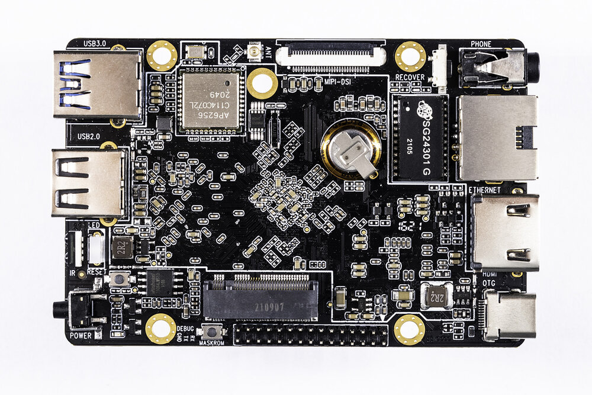
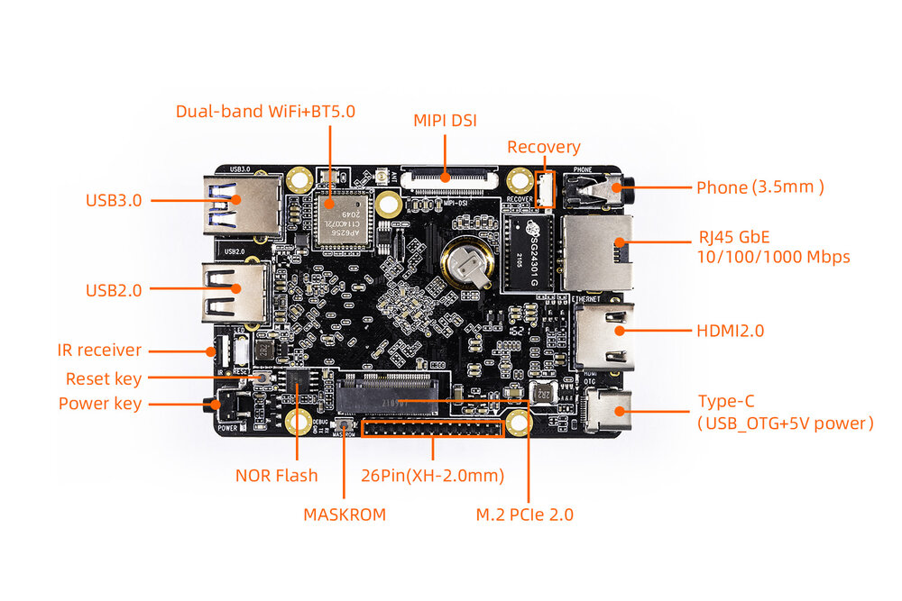
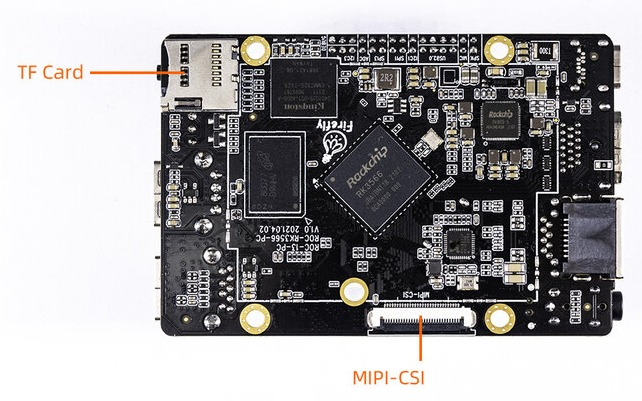

# 简介

[规格书](https://download.t-firefly.com/%E4%BA%A7%E5%93%81%E8%A7%84%E6%A0%BC%E6%96%87%E6%A1%A3/%E5%BC%80%E6%BA%90%E4%B8%BB%E6%9D%BF/ROC-RK3566-PC-%E5%BC%80%E6%BA%90%E4%B8%BB%E6%9D%BF-%E8%A7%84%E6%A0%BC%E4%B9%A6.pdf) | [购买链接](https://store.t-firefly.com//goods.php?id=149) | [下载资料](https://community.t-firefly.com/doc/download/106)

ROC-RK3566-PC 是一款迷你 PC 主板，体积只有小型手机的大小，主控采用 Rockchip RK3566 四核处理器，集成双核心架构 GPU 以及高效能 NPU，支持 8G 大内存，板载 M.2，支持 2.4/5G WIFI，4G 无线网络通讯，可应用于智能 NVR、云终端、物联网网关、工业控制等场景

## 接口描述

ROC-RK3566-PC 提供了丰富的接口，主要包括：

- 1 x USB3.0（host）
- 1 x USB2.0（host）
- HDMI
- MIPI 屏幕接口
- TP 触摸接口
- 以太网
- WIFI 天线
- 3.5mm 耳机接口
- Type-C（PD）电源接口
- IR 接口
- TF 卡槽
- Power 按键
- Reset 按键
- Recovery 按键
- 调试串口
- NOR flash
- MIPI 摄像头接口

整机接口分布如下图（正面/背面）：

## 资源与技术支持

- [[技术交流论坛]](https://forum.t-firefly.com/)：超过 10 万企业客户和用户沟通交流平台

### 联系方式

- 邮箱：sales@t-firefly.com
- 手机：(+86) 186 8811 7175
- 座机：0760-89881218
- 地址：广东省中山市东区中山四路 57 号宏宇大厦 2101 室
