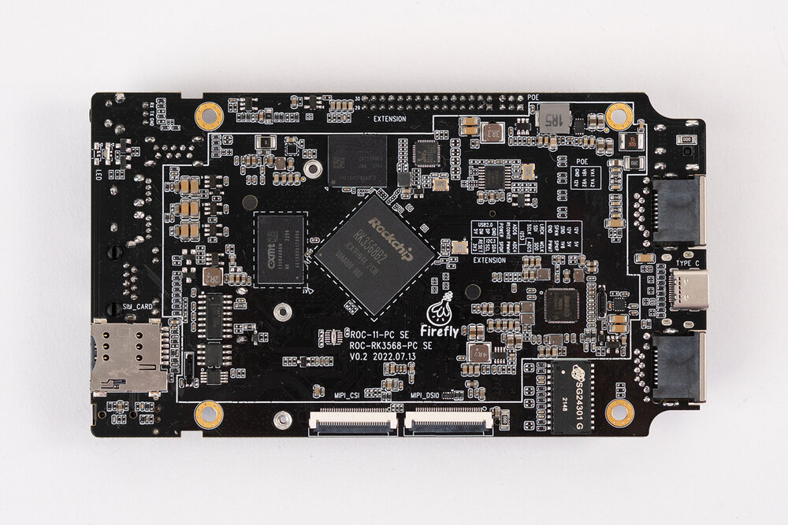
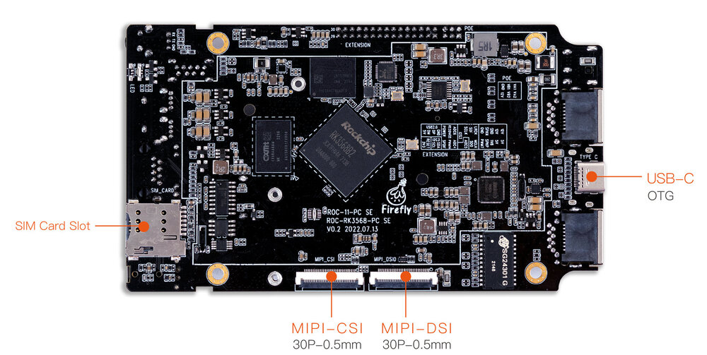
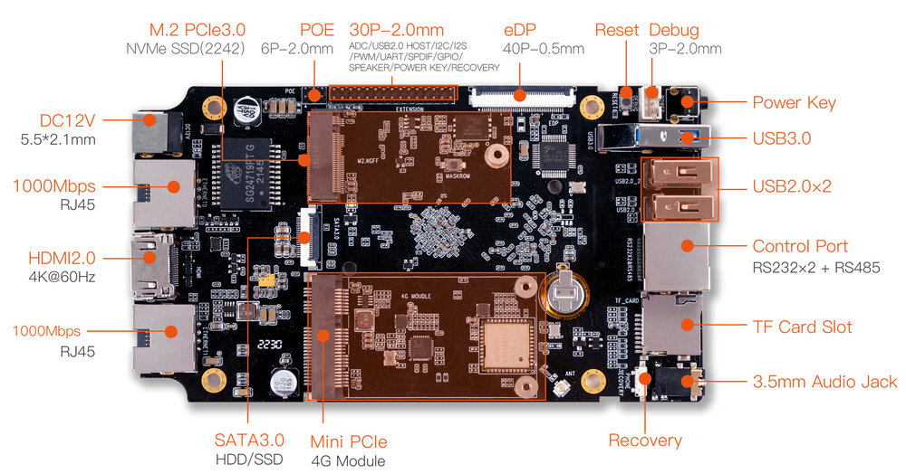

# 简介

[规格书](https://download.t-firefly.com/Spec/Mainboards/ROC-RK3568-PC%20SE_Specification_CN.pdf) | [购买链接](https://item.taobao.com/item.htm?spm=a1z10.5-c-s.w4002-24614730371.11.18435c47KlWMgK&id=687407527036) | [下载资料](https://community.t-firefly.com/doc/download/180)

ROC-RK3568-PC-SE 采用 ROC-RK3568-PC-SE 四核 64 位 Cortex-A55 处理器，22nm 先进工艺，主频最高 2.0GHz，集成双核心架构 GPU 以及高效能 NPU；最大支持 8G 大内存；支持 WiFi6、双千兆以太网；拥有丰富的接口扩展，支持多种视频输入输出接口，可适用于智能 NVR、云终端、物联网网关、工业控制等场景。

## 接口定义

### 整机接口定义

ROC-RK3568-PC-SE 提供了丰富的接口，主要包括：

- 电源接口
- 1 x Type-C
- 1 x USB3.0
- 2 x USB2.0
- HDMI
- MIPI 屏幕接口
- EDP 屏接口
- 以太网
- 3.5mm 耳机接口
- 12V 电源接口
- TF 卡槽
- SIM 卡槽
- MINI-PCIE
- SATA 接口
- Power 按键
- Reset 按键
- Recovery 按键
- MaskRom 按键
- 调试串口
- 工业级串口（RS485、RS232、TTL）
- MIPI 摄像头接口
- M.2 PCIE 3.0 接口

具体如下图：

## 资源与技术支持

- [技术交流论坛](https://forum.t-firefly.com/)：超过 10 万企业客户和用户沟通交流平台

### 联系方式

- 邮箱：sales@t-firefly.com
- 手机：(+86) 186 8811 7175
- 座机：0760-89881218
- 地址：广东省中山市东区中山四路 57 号宏宇大厦 2101 室
