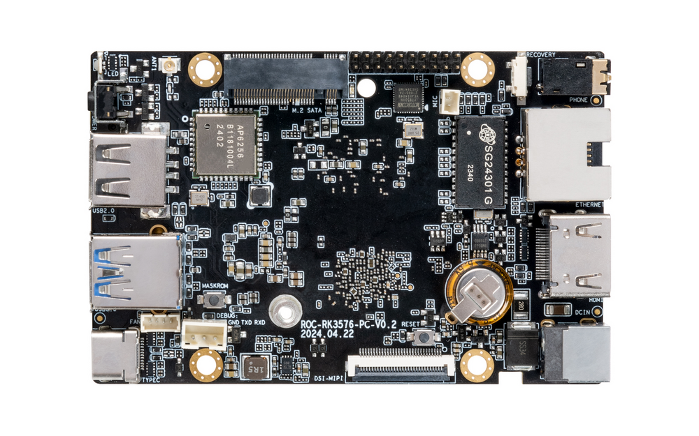
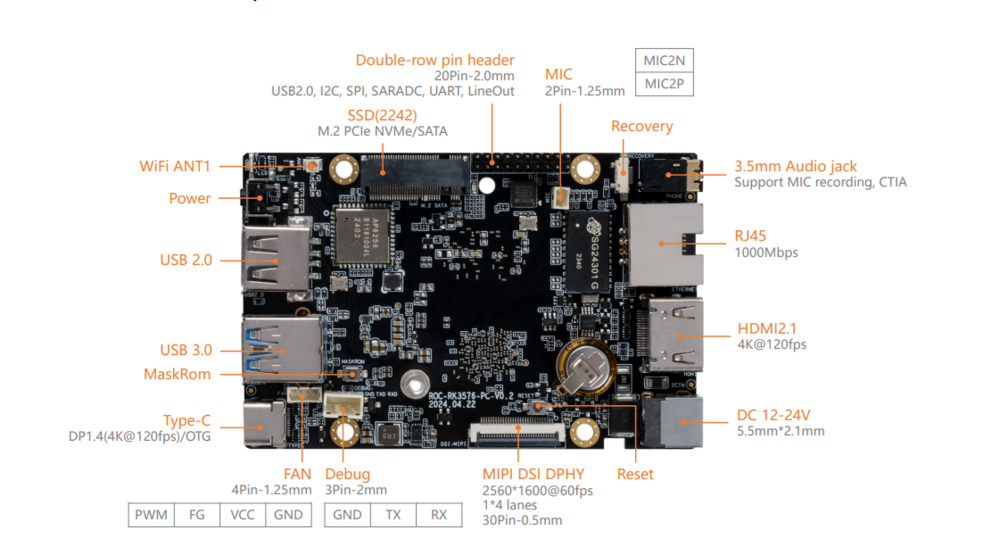
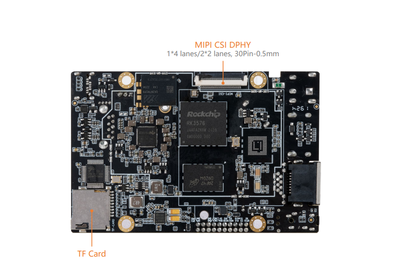

# 介绍

[规格书](https://download.t-firefly.com/%E4%BA%A7%E5%93%81%E8%A7%84%E6%A0%BC%E6%96%87%E6%A1%A3/%E8%A1%8C%E4%B8%9A%E4%B8%BB%E6%9D%BF/ROC-RK3576-PC_%E4%BD%8E%E5%8A%9F%E8%80%97%E5%A4%A7%E6%A8%A1%E5%9E%8B%E4%B8%BB%E6%9D%BF_%E4%BA%A7%E5%93%81%E8%A7%84%E6%A0%BC%E4%B9%A6.pdf) | [购买链接](https://item.taobao.com/item.htm?id=801399117055) | [下载资料](https://community.t-firefly.com/doc/download/254)

**ROC-RK3576-PC** 基于 Rockchip 新一代 8nm 高性能 AIoT 芯片 -- **RK3576** , 搭载八核（Cortex-A72 x 4 + Cortex-A53 x 4）64位 CPU，主频高达 2.2GHz，为高性能计算和多任务处
理提供了强大支持。

内置 ARM Mali G52 MC3 GPU，集成 6 TOPS算力 NPU，支持 Transformer 架构下超大规模参数模型的私有化部署，支持多种深度学习框架、自定义算子开发、Docker 容器化管理技术。
配置外部看门狗，具备工业级稳定性，广泛适用于AI本地部署的应用场景。

## 接口描述

**ROC-RK3576-PC V1.0** 使用的接口，主要包括：

* 1 x HDMI2.1（最大支持 4K@120Hz 输出）
* 1 x Display Port1.4（最大支持 4K@120Hz 输出）
* 1 x USB3.0 OTG(Type-C)
* 1 x MIPI-DSI
* 1 x MIPI-CSI
* 1 x SATA3.0 或 PCIe2.0
* 1 x TF Card
* 1 x USB3.0
* 3 x USB2.0 (其中2个USB2.0由20Pin排针引出)
* 1 x WIFI
* 1 x Bluetooth
* 1 x FAN
* 1 x RJ45（支持 1Gbps）
* 1 × 3.5mm耳机接口
* 1 × Mic输入（2P-1.25mm）

具体如下图：

## 资源与技术支持

* [[技术交流论坛]](https://forum.t-firefly.com/)：超过10万企业客户和用户沟通交流平台

### 联系方式

* 邮箱：sales@t-firefly.com
* 手机：(+86) 186 8811 7175
* 座机：0760-89881218
* 地址：广东省中山市东区中山四路 57 号宏宇大厦 2101 室