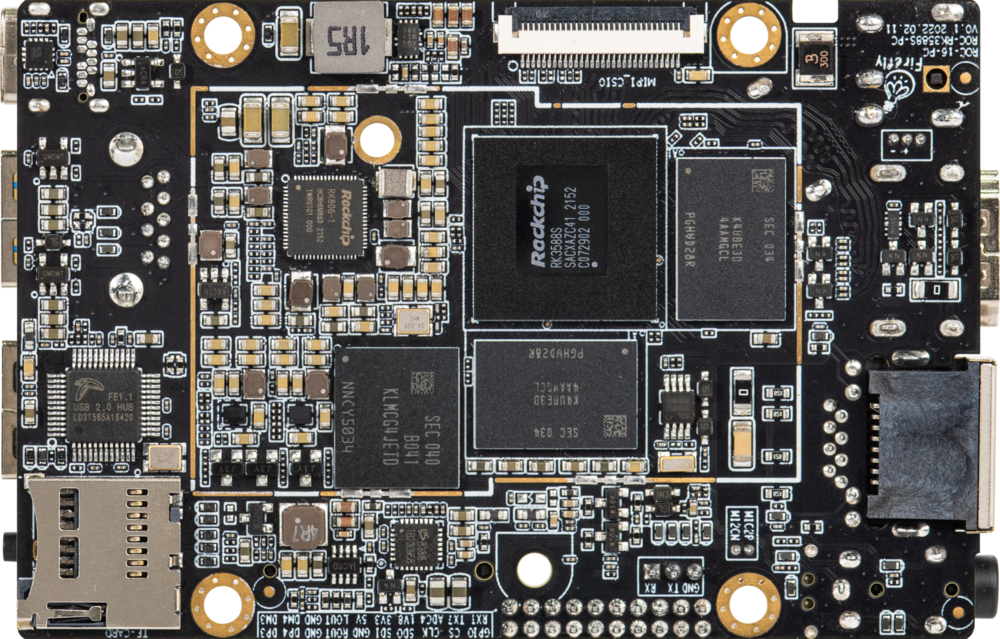
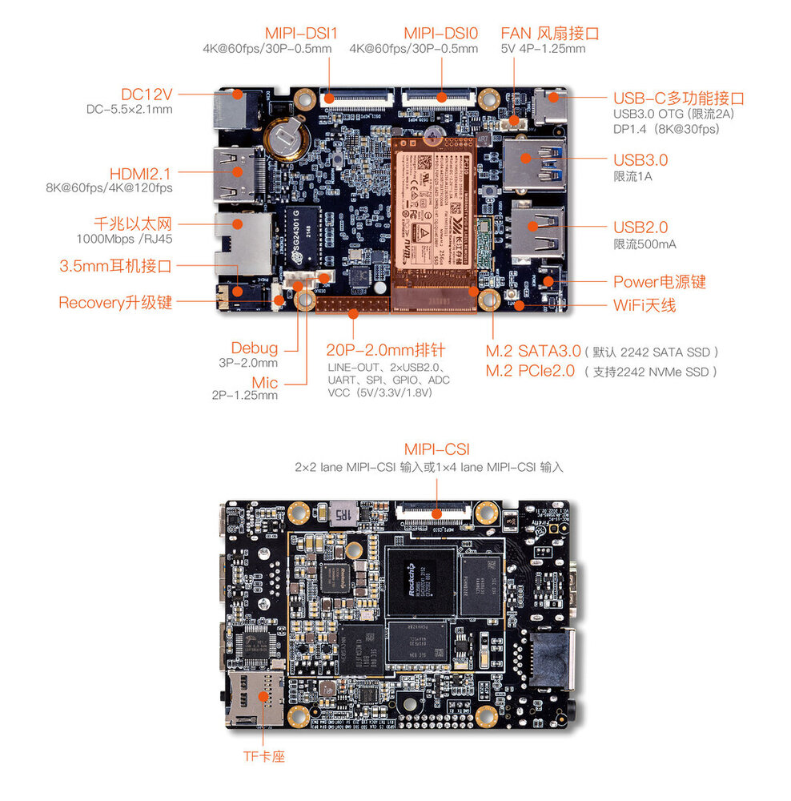

[规格书](https://download.t-firefly.com/%E4%BA%A7%E5%93%81%E8%A7%84%E6%A0%BC%E6%96%87%E6%A1%A3/%E5%BC%80%E6%BA%90%E4%B8%BB%E6%9D%BF/ROC-RK3588S-PC%E5%85%AB%E6%A0%B88K%E4%BA%BA%E5%B7%A5%E6%99%BA%E8%83%BD%E4%B8%BB%E6%9D%BF%E8%A7%84%E6%A0%BC%E4%B9%A6.pdf) | [购买链接](https://item.taobao.com/item.htm?spm=a1z10.1-c-s.w5003-24349362759.1.8a167bdbIQVXx9&ft=t&id=673575731804&scene=taobao_shop) | [下载资料](https://community.t-firefly.com/doc/download/164)

# 介绍

**ROC-RK3588S-PC** 基于 Rockchip 全新一代旗舰 AIoT 芯片 -- **RK3588**，采用了 8nm LP 制程；搭载八核（Cortex-A76 x 4 + Cortex-A55 x 4）64位 CPU，主频高达2.4 GHz。  

集成 ARM Mali-G610 MP4 四核 GPU，内置 AI 加速器 NPU，可提供6 Tops 算力，支持主流的深度学习框架；最大支持32 GB 大内存；支持 8K 视频编解码和多种格式的视频输入输出；支持多
种操作系统；可适用于 ARM PC、边缘计算、云服务器、智能NVR 等领域。

## 接口描述

**ROC-RK3588S-PC V1.1** 使用的接口，主要包括：

* 1 x HDMI2.1（最大支持 8K@60Hz 输出）
* 1 x Display Port1.4（最大支持 8K@30Hz 输出）
* 1 x USB3.0 OTG(Type-C)
* 2 x MIPI-DSI
* 1 x MIPI-CSI
* 1 x SATA3.0 或 PCIe2.0
* 1 x TF Card
* 1 x USB3.0
* 3 x USB2.0 (其中2个USB2.0由20Pin排针引出)
* 1 x WIFI
* 1 x Bluetooth
* 1 x FAN
* 1 x RJ45（支持 1Gbps）
* 1 × 3.5mm耳机接口（V1.1版本支持录音）
* 1 × Mic输入（2P-1.25mm）

具体如下图：

若您手上的设备为旧版本硬件，其接口定义可能与上文有所差异，详情请查阅 [ROC-RK3588S-PC 旧版本接口定义](../interface_definition_old.md)。

## 资源与技术支持

* [[技术交流论坛]](https://forum.t-firefly.com/)：超过10万企业客户和用户沟通交流平台

### 联系方式

* 邮箱：sales@t-firefly.com
* 手机：(+86) 186 8811 7175
* 座机：0760-89881218
* 地址：广东省中山市东区中山四路 57 号宏宇大厦 2101 室