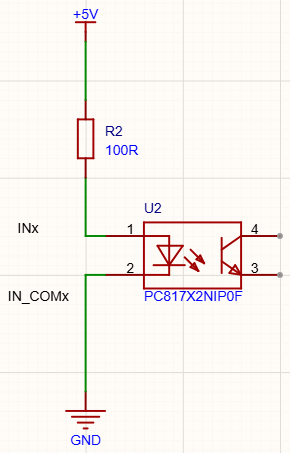
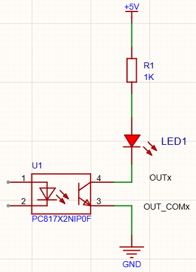
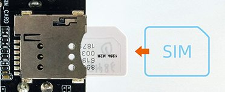

# 硬件功能使用
## 调试串口

AIBOX-9075-KIT 采用板载 USB 串口方案（串口转 USB 芯片为 CH342），使用 USB 数据线直连整机的 Type-C 调试口即可进行调试，无需外接 USB 转 TTL 串口模块。

Windows 下安装驱动后，设备管理器会出现 "USB-Enhanced-SERIAL-A CH342" 和 "USB-Enhanced-SERIAL-B CH342" 两个串口设备：SERIAL-A 是主系统（Linux）的 Debug 串口，SERIAL-B 是子系统（RTOS）的 Debug 串口。串口参数：波特率 115200、数据位 8、停止位 1、无奇偶校验。

连接方式与 Windows 驱动安装详见：[调试串口](debug.md)。

## 显示接口

AIBOX-9075-KIT 提供 1 个 HDMI 2.0 显示输出接口。整机出厂默认运行 Ubuntu 24.04（Wayland + Gnome 桌面），接上显示器即可看到桌面显示。

## 以太网

AIBOX-9075-KIT 提供 2 个 2.5G RJ45 网口，对应系统中的 `eth0`、`eth1` 设备（以实际系统为准）。网口接入网络后，可以通过调试串口或 SSH 登录设备查看 IP 地址并测试连通性：

```
ifconfig eth0
ping -I eth0 -c 10 www.baidu.com
```

## USB 接口

AIBOX-9075-KIT 提供 2 个 USB3.0 接口，可外接 USB 键鼠、U 盘等设备。

## RS485

AIBOX-9075-KIT 提供 2 个 RS485 接口：RS485_1 对应系统中的 `/dev/ttyHS1`，RS485_2 对应系统中的 `/dev/ttyHS3`。RS485 收发需要额外 GPIO 控制方向（RS485_1 使用 695 号引脚，RS485_2 使用 693 号引脚），收发测试方法详见[串口教程](usage_serial.md)。

## CAN-FD

AIBOX-9075-KIT 提供 2 路 CAN-FD 接口（光耦隔离），可连接 CAN 总线设备进行通信。
接线时 CAN_H 接 CAN_H，CAN_L 接 CAN_L。
Ubuntu 系统可先执行 `apt update && apt install can-utils` 安装测试工具，通信测试命令如下：

``` 
# 关闭 can0 设备
ip link set can0 down
# 设置比特率为 250Kbps
ip link set can0 type can bitrate 250000
# 打开 can0 设备
ip link set can0 up
# 接收端执行 candump，阻塞等待报文
candump can0
# 发送端执行 cansend，发送报文
cansend can0 123#1122334455667788
``` 

更多 can 工具的使用， 详见 https://manpages.debian.org/testing/can-utils/index.html。

## GMSL2

AIBOX-9075-KIT 提供 2 个 GMSL2 4Pin Mini FAKRA 接口，可用于接入 GMSL2 摄像头等设备。

比如摄像头模组： ZYG2-ISX031-E05A-H120, 同一个端口接入 4 个

```
export XDG_RUNTIME_DIR=/run/user/1000
export WAYLAND_DISPLAY=wayland-0

# 打开摄像头 0
gst-launch-1.0 -e qtiqmmfsrc camera=0 ! \
video/x-raw,format=NV12,width=1920,height=1536,framerate=30/1 ! \
videoconvert ! waylandsink sync=true 

# 打开摄像头 1
gst-launch-1.0 -e qtiqmmfsrc camera=1 ! \
video/x-raw,format=NV12,width=1920,height=1536,framerate=30/1 ! \
videoconvert ! waylandsink sync=true 

# 打开摄像头 2
gst-launch-1.0 -e qtiqmmfsrc camera=2 ! \
video/x-raw,format=NV12,width=1920,height=1536,framerate=30/1 ! \
videoconvert ! waylandsink sync=true 

# 打开摄像头 3
gst-launch-1.0 -e qtiqmmfsrc camera=3 ! \
video/x-raw,format=NV12,width=1920,height=1536,framerate=30/1 ! \
videoconvert ! waylandsink sync=true 
```

## IO

AIBOX-9075-KIT 引出 6 路 IO 输入（IO in）与 6 路 IO 输出（IO out）。

### IN 
#### 硬件接法

INx 其中 x 是 IO_IN 的 1, 2, 3, 4, 5, 6; IN_COMx 其中 x 是 IO_IN 的 C1, C2, C3, C4, C5, C6。
INx 可以使用外部电源加限流电阻驱动该引脚，也可以使用外部GPIO驱动。注意电流大小。

#### 软件使用
|名称|GPIO 编号|
|---|---|
|IO_IN 1| 675|
|IO_IN 2| 682|
|IO_IN 3| 680|
|IO_IN 4| 681|
|IO_IN 5| 690|
|IO_IN 6| 688|

比如要操作 `IO_IN 1` (GPIO 编号为 675)， 以 root 用户运行

```
echo 675 > /sys/class/gpio/export
cd /sys/class/gpio/gpio675
echo in > direction
cat value
```

### OUT
#### 硬件接法

OUTx 其中 x 是 IO_OUT 的 1, 2, 3, 4, 5, 6; OUT_COMx 其中 x 是 IO_OUT 的 C1, C2, C3, C4, C5, C6。

#### 软件使用
|名称|GPIO 编号|
|---|---|
|IO_OUT 1| 686|
|IO_OUT 2| 692|
|IO_OUT 3| 694|
|IO_OUT 4| 696|
|IO_OUT 5| 678|
|IO_OUT 6| 679|

比如要操作 `IO_OUT 1` (GPIO 编号为 686)，以 root 用户运行

```
echo 686 > /sys/class/gpio/export
cd /sys/class/gpio/gpio686
echo out > direction
echo 0 > value
echo 1 > value
```

## SIM 卡

AIBOX-9075-KIT 的 SIM 卡槽用于配合无线模块实现移动网络连接。**无线模块为选配**，需要在机箱内部安装无线模块后，SIM 卡功能才能正常使用。SIM 卡插入方向如下图所示，插拔前请先断电。

<center>


</center>

## RTC

AIBOX-9075-KIT 支持 RTC 实时时钟，时间的读取、写入与同步方法详见[RTC 教程](usage_rtc.md)。

## 视频

AIBOX-9075-KIT 默认的视频框架为 Gstreamer，编解码能力与播放、编码命令详见[视频教程](usage_video.md)。

## NPU（AI）

IQ-9075 峰值算力 200 TOPS，支持端侧大模型私有化部署，AI 开发方法详见[AidLux](usage_aidlux.md)。
