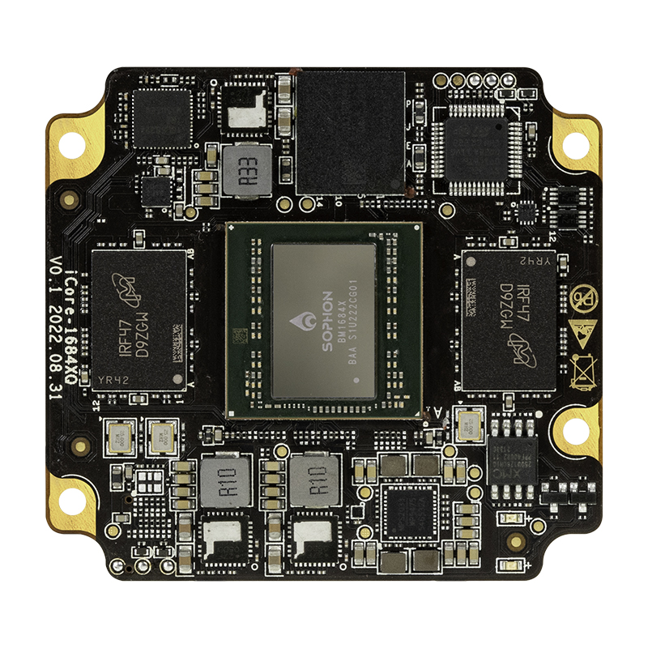
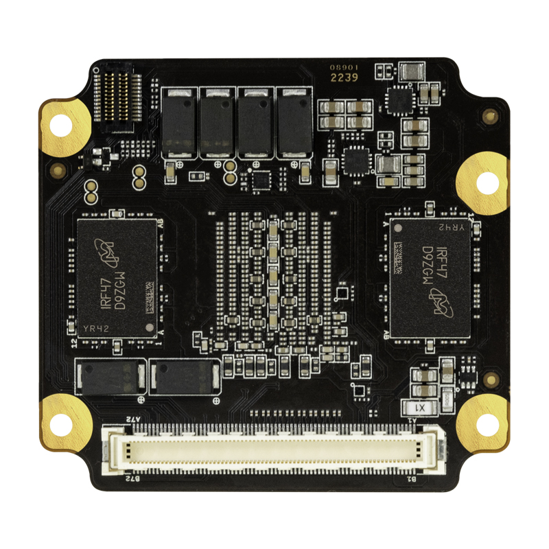
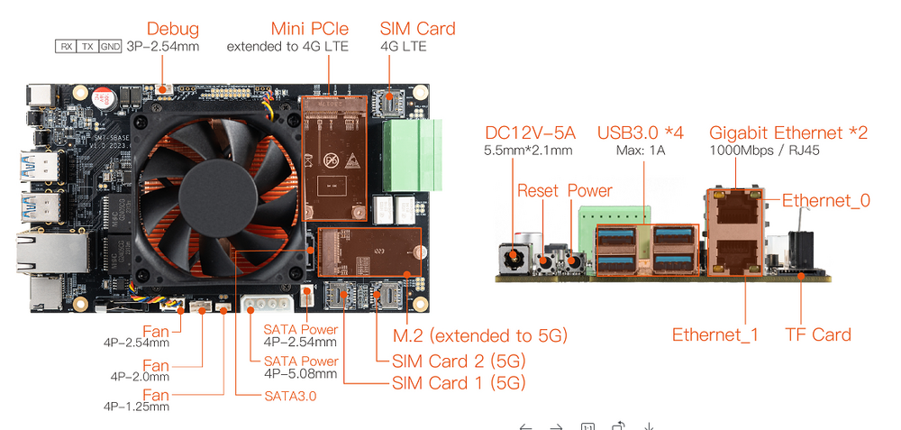
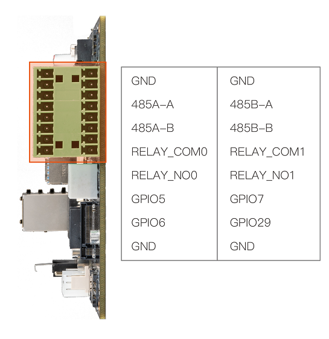

[规格书](https://download.t-firefly.com/%E4%BA%A7%E5%93%81%E8%A7%84%E6%A0%BC%E6%96%87%E6%A1%A3/%E6%A0%B8%E5%BF%83%E6%9D%BF/iCore-1684XQ_%E5%85%AB%E6%A0%B832TOPS%E9%AB%98%E7%AE%97%E5%8A%9BAI%E6%A0%B8%E5%BF%83%E6%9D%BF%20_%E4%BA%A7%E5%93%81%E4%BB%8B%E7%BB%8D.pdf?v=1692869940) | [购买链接](https://item.taobao.com/item.htm?spm=a1z10.3-c-s.w4002-25052033196.19.7b2426b9wv7bRi&id=733075112164) | [下载资料](https://community.t-firefly.com/doc/download/209)

# 简介

iCore-1684XQ 核心板采用 SOPHON 算能 AI 处理器 BM1684X，可配置 16GB 大内存以及 64GB eMMC ； 支持 32TOPS（ INT8 ） 峰 值 算 力，16TFLOPS （FP16/BF16）算力，2TFLOPS（FP32）高精度算力；支持 32 路 H.265/H.264 1080p@25fps 视频解码； 核心板 BTB 接口，拥有PCIe3.0、GMAC、SDIO3.0、I2C、PWM、UART、GPIO接口，易集成入各类边缘嵌入式产品；支持主流编程框架，工具链完备易用度高，算法迁移代价小；提供底板参考设计资料，用户可自主深度化定制；高效适配市场上所有AI算法，为视觉计算、边缘计算、通用算力服务、人工智能、智慧工地/交通/课堂/超市/监控/安防等行业进行AI赋能。

**iCore-1684XQ  核心板正面：**

**iCore-1684XQ  核心板反面：**

## 配件清单

收到开发板后就检查配件清单是否齐全：
- 带壳的整机，或核心板 iCore-1684XQ 和底板 SM7-SBASE-EN4 各一块及散热风扇
- 12V-5A 电源适配器一个

选购的配件有：
- Firefly 串口模块

另外，在使用过程中，你可能需要以下配件：
- 显示设备
     + 带 HDMI 接口的显示器或电视，及 HDMI 连接线
- 网络
     + 100M/1000M 以太网线缆，有线路由器
     + WiFi 路由器
- 升级固件
     + TF 卡，4GB/Class 10 以上
- 调试
     + USB 转串口适配器

## 接口描述

AIO-1684XQ  主板由核心板 iCore-1684XQ + 底板 SM7-SBASE-EN4  组成，AIO-1684XQ 板载 M.2(5G)、Mini PCIe、SATA3. 0、Gigabit Ethernet、USB3.0、RS485、RELAY、GPIO 等丰富接口。

具体如下图：

## 资源与技术支持

* [[技术交流论坛]](https://forum.t-firefly.com/)：超过10万企业客户和用户沟通交流平台

### 联系方式

* 邮箱：sales@t-firefly.com
* 手机：(+86) 186 8811 7175
* 座机：0760-89881218
* 地址：广东省中山市东区中山四路 57 号宏宇大厦 2101 室