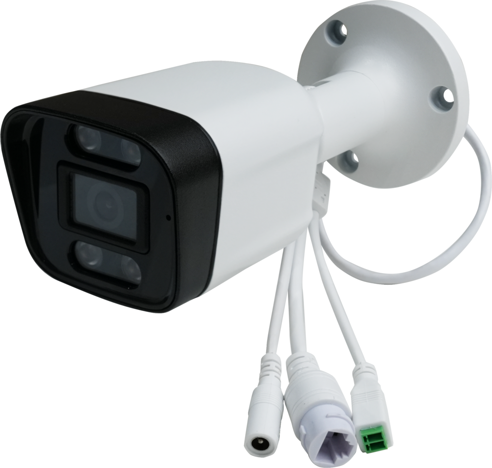
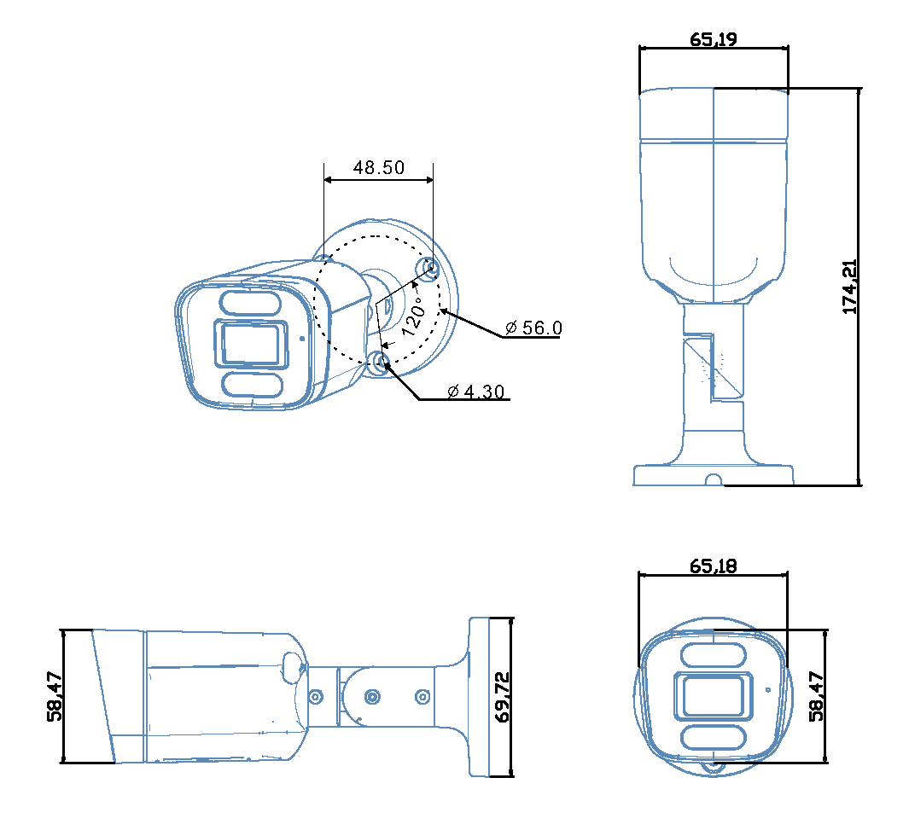
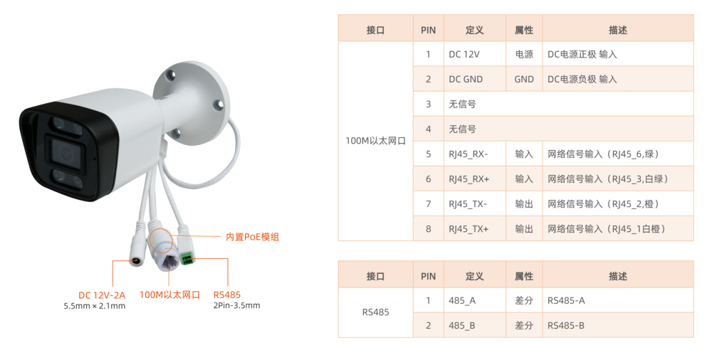

[规格书](https://download.t-firefly.com/Spec/Cameras/CQ38W-1126B_CQ38W-1126BJ_Specification_CN.pdf) | [购买链接](https://item.taobao.com/item.htm?id=779829829112&pisk=hLHsvFvMCdsaoR22TTvtz2egS-yAHqz4umUYfy4O3cKDhS3rz-SZDryjlqgb7SLgQxgIkq6q_AyaMKUUcsEYWrUKvlq7DSH4uxwgn-Q5rPoCSwEg2KWYD-Eqa_T9zUJyh6Bu8Ei4DZhqJ6EuJlBTMoKQ9uqTHlFYXHaLcu4ABqevADU30OETktpLpor5W-BOBpILcl_YD1FTpWU3D-Uxk-KQpyqYHr3YHZYSpUXQtQpzr8KVU5a-AQXAsnrTKzitCTBRmliHSiucFIz-ZPPrJ2pFC-iLc2Nr1U6slmnoMWMfWhuJYI6V6xy2kvhmKYnVsdLqO0HrWJ6BpFGtSJutxdxKhEas90mlsKTDn2GoYbWGYLAtvSnSlaYwf3gE_YGhBpYppD3t40IWkjfmCba4RjrgLaPTxlNeAH_ti5E3Az-BAsf06kq_8HtCWjf..&skuId=6073962237692&spm=a1z10.5-c-s.w4002-25768776046.20.15644c0188SCML) | [下载资料](https://community.t-firefly.com/doc/download/367)

# 简介

**CQ38W-1126B** 采用 Rockchip 四核 AI 视觉处理器 RV1126B，集成 3 TOPS NPU，可高效支撑人脸识别、手势识别等智能应用。影像方面，内置1600万像素ISP，支持4K@120fps解码与4K@60fps编码，配合500万/300万像素高清摄像头，在低光环境下也能精准捕捉细节。设备采用IP67级防水铝合金外壳，支持PoE供电，一根网线即可完成供电与数据传输，部署便捷，适用于闸机门禁、智能安防等多种场景。

## 结构尺寸

 
## 接口描述

### 整机接口定义

**CQ38W-1126B** 主要包括：

具体如下图：

## 资源与技术支持

* [[技术交流论坛]](https://forum.t-firefly.com/)：超过10万企业客户和用户沟通交流平台

### 联系方式

* 邮箱：sales@t-firefly.com
* 手机：(+86) 186 8811 7175
* 座机：0760-89881218
* 地址：广东省中山市东区中山四路 57 号宏宇大厦 2101 室
