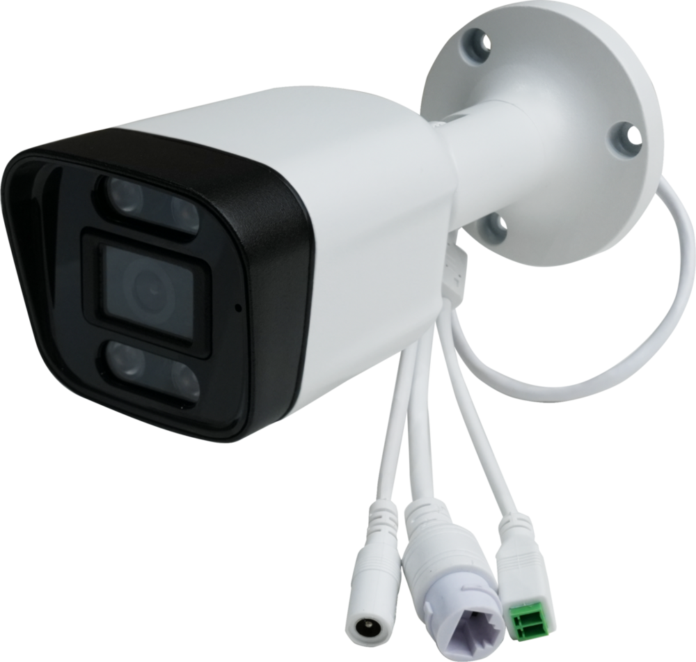
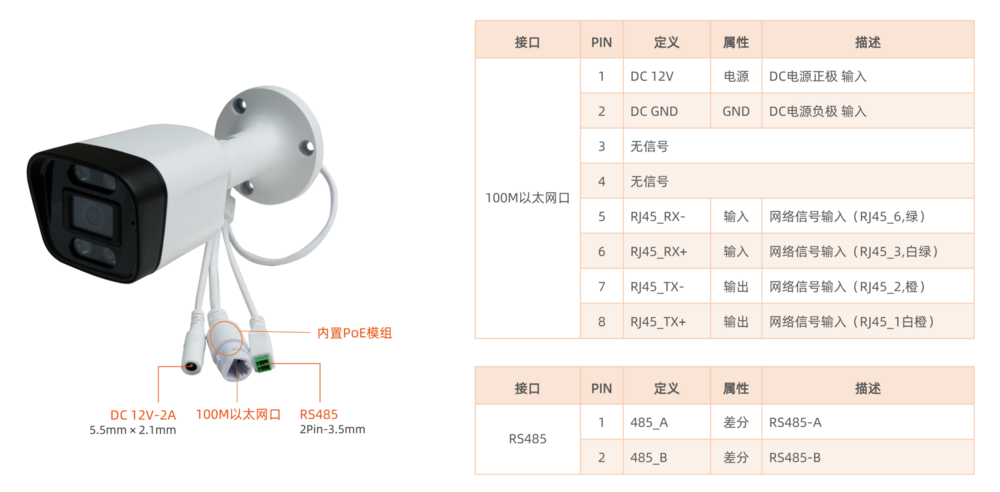
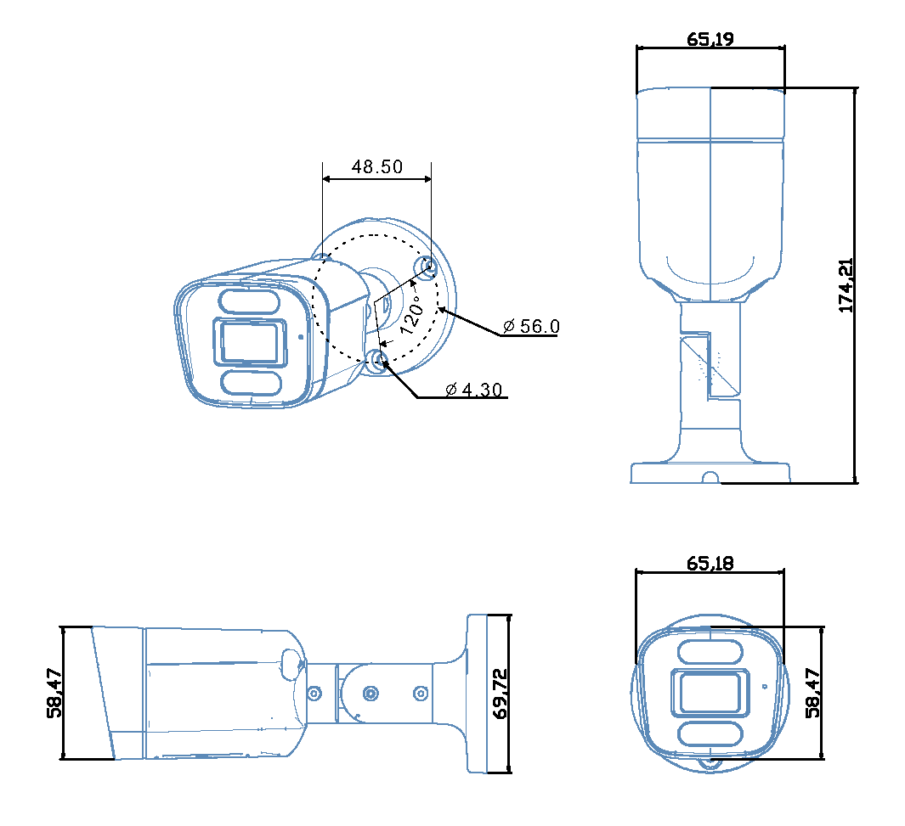

# 简介

[规格书](https://download.t-firefly.com/Spec/Cameras/CQ38W-3576_CQ38W-3576J_CQ38W-3576M_Specification_CN.pdf) | [购买链接](https://item.taobao.com/item.htm?id=779829829112&skuId=5967781597959) | [下载资料](https://community.t-firefly.com/doc/download/342)

**CQ38W-3576**搭载RK3576八核AI处理器与6 TOPS算力NPU，可高效支撑人脸识别、手势识别等智能应用。影像方面，内置1600万像素ISP，支持4K@120fps解码与4K@60fps编码，配合500万/300万像素高清摄像头，在低光环境下也能精准捕捉细节。设备采用IP67级防水铝合金外壳，支持PoE供电，一根网线即可完成供电与数据传输，部署便捷，适用于闸机门禁、智能安防等多种场景。

## 接口描述

**CQ38W-3576** 主要包括：

具体如下图：

## 结构尺寸

## 资源与技术支持

* [[技术交流论坛]](https://forum.t-firefly.com/)：超过10万企业客户和用户沟通交流平台

### 联系方式

* 邮箱：sales@t-firefly.com
* 手机：(+86) 186 8811 7175
* 座机：0760-89881218
* 地址：广东省中山市东区中山四路 57 号宏宇大厦 2101 室