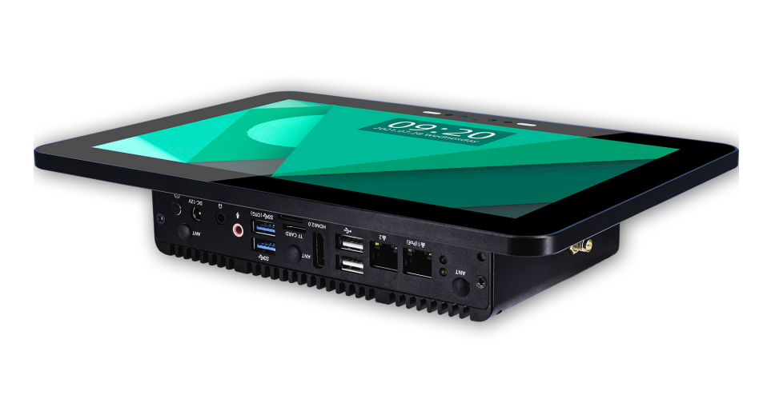
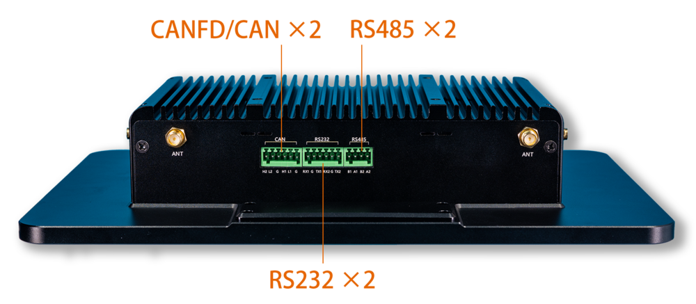
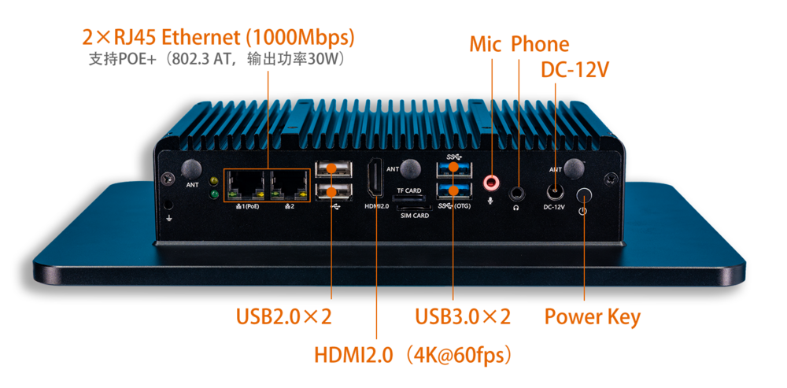
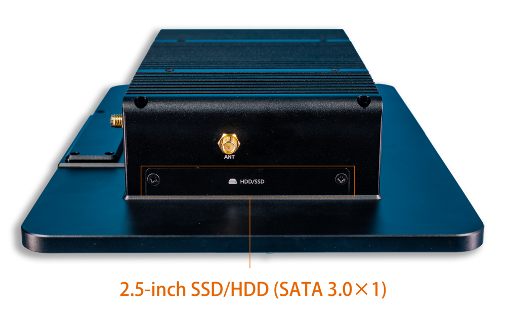
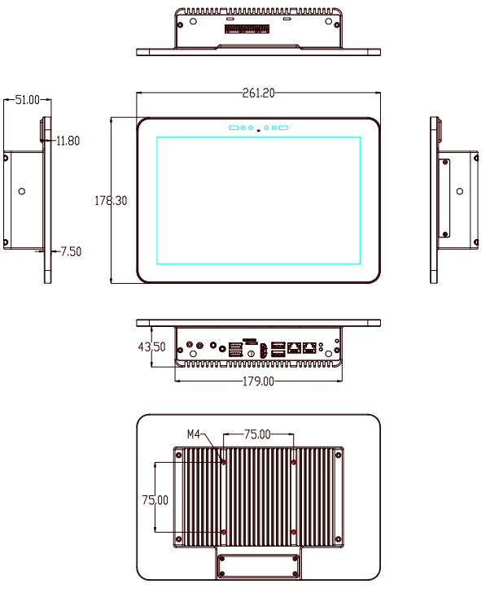

# 简介

[规格书](https://download.t-firefly.com/Spec/Tablets/IPC-M10R800-A3568J_Specification_CN.pdf) | [购买链接](https://item.taobao.com/item.htm?ft=t&id=654969153491&sku_properties=5919063%3A6536025) | [下载资料](https://community.t-firefly.com/doc/download/124)

IPC-M10R800-A3568J 工业级行业平板，基于 AIO-3568J 高性能开源平台，采用电容式 10 点触摸屏，全视角高清显示，配置工业级外壳，防尘防干扰，长时间稳定运行，支持 4K 硬解，丰富的接口方便连接各种工业设备。
搭载 ARM 全新 Cortex-A55 架构、四核 64 位高性能处理器，主频高达 2.0GHz，ARM G52 2EE 图形处理器，RKNN NPU AI 加速器（SoC 集成）。

## 接口描述

IPC-M10R800-A3568J 提供了丰富的接口，主要包括：

- 12V DC 电源接口
- HDMI 输出（最高支持 4K@60fps）
- USB3.0 接口
- USB2.0 接口
- 千兆以太网（RJ45）
- 工业级串口（RS232 / RS485）
- SATA 接口
- TF 卡槽
- SIM 卡槽（4G 模块选配）
- 3.5mm 耳机接口（兼 Recovery）
- 10.1 寸 MIPI 显示屏（内置，10 点电容触摸）

整机接口分布如下图：

## 结构尺寸

## 资源与技术支持

- [技术交流论坛](http://dev.t-firefly.com/forum.php)：超过 10 万企业客户和用户沟通交流平台

### 联系方式

- 邮箱：sales@t-firefly.com
- 手机：(+86) 186 8811 7175
- 座机：0760-89881218
- 地址：广东省中山市东区中山四路 57 号宏宇大厦 2101 室
